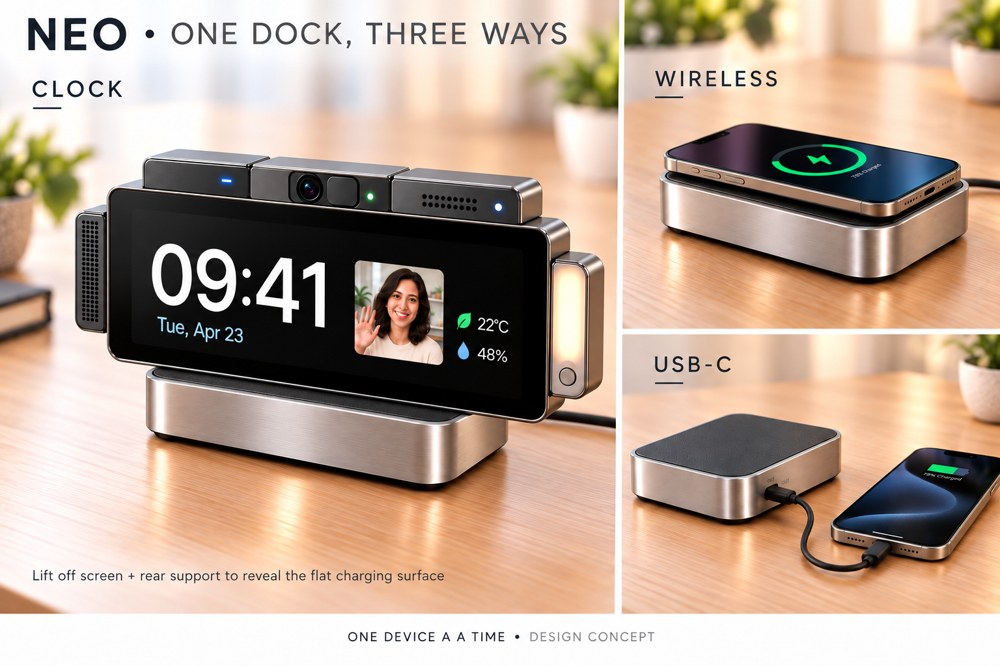

# Neo Modular Desk Clock concept đã chốt

> **Cập nhật 2026-10-31:** Sản phẩm được đặt tên **NeoFilos**; mỗi module chức năng có pin riêng và giao tiếp điều khiển qua BLE Mesh. Mục tiêu là bất kỳ hai module nào cũng có một cách kết hợp hữu ích. Xem [thiết kế hệ thống NeoFilos](neofilos-system-design.md); tài liệu mới ưu tiên hơn các câu bên dưới về kiến trúc nguồn và pin module. Phân phối nguồn từ màn hình tới các module chưa được chốt lại. Ngoại hình v7 và dock sạc luân phiên vẫn là mốc kế thừa.

Ngày chốt: **2026-10-30**. Người dùng chọn bản hình **v7** làm mốc ngoại hình và cách sử dụng cho các lần phát triển tiếp theo. Phạm vi chốt là concept sản phẩm; thông số điện, cơ khí và cấu hình linh kiện sẽ được xác định qua thiết kế và thử nghiệm.

[Ảnh gốc](assets/neo-clock-hidden-support-dock-v7.png) · [Mô tả tạo hình](assets/neo-clock-hidden-support-dock-v7.json)

Danh sách đặc điểm riêng của dock được lưu tại [Đặc điểm sản phẩm DC Power Dock](dc-power-dock/product-features.md), gồm ba đặc điểm từ concept và bảy mục tiêu bổ sung được đồng ý ghi nhận để phát triển tiếp.

## Ngoại hình và bố trí module

Màn hình hình chữ nhật, nằm thấp sát dock nhỏ gọn. Chân đỡ được giấu phía sau màn hình và tháo theo cụm đồng hồ, để lại mặt dock phẳng khi đặt điện thoại.

Cấu hình mở rộng trong hình gồm năm module tháo rời:

| Vị trí | Module | Vai trò |
|---|---|---|
| Trên trái | AI + Wi-Fi | Bổ sung xử lý AI và kết nối; âm thanh thuộc module riêng. |
| Trên giữa | Camera | Thu hình và hiển thị hình từ camera trên màn hình đồng hồ. |
| Trên phải | Cảm biến môi trường | Hướng tới đo ánh sáng, nhiệt độ hoặc độ ẩm; loại cảm biến cụ thể còn mở. |
| Cạnh trái | Âm thanh | Phát âm thanh; khả năng thu giọng nói phụ thuộc cấu hình microphone được chọn. |
| Cạnh phải | Đèn | Chiếu sáng nhẹ hoặc báo hiệu; chế độ sử dụng còn cần xác định. |

Các module là phần mở rộng có thể tháo, thay thế và sử dụng theo nhu cầu. Cấu hình đồng hồ cơ bản vẫn là điểm bắt đầu để đo tải trước khi thêm từng module.

## Ba cách dùng dock

**Mỗi lần dock sạc hoặc cấp nguồn cho một thiết bị nhận điện.** Cụm đồng hồ gồm màn hình và các module đang gắn được xem là một thiết bị, với tổng tải phải nằm trong ngân sách nguồn của dock.

| Cách dùng | Trạng thái sản phẩm |
|---|---|
| Đồng hồ trên dock | Dock truyền điện không dây tới phần nhận điện của cụm đồng hồ; cụm đồng hồ phân phối nguồn cho các module. |
| Điện thoại sạc không dây | Tháo cả đồng hồ và chân đỡ; đặt điện thoại tương thích lên chính mặt dock phẳng đó. |
| Thiết bị sạc bằng cáp | Dùng cổng USB-C cấp điện ra ở bên hông thay cho chế độ sạc không dây. |

Định hướng bố trí phần nhận sạc nằm trong đáy chân đỡ đi theo màn hình. Kết cấu thực tế phải đồng thời đáp ứng việc nâng đỡ màn hình, định vị sạc và để lại mặt đế phẳng sau khi tháo.

**Cập nhật ngày 31-10-2026:** Người dùng chốt mục tiêu **tối đa 25 W cho đầu ra sạc không dây** khi làm việc với thiết bị nhận tương thích. Điểm đo, điều kiện đạt công suất và chuẩn sạc vẫn cần được xác định; mức công suất cổng USB-C đầu ra chưa được chốt. Xem [DOCK-F01](dc-power-dock/product-features.md).

## Khả năng di động và tái sử dụng

Giữ mục tiêu đã nêu: mang cả cụm đồng hồ để dùng trong vài giờ và hướng tới dock có thể làm pin dự phòng. Theo danh sách đặc điểm dock đã ghi nhận, định hướng là tích hợp pin bên trong dock; cách bố trí pin, dung lượng và thời lượng cụ thể sẽ được quyết định sau khi đo tải.

Các module hướng tới khả năng dùng độc lập và chuyển sang sản phẩm tương thích khác trong NeoVerse. Mỗi cách dùng cần nguồn điện, điều khiển và giao tiếp phù hợp; chưa chốt việc mỗi module đều có pin riêng hoặc hoạt động được với mọi sản phẩm.

## Các quyết định kỹ thuật tiếp theo

- Đo công suất lõi đồng hồ và màn hình trước; sau đó đo phần tăng thêm của từng module, kể cả lúc khởi động và hoạt động cao nhất.
- Thiết kế và kiểm chứng mục tiêu tối đa 25 W không dây; xác định điểm đo, chuẩn/profile, vị trí phần phát và nhận, khoảng cách ghép và tổn hao nhiệt.
- Thiết kế chân đỡ ẩn, cách giữ và nhả đồng hồ, độ vững, kích thước và khối lượng.
- Xác định nguồn đầu vào, cổng USB-C đầu ra và cách điều khiển để giữ giới hạn một thiết bị được sạc mỗi lần.
- Chọn kiến trúc pin, thời gian hoạt động và cách bảo trì.
- Xác định đầu nối, số tiếp điểm và giao thức giữa màn hình với module; giao diện sạc dock không thay thế giao diện dữ liệu module.
- Xác định nền tảng AI, chức năng dùng độc lập, danh sách thiết bị tương thích và chi phí mục tiêu.

## Quan hệ với hồ sơ dock trước đó

Mốc concept này được ưu tiên khi có khác biệt về bố cục hoặc phạm vi sử dụng so với [kế hoạch dock](dc-power-dock/README.md), [PRD nháp](dc-power-dock/requirements.md) và [kế hoạch kiểm chứng](dc-power-dock/verification-plan.md) trước đó. Các tài liệu đó còn dùng kiến trúc dock pogo và trước đây đặt sạc không dây, USB-C đầu ra ngoài phạm vi v0; những phần này cần cập nhật trước khi làm chuẩn thiết kế cho concept hiện tại.

Các số liệu ví dụ, lựa chọn pin 1S, số chân pogo và mục tiêu kiểm tra trong hồ sơ cũ không tự động trở thành thông số đã chốt. Các hình trước v7 được giữ để tham khảo quá trình phát triển; v7 là mốc ngoại hình hiện tại.
