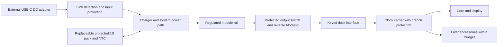

# Neo Modular Desk Clock — DC Power Dock plan

**Concept update, 2026-10-30:** The user accepted the [current product concept](../approved-concept.md) and [v7 appearance](../assets/neo-clock-hidden-support-dock-v7.png): concealed removable screen support, a flat reusable wireless charging surface, and side USB-C output, used one receiver at a time. The earlier pogo-based architecture and scope below remain an engineering draft and require revision before use for this concept.

**Power target update, 2026-10-31:** The user selected a maximum **25 W wireless charging output target** for a compatible receiver; its precise measurement boundary, profiles and operating conditions remain to be defined and verified. See [DOCK-F01](product-features.md). Previous 5 V / 2 A / 10 W DC bench examples below are from the earlier architecture and do not define this wireless output rating.

Status: **draft for product and engineering review**. Date: 2026-10-30.

The first engineering milestone is a reusable DC power dock for a **basic clock core and display**, with a battery that lets the **assembled clock move around and operate for several hours**. These priorities come from the current product discussion. The exact runtime, load, dimensions, price and production rating remain open.

The dock should establish a dependable power interface that other compatible NeoVerse products can use. Reuse means meeting an explicit electrical and mechanical contract; it does not mean that every future robot, wearable or AI module can use the same supply or connector.

The diagram is a functional proposal, not a schematic. A small supervisor, status sensing and hardware protection span these blocks. The exact converter topology depends on the system voltage range and measured load.

## Planning package

| Document | Purpose |
|---|---|
| [Current dock product features](product-features.md) | Three agreed concept features and seven additional product goals recorded with user agreement; basis for the next requirements revision |
| This plan | Concept review, architecture, interface choices, numerical examples, decisions and development gates |
| [Draft PRD](requirements.md) | User scenarios, scope, requirement IDs, measurable targets and ownership |
| [Verification plan](verification-plan.md) | Required tests and evidence; all hardware tests remain unexecuted |
| [Research notes](research-notes.md) | Primary-source checks, candidate component families and selection cautions |

Visual explanations: [annotated dock features](assets/dock-features-v1.png) and [use/service storyboard](assets/dock-use-storyboard-v1.png). These illustrate proposed features rather than verified hardware. [Generation prompts and file details](assets/feature-visuals-v1.json).

Feature design walkthrough: [01 — USB-C DC input through the V-model](features/01-usb-c-input-v-model.md).

Engineering learning path: [from the university charger exercise to practical dock mathematics](learning/00-from-exercise-to-engineering.md), with worked examples, plots and reproducible calculations.

Current wireless feature: [Huỳnh Văn Kiểm, 25 W calculations and an educational QSPICE RLC model](learning/01-f01-mat-sac-khong-day-hvk.md), with [primary-source component research](learning/qi25-component-research.md). Its 25 W receiver-side example and RLC model are assumptions, not Qi certification or measured Neo hardware.

Full-course roadmap: [read all six Huỳnh Văn Kiểm chapters while developing the dock](learning/huynh-van-kiem/README.md), planned at 6–8 hours per week with section/page maps and design milestones.

## 1. What the workspace establishes

The complete working-tree content before this package was three tracked Markdown files. Reviewed all three and the supplied rendering. Git metadata is not product design evidence.

| Source | Finding and implication |
|---|---|
| [Repository README](../../../README.md) | NeoLab owns product concepts and engineering. |
| [Repository plan](../../../docs/Repo%20Plan.md) | Concepts precede product hardware; measured evidence belongs with the product. Its initial-commit/README-only inventory and branch description are historical snapshots. |
| [Clock concept](../README.md) | Detachable thin core behind the screen; repairable modules; metal enclosure intent; pogo count, power, runtime and protocols explicitly unconfirmed. |
| [Supplied dock rendering](assets/dc-power-dock-concept.png) | Exploded enclosure, 1-cell pouch pack, NTC, charger/power path, regulator and four-contact daughterboard. Useful packaging hypothesis, with no dimensions, BOM or test results. |

Observed starting checkout: `E:\workspace\NeoLab`, branch `neolab/modular-desk-clock`, HEAD `4a05ce74404ebecbf60a4bef9c43bb7a7cf8aaa2`, remote `git@github.com:NeoTech-vietnam/NeoLab.git`, clean working tree. No schematics, CAD, firmware, measured loads or hardware validation existed in this workspace. References to other repositories in the repository plan were not independently inspected.

The earlier concept proposed a whole-clock prototype first. The current request changes the sequence: **dock definition and bench validation first; full clock integration follows**. The clock vision remains useful context. Keep planning in this concept directory until the architecture gate; decide the eventual product-source location before starting PCB/CAD implementation.

## 2. Product value and boundaries

The useful product is a repairable, portable power foundation: attach a compatible clock assembly, run it from an external adapter, charge safely while operating, unplug it to move it, and replace wear parts without discarding the clock.

| Boundary | Dock responsibility | Receiver/carrier responsibility |
|---|---|---|
| Energy | Input limits, charging, battery monitoring, source transition, total output budget | Declare and obey startup, continuous, peak and sleep demand |
| Regulation | Deliver the agreed rail at the mating interface | Local processor/display rails, decoupling, local undervoltage behavior |
| Faults | Global overload, short, overtemperature, battery and reverse-current protection | Isolate accessory branches; shed optional loads before essential clock operation |
| Control | Dock state, available power, low-battery/fault status | User display, orderly shutdown and optional-module scheduling |
| Mechanics | Base stability, keyed mating, retention, battery/contact service | Stay within mass, center-of-gravity and torque envelope |
| Timekeeping | Notify before energy cutoff when possible | Decide RTC/time retention after complete power loss |

One dock output is recommended for v0, feeding one clock carrier. Arbitrary stacking, multiple source docks, and independently powered receivers are outside v0. A faulty accessory must be isolated by the carrier if the clock is expected to keep running. A dock-wide shutdown can protect hardware but interrupts all modules.

Portability applies to the **assembled clock and dock**. Removing the core from this dock removes its power unless the core has a separate energy source. Battery replacement is a powered-down service operation; uninterrupted battery hot-swap is a separate future requirement.

## 3. Review of the supplied design

| Concept feature | Assessment | Work needed before freezing it |
|---|---|---|
| Low metal base | Promising stable support and repairable construction | Establish assembled mass/center of gravity, footprint, viewing angle, cable-pull and tip limits. Check heat spreading toward the cell and the clock's radio performance. |
| Pouch cell in front two-thirds | Plausible packaging | Size from watt-hours and discharge rating first. Reserve supplier-defined swelling space; keep screw tips, sharp edges and hot parts away. Do not constrain the cell to the render's proportions. |
| Rear power PCB | Useful separation of service areas | Check USB-C strain relief, routing, magnetic/thermal spacing, test access and cooling in the real enclosure. A divider alone does not establish thermal isolation. |
| Removable pack with strap and NTC | Matches repairability and temperature monitoring | Use an approved protected pack and keyed connector; define pack chemistry, voltage, NTC characteristic and service procedure. Strap cannot compress the pouch. |
| Four-contact pogo daughterboard | Good replaceable wear-part idea | Validate contact count, current, resistance, compression tolerance, bounce, debris, harness and mating life. Keying and retention must come from the assembly. |
| Dielectric liner and screw cover | Supports insulation and repair | Verify abrasion, fastener retention, wire trapping and assembly errors. Do not rely on aluminum anodizing as the sole insulation. |
| Single front indicator | Can provide quiet feedback | Define input, charging, battery, low-energy and fault signals without a bright or flashing normal sleep state. |

The priority changes to the rendering are functional: protected exposed contacts, an independently retained connector, a documented battery envelope, and a real power budget. Appearance can evolve after those constraints are known.

One cell in series defines an electrical topology, not a cell shape. Compare a qualified pouch pack with a protected cylindrical-pack option against usable watt-hours, discharge current, thickness, mass and replacement sourcing before choosing the final format.

## 4. Architecture options and recommendation

| Option | Advantages | Limits | Planning decision |
|---|---|---|---|
| DC-only regulated dock | Fastest way to measure the load and connector | Cannot meet the confirmed portable use case | Use as the first bench stage only |
| 1S battery, switching charger with system power path, separate regulated output | Matches the concept; separates charging from the module rail; supports load-first allocation | High cell current at low battery voltage; conversion heat; component defaults and transitions need validation | **Preferred architecture to investigate** |
| Higher-voltage battery pack and regulated output | Lower battery current at equivalent power; may suit larger loads | More complex pack/charging/service and packaging | Revisit if measured power/runtime makes 1S unsuitable |
| Integrated power-bank solution | Potentially fewer components | Pass-through operation, low-load auto-off, control, and source-change interruptions vary | Accept only if the full operating matrix is proven; not the default assumption |

Begin with a **USB-C sink-only** input and a **fixed 5 V output class** as planning candidates. Detect the source's available current and limit input accordingly; a USB-C receptacle does not itself guarantee 15 W. Evaluate USB PD input if the measured operating-plus-charging demand exceeds practical 5 V input capacity. An input PD contract must never place its higher voltage directly on a fixed 5 V module interface. [TI Type-C CC controller](https://www.ti.com/product/TUSB320)

A power-path charger's system output is not automatically the required module voltage. For example, the BQ25895 family documents an NVDC system path and separate charge/boost modes. A separate output regulator is the conservative block-level starting point; check whether its input range calls for boost or buck-boost. The example IC is not selected. [TI BQ25895](https://www.ti.com/product/BQ25895)

Protect the input and output independently. Hardware must enforce cell limits, excessive temperature, current limiting and safe output disable even while a supervisor is resetting. The dock must not depend on a running clock application to protect itself. Firmware, if used, handles policy and status rather than being the only safety barrier.

## 5. Measure before sizing

Measure voltage and current for core boot, maximum display brightness, normal clock display, sleep/dim display, alarm/audio if included, and radio bursts if the chosen core has them. Record peak amplitude **and duration**, simultaneous loads, inrush/capacitance, minimum acceptable voltage, and duty cycle. Use an electronic load until the real core/display are available; simulated loads do not replace later measurements on the real assembly.

### Illustrative power and battery calculations

All numbers below are assumptions for planning, not device specifications or measured performance.

`E_nominal = V_nominal × capacity_Ah`

`E_delivered ≈ E_nominal × usable-energy factor × conversion efficiency`

`runtime ≈ E_delivered / average load power`

A sample 1S pack rated 3.7 V and 5 Ah contains nominally 18.5 Wh. Assuming 80% usable energy after the chosen reserve/derating and 85% conversion efficiency gives about **12.58 Wh at the load**:

| Average assembled-clock demand | Illustrative runtime |
|---|---:|
| 2 W | 6.29 hours |
| 5 W | 2.52 hours |
| 10 W | 1.26 hours |

This is why a basic core and display should define v0. Exact runtime must include dock consumption, the measured use profile, temperature, cell age and cutoff behavior. A 5 Ah pack has not been selected. At a 3.0 V cell, delivering 10 W at 85% efficiency requires about **3.92 A from the battery**, before extra dock consumption. Check the pack, protection FETs, connector, inductor and wiring against continuous and transient currents, not the 2 A output alone.

For the external input:

`P_input_required ≈ P_load/η_system + P_stored_charge/η_charger + P_dock`

An illustrative 10 W load at 85% path efficiency, plus 4.2 W into the cell at 90% charging efficiency and 0.2 W overhead, needs about **16.63 W**. A nominal 5 V/3 A input supplies only 15 W before cable loss. It cannot sustain that example at full charging rate. Reduce charging first; reduce optional load or reject the operating mode if the source remains insufficient. Do not conceal sustained battery drain as normal charging.

Use **5 V, up to 2 A / 10 W** only as a provisional bench qualification envelope. It is not a user-approved requirement, final continuous rating or justification to buy a 2 A pogo contact. If measurement shows a smaller or larger requirement, revise the envelope before selecting parts. Characterize burst power separately; no peak rating is assigned yet.

For contact loss, `V_drop = I × R_loop` and `P_loss = I² × R_loop`. A hypothetical 40 mΩ total supply-and-return contact resistance at 2 A loses 80 mV and dissipates 0.16 W; traces and harness add to that. Treat this as a calculation example, not a resistance claim for the pictured connector. Part-specific current and working-height ratings matter; Harwin's example contact is rated 2 A and is explicitly unpolarized. [Harwin product data](https://www.harwin.com/products/P70-2200045)

## 6. Define the reusable interface before freezing the connector

The interface contract needs a mechanical drawing plus an electrical/state specification. A shared footprint alone is insufficient.

| Contract item | Proposed direction / unresolved work |
|---|---|
| Power class | Fixed 5 V candidate; tolerance, continuous/peak limits and load capacitance must be frozen from receiver needs. No raw cell voltage at the module interface. |
| Topology | One source dock to one carrier; carrier supplies branches. No source paralleling or unspecified daisy-chain power. |
| Physical envelope | Keying, independent retention, hard stops, datum scheme, pin travel tolerance, keepouts, carrier mass/torque and repair access. |
| Attach/detach | Default main output off without valid attachment. Use low-energy detection, debounce, controlled ramp/inrush and safe disable with bounded residual voltage/energy on exposed contacts. Sequence contacts only if geometry proves it. |
| Reverse/foreign power | Prevent backfeed into dock and USB input. Independently powered receivers unsupported in v0; still test accidental foreign voltage within defined fault limits. |
| Module admission | Identify compatible voltage/power class before enabling main power; if identity uses powered logic, specify a limited bootstrap state. Unsupported/unknown class stays off or in safe limited probe. |
| Status | Input available, output budget, battery/charge state, low-energy warning and faults. Exact transport open; basic power protection works with data absent. |
| Signaling | Logic voltage, pullups, ESD, unpowered-pin behavior, no phantom powering, timeout and recovery. No display/camera payload on dock telemetry. |
| Compatibility | Record interface class/revision, receiver demand and permitted HW/FW combinations. Future incompatible voltages require distinct keying or an explicitly designed safe negotiation mechanism. |

Four-contact assignments to evaluate, **not physical pin order**:

| Candidate | What it enables | What it costs |
|---|---|---|
| V+, GND, DET, single-wire DATA | Independent presence and low-rate status; preferred four-contact candidate for investigation | Needs suitable protocol/bootstrap and one supply/return pair rated for the entire load |
| V+, GND, SDA, SCL | Local I²C telemetry | Detection requires another mechanism; hotplug, bus recovery and unpowered devices need explicit handling |
| V+, V+, GND, GND | Power-only option | No dedicated detect/data; uneven sharing and one-contact-open fault prohibit assuming twice the current rating |
| Six or more contacts | More power/return contacts plus detect/telemetry | Larger connector; often a better tradeoff than overloading four contacts |

Build connector coupons for four-contact and expanded alternatives before the industrial-design freeze. If the current, fault or telemetry contract does not fit four pins, change the connector. Define compatibility for a bounded 5 V receiver class first, then validate it with a second receiver fixture and later a real second NeoVerse product.

## 7. Development sequence and gates

These are deliverable-based stages, not a delivery-date commitment. Procurement, lab access, manufacturing lead times and a product owner are still needed to estimate a calendar.

| Stage | Work and outputs | Exit evidence / decision |
|---|---|---|
| G0 — Define use and load | Capture basic clock/display candidates, runtime use profile, price/size limits; measure or emulate load; revise PRD and power worksheet | Choose exact portable-runtime target, load envelope and receiver minimum voltage. Mark emulated vs measured loads. |
| G1 — Compare architectures on bench | Evaluate charger/power-path/regulator boards; source limits; battery emulator; charging allocation, no-battery boot and unplug transitions | Oscilloscope traces, power/thermal measurements and fault response across input/battery/load corners. Select 1S vs alternative and 5 V vs PD input. |
| G2 — Prove interface and package | Connector coupons, four vs more contacts, presence/telemetry, mechanical mockup with clock mass; battery/USB-C service and thermal layout | Warm/aged contact drop, partial mating/short tests, retention and tip tests; freeze interface revision and approved pack envelope. |
| G3 — Design first custom prototype | Schematic, PCB, mechanical CAD, reviewed BOM/alternates, any supervisor firmware, manufacturing test points and fixture plan | Independent design review closes critical risks; each PRD item maps to a design element and test. Establish product source location before CAD/PCB work. |
| G4 — Engineering validation | Bring up prototype; run [verification plan](verification-plan.md) with real core/display in enclosure; repeat sizing with measured efficiency | All accepted mandatory v0 criteria pass, including portable runtime; no unexplained resets or unsafe faults. Failures block exit unless product scope/criteria are explicitly revised and the affected verification is completed. |
| G5 — Reuse and production decision | Second receiver check, design-for-assembly/service, supplier quotes, test fixture, market-specific compliance review | Bounded compatibility demonstrated; repeatable assembly/test and costed BOM. Decide next revision, pilot and release scope. |

The immediate next work is **G0**, followed by the minimum G1 bench setup. Do not start a custom PCB or buy a final cell based on a rendering.

Proposed role ownership: product owner selects runtime, cost, audience and market; electrical lead owns power budget and protections; mechanical lead owns envelope, retention and service; embedded lead owns status/policy if needed; verification lead owns independent evidence. Roles are not yet assigned to people.

## 8. Decisions to close and risk register

| ID | Decision / risk | Proposed action and closure gate |
|---|---|---|
| D01 | Exact basic core/display and load unknown | Measure candidate assembly; include boot and dim/night mode. G0. |
| D02 | “Several hours” is not yet a testable runtime | Choose exact hours and use profile; 4 hours is a discussion example only. Also define recharge time with the clock operating and idle. G0/G1. |
| D03 | Size, mass, appearance and installed-clock envelope | Establish limits from desk use and carrying trials; do not scale the concept image. G0/G2. |
| D04 | Target retail, BOM ceiling, volume and repair cost | Set targets; quote battery, electronics, contact assembly, metal/plastic parts, assembly, test, packaging and yield separately. G0/G3. |
| D05 | 1S may fail runtime/current/thermal constraints | Use measured energy and low-cell current; compare larger pack, lower load and higher-voltage architecture. G1. |
| D06 | 5 V USB-C input may leave insufficient charge headroom | Budget worst supported adapter/cable; decide required adapter and whether PD is justified. G1. |
| D07 | Four-contact interface may be underspecified | Compare pin allocations and expanded connector with measured loads and mechanical tolerance. G2. |
| D08 | Faulty module may reset the entire clock | Coordinate carrier branch current limits and dock trip behavior; prove essential-load continuity. G2/G4. |
| D09 | Thermal spread, pouch damage, aging or contact wear | Approved pack data, clearance/thermal design, service access, fault tests and cycle testing. G2/G4. |
| D10 | Supervisor crash or unsafe power-on defaults | Hardware protection; safe reset/default configuration; watchdog and recovery evidence if firmware is used. G1/G4. |
| D11 | Battery removal loses time/alarms | Core owns RTC retention or documented reset/recovery; no implicit battery hot-swap promise. G0/G4. |
| D12 | Broad ecosystem promise exceeds evidence | Versioned voltage/mechanical class and explicit supported receivers; second-product validation. G2/G5. |
| D13 | Market and manufacturing obligations unknown | Choose sale/shipping markets and pack supplier; review battery transport, product safety, EMC and material obligations with qualified parties. No certification claim at planning stage. G0/G5. |

## 9. Definition of a successful first dock

A successful v0 powers the chosen basic clock reliably, charges within source and cell limits, meets the selected several-hour assembled-use runtime, handles specified faults safely, and can be assembled and serviced from written instructions. It demonstrates a reusable interface on another compatible receiver. Evidence must identify hardware/firmware revisions, load, adapter, cell, environmental conditions and observed results.

This package completes a planning baseline. It does not establish electrical performance, thermal safety, manufacturing readiness, cross-product compatibility or certification. All of those require the planned measurements and reviews.

## 10. Planning-package review

Documentation checks on 2026-10-30 verified local file links, balanced code fences, requirement/test references in both directions and the numerical examples. The PRD contains 29 proposed requirements mapped to 20 planned verification cases. Independent review identified and closed gaps in adapter-only operation, gate exit criteria, overvoltage coverage, recharge time and residual contact energy. These are document checks and design-review findings; **zero hardware test cases have been executed**.
