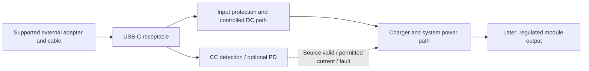

# Feature 01 — USB-C DC input: V-model starter

Date: 2026-10-30. Status: **draft learning and design worksheet**. No circuit, component choice, input rating or hardware result is established here. [Dock PRD](../requirements.md) · [Dock plan](../README.md) · [Verification plan](../verification-plan.md).

## 1. Start with purpose and evidence

The user-facing need is: **Connect the assembled clock to a supported external adapter through a reversible USB-C connection; provide enough power for the accepted desk-use mode and allocate remaining power to charging.**

The feature begins as an input subsystem allocated from the dock requirements. The V-model connects increasingly detailed design decisions to matching verification. Define the evidence while defining the requirement, then collect it as prototypes and integrated hardware become available. Early analysis, mockups and bench experiments can refine either side; this is an iterative development process, not a rule to postpone learning until after all design work.

```text
Define and decompose                              Integrate and demonstrate

User needs -------------------------------------- Real-use validation
  Dock system requirements -------------------- Dock system verification
    USB-C input requirements ---------------- Input subsystem verification
      Circuit / PCB design ---------------- Board-level verification
                   \                         /
                    Build the input prototype
```

Verification establishes compliance with the specified requirement. Validation establishes whether the resulting product serves the intended user and operating context. Requirements themselves also need validation for clarity, completeness, consistency and suitability. Plan both before implementation. [NASA product realization](https://www.nasa.gov/reference/5-0-product-realization/), [NASA system design](https://www.nasa.gov/reference/4-0-system-design-processes/)

## 2. Define this feature's boundary



Feature 01 covers the receptacle and its mounting, CC attachment/orientation/current detection, input-path protection and coordination of permissible input draw. The actual current-limit actuator may be inside the charger; the interface must specify who sets it, its safe startup default and how it responds to a changed source allowance.

Its outputs are **protected DC power plus source-valid/current-allowance/fault information**. The external adapter and cable are supported accessories/interfaces; their internal design is outside this dock feature. Charging policy, cell protection, battery backup and module-rail regulation are adjacent functions with their own requirements. Seamless unplugging must be verified on the integrated dock rather than claimed from the input circuit alone.

USB-C describes the connection system. Type-C current detection and USB Power Delivery are distinct capabilities: Type-C can advertise 1.5 A or 3 A at 5 V without PD; an implementation must detect and obey the applicable source allowance. A physical receptacle or sink termination does not establish that 3 A is available. Higher-voltage input requires the appropriate PD design. Use the selected applicable USB specification and component documentation for exact limits. [TI Type-C/PD primer](https://www.ti.com/lit/wp/slyy109b/slyy109b.pdf)

## 3. First design session: complete these six decisions

Record an answer, its reason, evidence or assumption, owner and closure date/gate for each row. No people are assigned by this worksheet.

| Decision | Proposed starting position | What closes it |
|---|---|---|
| Intended connection | Sink-only external DC input; no USB source/phone-charging mode | Accept interface scope and document how source mode is prevented |
| Source/cable support | Start evaluation with a defined USB-C-to-C adapter/cable pair | Decide required adapter profile, cable drop and whether other sources/A-to-C connections are supported, reduced-power or refused |
| Input voltage capability | Evaluate nominal 5 V Type-C first; PD remains a trade study | Worst-case operating-plus-charging budget and source/cable constraints justify 5 V or PD |
| USB data | No user data connection required for this feature candidate | Confirm flashing/debug has another route or deliberately add data requirements |
| Weak-source behavior | Reduce charging first at system level; expose available power | Decide when to supplement from battery, reduce the clock mode or refuse startup; define truthful status |
| Physical use | Side-entry receptacle as shown in concept | Validate finger/cable access, plug envelope, shell cutout, PCB support and strain relief with a mockup |

These are candidate decisions for discussion, not changes to an accepted specification. Keep USB input-voltage limits separate from the proposed 4.75–5.25 V **receiver output** window in the dock PRD.

## 4. Calculate required input power

Measure or bound the basic core/display load first. Record average demand, startup/peak demand and duration, display brightness, relevant radio/audio activity and sleep demand. Use an electronic-load surrogate if the real assembly is unavailable and label it accordingly.

At the dock's input terminals:

`P_required ≈ P_clock / η_input_to_clock + P_charge_into_pack / η_input_to_pack + P_dock_overhead`

`P_available = V_at_dock × I_permitted`

Use conservative source/cable voltage, efficiency, temperature and component tolerances. Ensure input current-limit accuracy and startup transients also obey the permitted source behavior.

The existing illustrative example uses a 10 W load, 85% input-to-load efficiency, 4.2 W stored charging power, 90% charge-path efficiency and 0.2 W overhead:

`P_required ≈ 10/0.85 + 4.2/0.90 + 0.2 ≈ 16.63 W`

A nominal 5 V/3 A source supplies 15 W before cable losses. This example requires less charging/load or a different input-power architecture. The 10 W load and efficiencies remain assumptions, not measured clock demand. This calculation informs the 5 V versus PD decision; it does not select PD automatically.

## 5. Decompose into requirements and plan their verification

These child IDs are a **proposed decomposition** of the existing PRD. They do not replace its IDs or create passed tests. Freeze missing numerical parameters before design verification; characterize unresolved behavior on evaluation hardware first.

| Child ID | Parent requirement(s) | Draft requirement | Planned proof / existing test link |
|---|---|---|---|
| USB-IN-01 | PWR-01 | The dock shall operate as an input sink using the accepted source/cable profiles and shall not enable a USB source role. | Configuration/schematic inspection plus role/attachment observation; T01 |
| USB-IN-02 | PWR-01 | Each supported Type-C-to-C source shall attach in both plug orientations and report its permitted current/valid status. Define response-time limits. | CC/source analyzer and status capture in both orientations and supported source modes; T01 |
| USB-IN-03 | PWR-01, PWR-04 | The complete input path shall keep draw within the applicable detected/negotiated allowance, including startup, load changes and permitted source-allowance changes. Define tolerance and transient limits. | Capture CC/contract, VBUS current, input-limit settings and downstream load; T01/T02 |
| USB-IN-04 | PWR-01, REL-02 | Before normal control starts, and during controller reset/hang, input settings shall remain in the defined safe state. | Review default straps/registers and reset/hang/watchdog experiments if firmware exists; T01/T15 |
| USB-IN-05 | PWR-01, PWR-06 | Input overvoltage/undervoltage, surge/transient, ESD and overload within the frozen fault envelope shall produce the specified safe behavior without damage. Define thresholds, hysteresis, energy and recovery. | Analysis and bounded fault injection with current-limited equipment; T01/T02/T12, plus the scoped external ESD plan |
| USB-IN-06 | PWR-07 | With USB input absent or below the defined reverse-power boundary, the dock shall not feed prohibited current from its battery/system into VBUS. Freeze maximum leakage and voltage conditions. | Measure reverse current/port voltage across source and battery states; T09 |
| USB-IN-07 | PWR-01, IFC-04, UX-01 | The input subsystem shall expose source-valid, permitted current and faults with defined timing and stale-data behavior, allowing the system to apply its weak-source policy. | Observe signals/status while changing source modes, attaching/detaching and interrupting control; T01/T02/T15 |
| USB-IN-08 | MEC-01, MEC-02, MEC-03 | The receptacle and mounting shall meet the accepted insertion/access, cable-pull, mounting-life and insulation envelope without intermittent power or PCB/shell damage. | Mechanical inspection, access mockup and defined force/cycle tests; T14/T16 |
| USB-IN-09 | PWR-02, REL-01 | At the accepted input-current envelope, input-path voltage drop and device/receptacle temperatures shall stay within allocated limits. | Drop/power-loss analysis and warm steady-state measurements with cable variation; T02/T12 |

Seamless input removal/restoration remains a parent integration check: PWR-03/T04. No-battery/deeply depleted-pack startup remains PWR-05/T05/T06. They depend on the charger/power-path and receiver as well as Feature 01.

## 6. Write the acceptance procedure now

Example procedure **IN-V01**, traced to USB-IN-02/03 and T01/T02:

1. Identify the prototype revision, control configuration, supported USB source/cable and instruments. Set the accepted numerical limits and load profile before judging a result.
2. Start from unpowered input with downstream demand controlled by an electronic load or charger emulator.
3. Attach the Type-C source; log source advertisement/contract, VBUS at the dock, input current, valid/current-allowance signals and the input-limit setting.
4. Increase downstream demand, then change the source allowance in a supported way. Repeat startup and load steps with the control reset where applicable.
5. Repeat in both plug orientations and for each supported source mode. Cover defined weak-source and refusal behavior.
6. Compare steady and transient current, voltage, detection latency and recovery to their specified limits. Record raw evidence and discrepancies.

The test can pass only after its limits are established and the observed results meet them. No plugged-in LED or successful one-time clock startup substitutes for these measurements.

## 7. Continue down the V after the requirements review

| Stage | Work | Review output |
|---|---|---|
| Functional architecture | Compare 5 V CC-detected sink and PD sink only as needed; allocate protection, current-limit actuator, status and reset defaults | Block diagram, interface definition, updated power budget and risk list |
| Detailed electrical/mechanical design | Select receptacle/controller/protection; calculate ratings, losses, inrush, capacitance, protection thresholds, thermal and mounting limits; route shield/ESD intentionally | Reviewed schematic, BOM, calculations, PCB/layout constraints and mounting drawing |
| Build | Begin with controlled evaluation hardware and a representative load; then fabricate reviewed custom hardware | Identified hardware revision and reproducible bring-up instructions |
| Board verification | Check pinout/straps, power-on defaults, detection, limits, drop, reverse blocking and bounded faults | Evidence against detailed input requirements; correct and repeat as needed |
| Subsystem/system verification | Integrate charger/power-path, battery simulator/approved pack, module regulator and real clock | T01/T02/T04/T05/T06/T09/T12/T15/T14 as applicable, linked to parent requirements |
| Use validation | Use the intended adapter/cable in real desk operation; plug in, run and recharge, move the assembled clock, reconnect, and review user understanding of status | Evidence that accepted usage needs are met; port-only tests do not establish portable runtime |

Keep one trace chain: `User need → parent PRD requirement → USB-IN child → design element → planned procedure → actual result`. Review requirements and testability before schematic freeze. Bench investigation can occur earlier to replace assumptions.

## 8. What to produce first

Complete the following in this worksheet or linked design records:

- One accepted purpose statement and boundary diagram.
- Source/cable support table and the six decision rows above.
- Load and input-power worksheet with measured values clearly distinguished from assumptions.
- Child requirement table with numeric acceptance parameters, parent trace and planned proof.
- Evaluation setup and initial procedure, with all tests still marked unexecuted until measured.

The immediate activity is to **fill the load/power worksheet and source-support table**. Those determine whether nominal 5 V is adequate, how much input current is required, and which controller/protection architectures should be evaluated. A custom PCB becomes useful after these choices and interfaces have a reviewed baseline.
