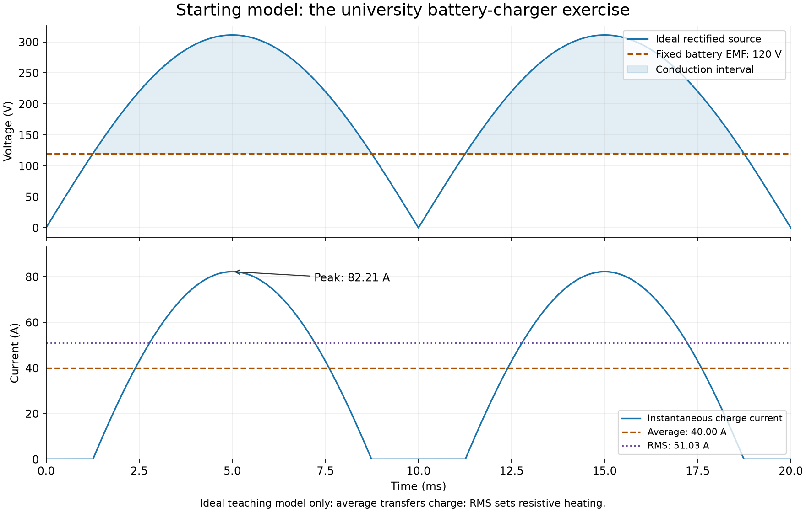
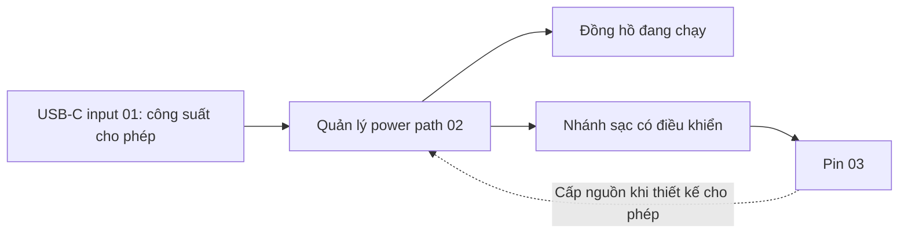
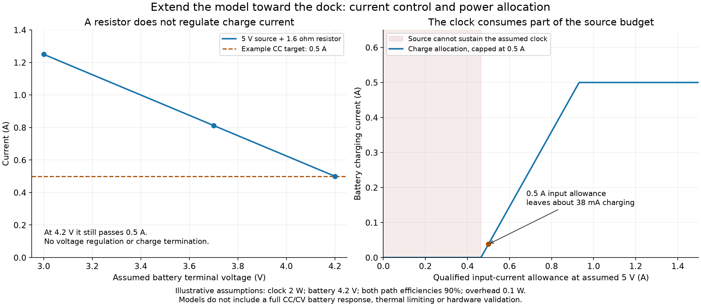

# Từ bài tập đại học đến thiết kế Charging Dock

Ngày: 2026-10-30. Trạng thái: **lộ trình học và mô hình tính toán**, chưa phải thiết kế bộ sạc để chế tạo. [PRD](../requirements.md) · [Nguồn hãng](charging-math-source-notes.md) · [Mã tính và vẽ đồ thị](charging_math.py) · [Kết quả tính](charging-math-results.json).

## 1. Đây là bước đầu của kỹ sư theo nghĩa nào?

Đây là một điểm bắt đầu tốt cho **phân tích kỹ thuật**. Trong phát triển sản phẩm, ta bắt đầu từ nhu cầu sử dụng và giới hạn; chuyển chúng thành yêu cầu đo được; dùng toán để dự đoán, so sánh phương án và lựa chọn phép đo. Mô hình được sửa khi đo đạc cho thấy giả thiết chưa đúng.


Với dock của mình, nhu cầu đã rõ là cấp điện cho lõi đồng hồ cơ bản và màn hình, đồng thời mang cả cụm đi dùng trong vài giờ. Công suất thực, số giờ chính xác, pack pin, nguồn và kích thước vẫn cần xác định. Các con số bên dưới là **đề bài học có giả thiết**, không tự trở thành thông số sản phẩm.

Ta làm bài toán lớn hơn bằng cách thêm từng hiện tượng: điện áp pin thay đổi, tổn hao, giới hạn dòng nguồn, tải đồng hồ, điều khiển sạc, nhiệt, thời gian và tiếp điểm. Không cần tăng công suất của bài tập 220 V.

## 2. Giữ lại nền tảng từ bài gốc

Nguồn bài tập đã đọc: [01_solution_note.md](D:/workspace/NeoLearning/07_mechatronics_engineering_master_program/02_Industrial-Electronics-For-Mechatronics-System/02_exercises/01_solution_note.md). Các số được tính mới dưới đúng giả thiết của ghi chú, không dựa vào kết quả đo phần cứng.

Bài gốc: `nguồn AC → cầu diode lý tưởng → R → nguồn sức điện động E cố định`.

`i(t) = max(0, (|U_m sin(ωt)| - E) / R)`

`I_avg = (1/T)∫i(t)dt`

`I_rms = sqrt((1/T)∫i²(t)dt)`

`P_R = R I_rms²`, `P_E = E I_avg`

Với đúng giả thiết của bài: `U=220 Vrms`, `f=50 Hz`, `E=120 V`, `I_avg=40 A`, tính lại được `R≈2.324835 Ω`, `I_rms≈51.031919 A`, `I_peak≈82.210978 A`, `P_R≈6054.47 W`, `P_E≈4800 W` và hiệu suất hữu ích theo mô hình khoảng `44.22%`.



Ý nghĩa thiết kế:

- Trung bình của dòng cho biết điện lượng truyền trong một khoảng thời gian.
- RMS của dòng quyết định nhiệt trên một điện trở không đổi.
- Đỉnh dòng giúp đánh giá ứng suất tức thời; thời gian xung cũng quan trọng.
- Hiệu suất cần một ranh giới công suất và định nghĩa phần hữu ích rõ ràng.

Các định nghĩa này tiếp tục dùng trong dock. Công thức góc dẫn của cầu AC chỉ dùng lại khi mạch và giả thiết còn phù hợp. Bài gốc không có tải đồng hồ, điều khiển sạc, mô hình SOC hay nhiệt. Không chuyển nguyên mạch AC đó thành dock DC.

## 3. M01 — Đổi sang DC và cho điện áp pin thay đổi

Mạch học: `nguồn DC 5 V → R → pin có điện áp đầu cực V_bat`.

Giả thiết nguồn đủ dòng, đường dẫn chỉ cho dòng nạp, bỏ qua sụt áp diode/dây và điện trở trong pin. Đây là **phản ví dụ để học**, không phải cách sạc Li-ion để lắp thật. Các điểm 3.0/3.7/4.2 V không xác lập giới hạn an toàn của một pack đã chọn.

**Đề bài:** Chọn một R để dòng bằng 0.5 A tại V_bat=4.2 V. Khi pin có điện áp khác, dòng và nhiệt thay đổi thế nào?

Từ KVL: `V_in = I R + V_bat`.

`R = (5 - 4.2)/0.5 = 1.6 Ω`

Sau đó giữ R không đổi và quét điện áp:

| V_bat giả định | I=(5−V_bat)/1.6 | Nhiệt trên R: I²R |
|---|---:|---:|
| 3.0 V | 1.2500 A | 2.5000 W |
| 3.7 V | 0.8125 A | 1.05625 W |
| 4.2 V | 0.5000 A | 0.4000 W |

**Quyết định rút ra:** Một R chọn tại một điểm không duy trì dòng sạc mong muốn trên dải điện áp pin. Tại 4.2 V nó vẫn đẩy 0.5 A và không tạo chức năng giới hạn điện áp hay kết thúc sạc. Ta có lý do định lượng để chuyển sang bộ điều khiển sạc. Kết luận phù hợp với phân tích của hãng về hạn dòng bằng điện trở. [TI power-path design](https://www.ti.com/lit/an/slyt333/slyt333.pdf)

**Feature liên quan:** 02 — chức năng sạc; 04/05 — nhiệt và ứng suất điện. **Phép đo dự kiến:** quét nguồn giả lập pin, ghi I và nhiệt/tổn hao; chưa dùng pin thật cho phản ví dụ này.

## 4. M02 — Thêm điều khiển dòng và điện áp

Mô hình chức năng tiếp theo gồm các trạng thái tiền nạp khi cần, dòng không đổi (CC), điện áp không đổi (CV), kết thúc hoặc tạm ngưng sạc theo điều kiện. Giới hạn và điều kiện chuyển trạng thái phải khớp pack/controller được chọn. [TI BQ24074 charge-cycle reference](https://www.ti.com/lit/gpn/BQ24074)

- **CC:** bộ điều khiển giới hạn dòng theo mức cho phép; điện áp đầu cực pin thay đổi theo trạng thái pin.
- **CV:** bộ điều khiển giữ điện áp ở mức quy định; dòng giảm theo đáp ứng pin.
- **Kết thúc/inhibit:** dựa trên điều kiện đã định nghĩa, không chỉ suy ra từ việc pin vừa chạm một điện áp.

Mô hình định lượng cho đường sạc tuyến tính, khi bỏ qua dòng tự dùng:

`P_loss ≈ (V_in - V_bat) I_chg`

Tại `V_in=5 V`, `V_bat=3.7 V`, `I_chg=0.5 A`: `P_loss≈0.65 W`.

Với một đường chuyển mạch giả định hiệu suất 90%, ở cùng công suất đầu cực pin `P_bat=3.7×0.5=1.85 W`:

`P_loss≈P_bat(1/η - 1)≈0.206 W`.

Đây là so sánh mô hình ở **cùng điện áp và dòng pin**, chưa bao gồm mọi tổn hao hệ thống. Nó đặt ra bài toán cân bằng nhiệt, hiệu suất, diện tích, linh kiện và độ phức tạp; chưa chọn topology hay IC. Dòng vào và dòng pin của bộ chuyển mạch nói chung khác nhau. [ADI switching PowerPath](https://www.analog.com/en/resources/technical-articles/speed-up-li-ion-battery-charging-and-reduce-heat.html)

**Feature:** 02/04. **Bằng chứng sau này:** đo I/V và trạng thái sạc theo pack, nhiệt và nguồn; mô hình pin cố định không dự đoán được toàn bộ đường cong CV theo thời gian.

## 5. M03 — Thêm đồng hồ đang chạy và nguồn có giới hạn



Đặt các hiệu suất cùng tính từ ranh giới đầu vào dock; tổn hao chung chỉ tính một lần:

`P_in_required ≈ P_clock/η_sys + V_bat I_chg/η_chg + P_dock`

`P_in_allowed = V_in_at_dock × I_in_allowed`

Suy ra giới hạn dòng sạc do ngân sách nguồn:

`I_chg_budget = max(0, η_chg (P_in_allowed - P_clock/η_sys - P_dock)/V_bat)`

Dòng thực còn bị giới hạn bởi trạng thái CC/CV, mức cấu hình, pack và nhiệt. Công thức trên là budget tĩnh, không phải mô phỏng vòng điều khiển hoặc đường cong sạc.

**Đề bài mới có giả thiết:**

| Đại lượng | Giá trị học thử |
|---|---:|
| Điện áp tại đầu vào dock | 5.0 V |
| Đồng hồ tiêu thụ | 2.0 W |
| Hiệu suất từ đầu vào đến tải | 90% |
| Điện áp đầu cực pin tại điểm xét | 4.2 V |
| Dòng sạc yêu cầu | 0.5 A |
| Hiệu suất nhánh sạc | 90% |
| Tự dùng của dock ngoài các hiệu suất trên | 0.10 W |

Để vừa chạy đồng hồ vừa đạt dòng sạc này:

`P_in_required = 2/0.9 + (4.2×0.5)/0.9 + 0.10 ≈ 4.656 W`.

| Dòng vào đã được xác nhận cho phép | Công suất vào tại 5 V | Giới hạn dòng sạc do công suất | Sau khi giới hạn cấu hình 0.5 A |
|---|---:|---:|---:|
| 1.5 A | 7.50 W | 1.1095 A | 0.5000 A |
| 0.5 A | 2.50 W | 0.0381 A | 0.0381 A |

Hàng 0.5 A là một budget giả định đã được xác nhận, không phải khẳng định mọi cổng USB mặc định đều cho phép 0.5 A. Trong hàng này, sụt áp cáp, hiệu suất thấp hơn hoặc tải lớn hơn có thể xóa hết phần dư. Nếu công suất nguồn không đủ cấp riêng đồng hồ, việc công thức trả dòng sạc bằng 0 **không đảm bảo đồng hồ vẫn chạy**: cần chính sách bổ sung từ pin, giảm tải hoặc từ chối/tắt.



**Quyết định:** xác định nguồn tối thiểu, giảm dòng sạc khi tải tăng, và hiển thị đúng trạng thái. Việc một bộ power-path có thể ưu tiên hệ thống và giảm sạc được minh họa trong tài liệu hãng; cấu hình cụ thể của dock còn phải đo. [TI power-path reference](https://www.ti.com/product/BQ24074)

**Feature:** 01/02/07. **Test:** đo đồng thời công suất vào, công suất tải và dòng pin; tăng tải và giảm budget nguồn. Liên hệ PRD PWR-01/PWR-04 và T01/T02/T05.

## 6. M04–M08 — Mở rộng từng mô hình theo một quyết định

| Bài tiếp theo | Toán đại học dùng lại | Câu trả lời kỹ thuật / feature |
|---|---|---|
| M04 — Điện lượng, năng lượng và runtime | `ΔQ=∫I_bat dt`; `E=∫V_bat I_bat dt`; giờ và Ah phải cùng đơn vị | Dung lượng/Wh và thời lượng của pack: 03; thời gian nạp: 02 |
| M05 — Nhiệt và NTC | `ΔT≈P_loss R_θ`; `R_NTC(T)=R0 exp[B(1/T−1/T0)]`, T theo kelvin | Ước lượng nhiệt, vị trí cảm biến, giảm/ngưng sạc: 04/05 |
| M06 — Tải đột biến và chuyển nguồn | `CΔV≈ΔIΔt`; `ΔV_ESR≈ΔI·ESR` | Giới hạn sụt áp khi khởi động/cắm-rút: 02/05 |
| M07 — Tiếp điểm và đường cấp nguồn | `V_drop=IR_loop`; `P_loss=I²R_loop` | Sụt áp, nhiệt, pin-count/harness rating: 05/06 |
| M08 — Cơ khí và khả năng bảo trì | Moment `τ=mgx`, lực lò xo, stackup dung sai | Cơ cấu giữ, chống lật, hành trình pogo và tháo lắp: 06/08; cần mô hình cơ khí riêng |

Một số con số học thử:

- **Runtime:** pack minh họa `3.7 V×5 Ah=18.5 Wh`; giả định 80% năng lượng dùng được và hiệu suất ra tải 85% cho khoảng `12.58 Wh`, tương đương `6.29 h` ở tải 2 W trước phần tự dùng bổ sung. Thay bằng đường cong xả và profile đo được trước khi chọn pack.
- **Thời gian sạc:** nếu cần đưa thêm 2 Ah và dòng pin không quá 0.5 A, giới hạn lý tưởng là ít nhất 4 h. Tiền nạp, CV, nguồn và nhiệt có thể kéo dài; `Q/I` không đủ dự đoán thời gian empty-to-full.
- **Nhiệt:** nếu tổn hao 0.65 W và điện trở nhiệt hiệu dụng giả định 60 °C/W, độ tăng nhiệt nút xét khoảng 39 °C. Phải chỉ rõ nút junction/board/case; đây không phải nhiệt độ pin hay giới hạn được nghiệm thu.
- **Transient:** `ΔI=0.5 A`, `Δt=100 µs`, cho phép tụ gây sụt 0.1 V cho `C≥500 µF` theo mô hình giữ điện tích. ESR 50 mΩ gây thêm 25 mV; nếu tổng budget vẫn 0.1 V thì còn 75 mV cho tụ, nên `C≥667 µF`. Vòng điều khiển, bias/derating, inrush và pin khiến thiết kế thật phức tạp hơn.
- **Tiếp điểm:** tổng vòng nguồn-về `R_loop=0.1 Ω`, dòng 2 A tạo sụt 0.2 V và nhiệt 0.4 W. Đo cả tiếp điểm, dây và PCB khi nóng/cũ; không suy ra rating chỉ từ số chân.

Pin thật cần mô hình điện áp hở mạch theo SOC, nhiệt độ và tuổi, cộng trở kháng và đáp ứng động phù hợp. Với chiều dương là nạp, mô hình đơn giản có `V_terminal≈V_OC(SOC,T)+I_bat R_internal`. Pin không phải một tụ điện có C cố định trên toàn dải làm việc. [ADI battery modeling](https://www.analog.com/en/resources/technical-articles/a-closer-look-at-state-of-charge-and-state-health-estimation-tech.html)

## 7. Đặt các bài học vào V-model

Mỗi bài cần một chuỗi truy vết: **nhu cầu → yêu cầu định lượng → giả thiết → phương trình → dự đoán → phép đo → kết luận thiết kế**.

| Ví dụ | Bên định nghĩa/thiết kế | Bên kiểm chứng tương ứng |
|---|---|---|
| Chạy và sạc trên bàn | M03: budget, nguồn hỗ trợ, mức giảm sạc | Đo công suất/dòng khi thay tải và nguồn; T01/T02/T05 |
| Mang đồng hồ đi dùng vài giờ | M04: profile và Wh cần thiết | Đo runtime cả cụm; T13 |
| Pin trong vùng nhiệt cho phép | M05: tổn hao, thermal model, ngưỡng của pack | Đo nhiệt thực và NTC open/short; T11/T12 |
| Cắm/rút không reset khi pin còn dùng được | M06: droop budget và chuyển nguồn | Capture rail, dòng và reset; T03/T04 |
| Kết nối mô-đun ổn định | M07/M08: drop, lực giữ, dung sai | Điện trở nóng/cũ, rung/cắm-rút, tải cơ; T08/T14 |

Một kết quả tính đúng chỉ xác nhận mô hình dưới giả thiết của nó. Nó không thay thế dữ liệu cell, schematic review, mô phỏng mạch, đo nguyên mẫu và validation của chiếc đồng hồ thực.

## 8. Bài thực hành đầu tiên và trạng thái bằng chứng

**Bắt đầu ngay bằng M01 và M03.** Tự tính bảng dòng/nhiệt của điện trở; sau đó thêm tải đồng hồ và hai budget nguồn. Với mỗi kết quả, viết một quyết định: cần điều khiển dòng, cần giữ điện áp, cần giảm sạc hay cần nguồn mạnh hơn.

Chạy lại phép tính và đồ thị bằng PowerShell tại thư mục này:

```powershell
uv run .\charging_math.py
```

Script khai báo numpy/matplotlib theo môi trường riêng do uv quản lý, không yêu cầu thay Python của toolchain ESP-IDF. Khi uv chưa có interpreter phù hợp, có thể chỉ định Python đã cài bằng `uv run --python <python-path> .\charging_math.py`.

Đã tính mới bằng Python: tích phân số bài cầu lý tưởng, bảng DC, budget công suất và các hình minh họa. [JSON kết quả](charging-math-results.json) lưu loại bằng chứng. **Chưa chạy mô phỏng QSPICE mới, chưa chọn linh kiện/pack, chưa thử phần cứng.** Các bước M04–M08 là mô hình tiếp nối và ví dụ tính; chưa phải các tính năng đã hoàn thành.
