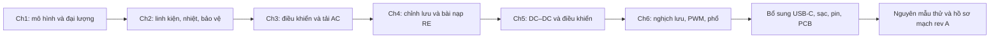

# Lộ trình đọc đủ Huỳnh Văn Kiểm và thiết kế DC Power Dock

**Cập nhật DOCK-F01, 31-10-2026:** Concept hiện tại có mặt sạc không dây mục tiêu tối đa 25 W. Bộ phát tạo AC cao tần từ nguồn DC, vì vậy phần nghịch lưu và cộng hưởng Chương 6 có liên hệ trực tiếp về nguyên lý. Các mã feature F01–F08 trong bản đồ cũ phản ánh phân loại trước đây, không trùng danh sách DOCK-F01–F10 hiện tại. Xem [lộ trình và bài toán mặt sạc dùng chung](../01-f01-mat-sac-khong-day-hvk.md).

Ngày lập: 2026-10-30. Nhịp học do người học chọn: **6–8 giờ/tuần, học kèm mô phỏng đều đặn**. Khung đề xuất sau khi đối chiếu mục con: **18 tuần, khoảng 108–144 giờ**. Đây là kế hoạch có thể điều chỉnh theo điều kiện hoàn thành, không phải thời hạn cam kết có sản phẩm đã nghiệm thu.

## 1. Mục tiêu và cách dùng

Học hết sáu PDF trong thư mục người học cung cấp, bao gồm mục con, hình, ví dụ, tóm tắt, bài tập/câu hỏi và phụ lục. Đồng thời xây dần một hồ sơ thiết kế dock: nhu cầu, budget nguồn/pin, mô hình mạch, lựa chọn kiến trúc, bảo vệ/nhiệt, sơ đồ nguyên lý và kế hoạch kiểm chứng.

Hai việc đi cùng nhau: **đọc đủ chương theo trình tự 1→6**, và **mở rộng mô hình dock sau mỗi chặng**. Phần AC/ba pha/động cơ có đầu ra học tập riêng; không phải mọi sơ đồ đã học đều cần xuất hiện trong sản phẩm. Các bài AC/cao áp thực hiện trên giấy hoặc mô phỏng trong lộ trình này; nguyên mẫu dock dùng miền DC và thiết bị thử phù hợp.

Mục tiêu sản phẩm hiện tại: lõi đồng hồ cơ bản + màn hình, dock là mốc kỹ thuật đầu tiên, mang cả cụm dùng vài giờ. Công suất, số giờ chính xác, pack, giá và kích thước vẫn phải xác định. Các ví dụ 5 V, 10 W hay 1S trước đây là giả thuyết học/bench, chưa phải rating được chốt.

## 2. Nguồn đã kiểm kê và bản đồ bao phủ

Số trang là **vị trí trang PDF tính từ 1**, không phải số trang cộng dồn giữa các chương. Các bản đồ giữ số mục in trong nguồn; chỗ trùng/sai được ghi thêm tên hoặc mã đọc để tra chính xác.

| Chương / file | Trang PDF | Phạm vi phải đọc | Bản đồ từng mục |
|---|---:|---|---|
| 1 — `Chuong1_Modau.pdf` | 1–8 | I.1–I.6; I.3.1–4, các phương pháp a–f; Bài I.5.1–4; danh sách tài liệu trong ảnh | [Chương 1](chapter-01-reading-map.md) |
| 2 — `chuong2_Linh_kien_CS.pdf` | 1–17 | II.1–II.7; diode/SCR/các họ thyristor/BJT/MOSFET/IGBT, các hình phân loại, nhiệt, bảo vệ, bài và phụ lục | [Chương 2–3](chapters-02-03-reading-map.md#1-chương-2---linh-kiện-đtcs-đọc-toàn-bộ-trang-1-17) |
| 3 — `Chuong3_DK_ap_AC.pdf` | 1–15 | III.1/2, mục ON-OFF in II.3, III.4/5; đủ ứng dụng/câu hỏi; phụ lục gamma, RMS, trung bình | [Chương 2–3](chapters-02-03-reading-map.md#2-chương-3---điều-khiển-công-suất-xoay-chiều-đọc-toàn-bộ-trang-1-15) |
| 4 — `Chuong4_Chinh_luu_DK_pha.pdf` | 1–37 | IV.1–IV.10, mọi nhánh R/RL/RE/RLE, Bài 1–6 và Câu 1–8 | [Chương 4](chapter-04-reading-map.md) |
| 5 — `Chuong5_Bo_bien_doi_ap_mot_chieu.pdf` | 1–24 | V.1–V.5; mọi phần tư, boost/flyback, mạch tắt SCR, điều khiển/ứng dụng, ví dụ/bài trong chương và cuối chương | [Chương 5–6](chapters-05-06-reading-map.md#1-chương-5---bộ-biến-đổi-áp-một-chiều) |
| 6 — `Chuong6_Nghich_luu_doc_lap_va_bien_tan.pdf` | 1–28 | VI.1–VI.4; các mục sau in V.3/V.6/V.7; điều chế a–h, điều khiển, biến tần, nguồn xung, UPS và bài trong chương | [Chương 5–6](chapters-05-06-reading-map.md#2-chương-6---nghịch-lưu-độc-lập-và-biến-tần) |
| **Tổng** | **129 trang** | Đủ nội dung hiện có trong sáu file, không khẳng định đây là toàn bộ mọi tập sách của tác giả | [Kiểm kê và SHA-256](source-inventory.json) |

Mỗi dòng trong bản đồ có nội dung/trang, lý do đọc, bài làm hoặc câu trả lời nhỏ và liên hệ feature. Đọc cả phần giữa các tiêu đề, chú thích hình và điều kiện công thức. Một trang có thể thuộc hai mục nên khoảng trang giao nhau là bình thường. Tệp không kèm nội dung được hứa ở nơi khác thì ghi thiếu, không tự giả định đã đọc.

## 3. Vì sao cần đọc cả chương ít dùng trực tiếp?

| Chương | Năng lực nhận được | Điều đem vào dock | Điều hoàn thành ở mức học nền |
|---|---|---|---|
| 1 | Chọn mô hình, trạng thái và đại lượng cần đo | Avg/RMS/peak, công suất, ripple, transient; nền cho mọi feature điện | Phân loại đủ các họ AC/DC/DC–DC/DC–AC và tài liệu tham khảo |
| 2 | Từ công tắc lý tưởng sang linh kiện thật | Diode/MOSFET, SOA, driver, tổn hao, nhiệt và bảo vệ: F01/F02/F04/F05 | SCR/TRIAC/GTO và các họ còn lại giúp hiểu lựa chọn và chuyển mạch |
| 3 | Thấy quan hệ điều khiển → khoảng dẫn → dạng sóng → công suất | Tư duy định lượng, RL/điều kiện đầu, tìm nghiệm số, ảnh hưởng switching | Zero-cross, điều áp AC một/ba pha và ứng dụng không thành khối của dock |
| 4 | Phân tích đường năng lượng và rating theo từng trạng thái | Bài RE, Iavg/Irms/Ipeak, ripple, sụt áp theo tải, chặn ngược: F02/F03/F05 | SCR, trùng dẫn lưới, biến áp ba pha, đảo chiều và động cơ là nền/upstream |
| 5 | Tính nguồn DC chuyển mạch và điều khiển | D/f/L/C, CCM/DCM, converter, lọc, hiệu suất: F02/F05; là trọng tâm power stage | SCR commutation và nhiều phần tư được đọc để hiểu nguồn gốc/giới hạn topology |
| 6 | Tư duy cầu công tắc, phổ, PWM, trình tự điều khiển và dự phòng | Chuyển giao phân tích switching/ripple, trạng thái, chuyển nguồn: F02/F05/F07 | CSI/VSI ba pha, đa bậc, SVM, U/f, gia nhiệt và AC UPS vẫn đọc đủ; chưa thêm AC/motor vào dock |

Điều này giúp trả lời cả hai câu hỏi thiết kế: một phương án hoạt động thế nào, và vì sao một phương án khác không phù hợp yêu cầu hiện tại. Không cần ép mọi kiến thức thành feature mới.

## 4. Nhịp học một tuần

| Buổi | Thời lượng gợi ý | Việc thực hiện |
|---|---:|---|
| A — Đọc bằng hình | 90 phút | Một cụm mục; tự vẽ đường dòng, trạng thái khóa, trục thời gian và ký hiệu |
| B — Toán | 90 phút | Từ KCL/KVL, v=Ldi/dt, i=Cdv/dt hoặc định nghĩa trung bình/RMS; giải một bài có số và kiểm tra đơn vị |
| C — Mô phỏng | 90 phút | Dự đoán trước rồi chạy QSPICE với mô hình phù hợp; ghi giá trị linh kiện, điều kiện đầu và các trace cần xem |
| D — Đối chiếu | 90 phút | So tính tay–mô phỏng, giải thích sai khác, ghi bài chưa hiểu và một quyết định hoặc giới hạn cho dock |
| Linh hoạt | 0–2 giờ | Ôn toán, làm thêm bài hoặc đọc datasheet; không dùng để che một mốc chưa đạt |

Tổng 6–8 giờ. Một mục dày có thể cần hơn một buổi; khi đó kéo dài chặng tương ứng. Đọc hết mục/bài là bắt buộc để hoàn tất phạm vi; không cần chạy mô phỏng riêng cho mỗi bài cùng dạng. Giải đủ các trường hợp khác nhau và câu hỏi lý thuyết, dùng vài mô phỏng đại diện để đối chiếu. Nếu muốn giải và mô phỏng riêng mọi bài, cần tăng thời gian ngoài khung 18 tuần.

## 5. Kế hoạch theo tuần và đầu ra thiết kế

Tất cả bài/mô phỏng trong bảng là **việc sẽ làm**. Việc đã rà PDF không có nghĩa người học đã đọc, giải bài hay chạy mô phỏng.

| Tuần | Đọc đủ | Bài toán / mô phỏng trọng tâm | Hồ sơ dock được tạo hoặc cập nhật |
|---|---|---|---|
| 1 | Ch1 I.1–I.3.4.b, tr.1–5 | Công tắc lý tưởng; xung avg/RMS/peak; khởi động RL và đường hồi dòng | Sơ đồ khối, glossary/đơn vị; nhu cầu runtime/load và danh sách TBD |
| 2 | Ch1 I.3.4.c–f, I.4–I.6; đọc lại phần giáp trang, tr.5–8 | Chu kỳ xác lập, xếp chồng, RLC/điều kiện đầu, đủ Bài 1–4; nguồn tài liệu | Worksheet trạng thái/mô hình và mẫu test; L1 nền đo lường |
| 3 | Ch2 tr.1–11: II.1/2/3, đủ họ thyristor, switching/SOA/driver | Diode recovery; loss khi đóng-ngắt; so sánh SCR và MOSFET trên nguồn DC | Bảng chức năng/rating của diode/MOSFET/driver, chưa chốt BOM |
| 4 | Ch2 tr.11–17: II.4–II.7, hình phân loại, nhiệt, bảo vệ, bài/câu hỏi và phụ lục | P_loss→nhiệt, fault/current/voltage envelope; bài nạp E=12 V và RMS | Bảng tổn hao/nhiệt/lỗi; L2 linh kiện và bảo vệ |
| 5 | Ch3 tr.1–8: III.1/2, ON-OFF, III.4 một pha R/RL | So điều khiển ON-OFF và góc pha; giải ODE và vẽ RMS/công suất theo tham số | Bảng giả thiết và điều kiện dùng công thức, phương pháp đánh giá inrush/transient |
| 6 | Ch3 tr.8–15: ba pha/ứng dụng, III.5, đủ câu hỏi/phụ lục | Tìm gamma bằng số; đủ các ví dụ RMS/trung bình, kiểm tra độ/radian | Báo cáo điều khiển–dạng sóng; toàn chương 3 được đóng phạm vi |
| 7 | Ch4 tr.1–11: IV.1/2 và mọi tải/topology tương ứng | Làm lại bài RE hiện có; thêm RL và góc kích, xem các dạng dòng | Dòng/áp/công suất và stress, bắt đầu mô hình DC thay thế cho dock |
| 8 | Ch4 tr.11–21: IV.3/4, đủ các mục con | Dòng liên tục/gián đoạn, transformer/SCR rating, commutation, ripple, đặc tính tải, ghép nguồn | Budget sụt áp/loss và bản đồ chiều công suất; chưa cho phép ghép hai dock |
| 9 | Ch4 tr.21–37: IV.5–IV.10, đủ Bài 1–6/Câu 1–8 | Freewheel, liên động, chuỗi điều khiển, các ứng dụng; giải và ghi tham chiếu thiếu nếu có | Từ bài AC–R–E sang DC–R–pin, rồi yêu cầu charger + tải; L3 mô hình nạp |
| 10 | Ch5 tr.1–7: mở đầu, V.1 một/hai phần tư, boost, mọi ví dụ/bài xen kẽ | ON/OFF RLE, D/f/L, CCM/DCM; kiểm tra quy ước ripple | Worksheet power stage cho các miền áp nguồn/pin/tải |
| 11 | Ch5 tr.7–13: phần còn lại V.1 và V.2 | Bốn phần tư, hài, song song, lưu trữ/phóng năng lượng; so họ buck/boost/buck-boost | Trade study topology theo dải áp và loss; giữ pin/rail/output khác ranh giới |
| 12 | Ch5 tr.13–24: V.3–V.5, mọi ứng dụng/tóm tắt/bài cuối | SCR turn-off ở mức nền; PWM/hysteresis; step tải và ripple; đủ bài tính | Kiến trúc nguồn DC ứng viên + lý do; L4 converter, chưa coi là charger hoàn chỉnh |
| 13 | Ch6 tr.1–12: mở đầu, VI.1–VI.3 | Phân loại inverter, nguồn dòng/áp, một/ba pha/đa bậc, xếp chồng, bài trong đoạn | Bảng trạng thái/đường dòng và giả thiết bỏ qua hài |
| 14 | Ch6 tr.12–28: VI.4, đủ điều chế a–h; điều khiển/biến tần/ứng dụng/UPS | Fourier/PWM/SVM, control sequencing; so AC UPS với handover DC | Phương pháp đo ripple/phổ, state diagram nguồn/fault; L5 đóng đủ sáu PDF |
| 15 | Bổ sung USB-C, datasheet controller/input protection, bài tính nguồn hiện có | Attach/orientation/current allowance; weak source, cable drop, reverse power | Spec Feature 01 và power budget rev1, trace tới PWR-01/T01/T02 |
| 16 | Bổ sung pack, CC/CV, power path, NTC, regulator/output protection, layout | Dòng sạc bị giới hạn bởi input/pack/nhiệt; runtime và loss; đọc datasheet/điều kiện thực | Spec Feature 02–05/07, pack envelope, dự kiến test; L6 kiến trúc đáp ứng PRD |
| 17 | Review và bring-up theo tài liệu evaluation board nếu đã có thiết bị | Nguồn/tải giả lập trước; source change, load step, charge allocation, backfeed, nhiệt | Báo cáo bench có revision và số đo; chưa đủ thiết bị thì mô phỏng tiếp nhưng không đánh dấu bench đã đạt |
| 18 | Datasheet/layout/mounting của linh kiện đã đánh giá; checklist review | Tổng hợp sơ đồ, loss/thermal, tolerances, test points, service và connector | Hồ sơ schematic/BOM rev A + ràng buộc PCB/cơ khí + test plan; L7 review trước đặt bo |

Các tuần 15–18 không thể chỉ dùng sáu chương để hoàn thành: đây là cầu nối bắt buộc từ nguyên lý sang product engineering. Mua linh kiện, fabrication, lịch phòng lab và các lỗi cần sửa có thể kéo dài tiến độ. Pilot, độ bền, chứng nhận và phát hành thương mại là các chặng sau, ngoài phạm vi khung học 18 tuần.

## 6. Các mốc học L1–L7 và liên hệ V-model

| Mốc | Cần tự làm được | Bằng chứng cần có |
|---|---|---|
| L1 — Sau Ch1 | Giải thích avg/RMS/peak/P, đường dòng và điều kiện đầu | Bài tính và dạng sóng có đơn vị; mô phỏng ghi rõ đầu vào/phương pháp đo |
| L2 — Sau Ch2 | Từ dòng/áp/tần số suy ra loại tổn hao, rating và fault | Worksheet linh kiện–loss–thermal–protection; nguồn datasheet dùng sau này |
| L3 — Sau Ch4 | Phân biệt mô hình nạp RE với charger có điều khiển và tải hệ thống | Bảng giả thiết, một mô hình DC mở rộng, các tiêu chí input/load/charge |
| L4 — Sau Ch5 | Tính trạng thái chuyển mạch, nhận ra CCM/DCM, chọn họ converter có lý do | Worksheet D/f/L/C và stress; so tính tay với mô phỏng theo miền làm việc |
| L5 — Sau Ch6 | Đọc đủ mọi mục, hiểu PWM/phổ/trình tự và phạm vi ứng dụng | Checklist sáu file, bài/câu hỏi, glossary và các điểm nguồn chưa giải quyết |
| L6 — Sau phần bổ sung | Chốt giao diện, pack, nguồn và giới hạn dựa trên nhu cầu | Yêu cầu số có owner, design element và verification method; đủ để review thiết kế |
| L7 — Hồ sơ rev A | Review được sơ đồ/BOM/ràng buộc PCB và test points | Tính toán, dữ liệu bench khi có, findings đóng hoặc ghi rõ chưa sẵn sàng chế tạo |

Lộ trình học không thay thế các gate phát triển sản phẩm trong [kế hoạch dock](../../README.md). Một gate toán/mô phỏng đạt không có nghĩa thử phần cứng đạt. [PRD](../../requirements.md) và [test plan](../../verification-plan.md) vẫn là nơi truy vết yêu cầu và bằng chứng tích hợp.

## 7. Sáu nhóm kiến thức ngoài giáo trình cần bổ sung

| Nhóm | Lý do và đầu ra | Nguồn khởi đầu |
|---|---|---|
| USB-C/PD | Nguồn được phép cấp bao nhiêu, giới hạn khởi động/reset, sink-only, profile/cáp; đầu vào USB-C không tự bảo đảm 3 A | [TI CC detection reference](https://www.ti.com/product/TUSB320) và đặc tả USB áp dụng cho thiết kế được chọn |
| Sạc và power path | CC/CV/termination, input limit, tách dòng pin và tải, có/không pin, thermal inhibit | [TI charge/power-path reference](https://www.ti.com/product/BQ24074); đây chỉ là ví dụ họ IC, không phải BOM hay rail 5 V được chốt |
| Battery pack và runtime | Chemistry, charge/discharge/NTC, protection, tuổi/độ nở, service và Wh thực | Datasheet và hồ sơ của pack thật; [nguồn học toán pin](../charging-math-source-notes.md) |
| Control/power stage | Compensation/stability, điện cảm bão hòa, tụ ESR/DC-bias, reverse current, lựa chọn topology | [TI power-stage calculations](https://www.ti.com/lit/an/slva477b/slva477b.pdf) chỉ xử lý power stage buck CCM; đọc thêm tài liệu đúng IC/topology |
| PCB/EMI/nhiệt và đo | Hot loop, sense/feedback, ground/shield, decoupling, probe/ripple và bố trí nguồn nóng gần pin | [TI switching layout guidance](https://www.ti.com/lit/an/snva021c/snva021c.pdf) rồi layout/reference của IC thật |
| Cơ điện và sản xuất | Contact warm/aged resistance, compression/keying/retention, USB-C mounting, wire/screw/liner, assembly/end-of-line; F06/F08 chưa đủ từ giáo trình này | Bản vẽ và rating nhà sản xuất connector/pack; checklist [verification](../../verification-plan.md) |

Khi chọn thị trường và hình thức vận chuyển, còn phải xác định hồ sơ an toàn sản phẩm, EMC, vật liệu và pin/vận chuyển theo phạm vi thực. Giáo trình hoặc chứng nhận của một linh kiện không xác nhận cả dock. Nội dung này chưa là thủ tục chứng nhận đã hoàn thành.

## 8. Cách ghi bài để không chỉ nhớ công thức

Với một mục có mạch, ghi tối đa một trang theo mẫu:

1. Hình mạch/đường dòng và điều kiện khóa ON/OFF.
2. Đại lượng đã cho, cần tìm, đơn vị và giả thiết.
3. Đi từ KCL/KVL/định nghĩa tới phương trình, ghi chỗ dùng xấp xỉ.
4. Một bộ số và ít nhất một trường hợp biên để kiểm tra.
5. Dạng sóng dự đoán; trace/cửa sổ đo sẽ dùng trong QSPICE.
6. Một câu: kết quả này thay đổi quyết định nào cho dock, hoặc vì sao chỉ là kiến thức nền?

Với mục phân loại/tài liệu tham khảo, đầu ra là bảng so sánh hoặc sơ đồ tìm nguồn, không cần ép có mô phỏng. Với bài nhiều phần, đánh dấu từng phần đã đọc và đã giải riêng. Với phần nguồn lỗi/thiếu hình, ghi vấn đề và cách đối chiếu, không bịa dữ kiện rồi gọi là lời giải theo sách.

Quy ước trạng thái cá nhân: `[ ] chưa đọc`, `Đ đã đọc`, `T đã tự tính/trả lời`, `M đã mô phỏng`, `K đã đối chiếu`, `H đã đo hardware`. Các trạng thái độc lập; bản đồ hiện chưa đánh dấu tiến độ của người học.

## 9. Những điểm cần ghi sẵn vào sổ đối chiếu nguồn

Đây là các ví dụ được kiểm tra trên bản render, chi tiết nằm trong từng bản đồ:

- Ch1 tr.3: quan hệ chu kỳ in sai thứ nguyên; dùng `T=2π/ω=1/f`. Giữ rõ định nghĩa form factor và tên tỷ số ripple DC so với THD AC.
- Ch2 tr.14: công thức gọi là công suất trung bình thiếu `1/T`; tích phân vi theo thời gian đơn thuần là năng lượng. Driver MOSFET vẫn có gate charge và năng lượng chuyển mạch.
- Ch2 tr.17: đoạn phụ lục giới thiệu datasheet SCR nhưng không kèm chúng trong file. Ch3 có chỗ đổi độ/radian và dữ kiện 9 A/11 A không nhất quán.
- Ch4 có số mục trùng và câu hỏi dẫn hình vòng kín chưa tìm thấy trong tệp; giữ lại như vấn đề nguồn.
- Ch5 tr.3 dùng `ΔI=(Imax−Imin)/2`; chuyển sang peak-to-peak phải nhân 2. Ví dụ tr.4 có L khác nhau giữa đề và phần thế số. FORWARD/FLYBACK là cách phân nhóm rộng của giáo trình.
- Ch6 có nhãn số chương/mục và tên hình không nhất quán. Dùng tên nội dung + trang PDF + mã đọc để tra.

Không sửa bản gốc. Kiểm tra đơn vị, trường hợp biên, phép tính mới và dữ liệu hãng khi dùng kiến thức để chọn phần cứng. Những lỗi này cũng là bài học thực tế về thẩm định nguồn kỹ thuật.

## 10. Bắt đầu ngay: bốn buổi của tuần 1

**Buổi A:** Ch1 tr.1–2, I.1/I.2. Vẽ `adapter → input → charger/power path ↔ pin → rail → clock`, ghi chức năng và ba mô hình công tắc diode/SCR/transistor.

**Buổi B:** I.3.1–3, tr.2–4. Tự tính xung 1 A, ON 25% chu kỳ: `Iavg=0.25 A`, `Irms=0.5 A`. Với R=1 Ω, nhiệt là 0.25 W; lấy `Iavg²R` chỉ ra 0.0625 W. Từ đó giải thích vì sao phải đo RMS cho đường có dòng xung.

**Buổi C:** I.3.4.a–b, tr.4–5. Với bài RL/freewheel, dự đoán dòng lúc đóng và lúc ngắt, sau đó dựng mô phỏng thích hợp. Ghi dấu v_L và đường dòng thay vì chỉ chụp một đường trace.

**Buổi D:** So kết quả, ghi giả thiết còn thiếu và liên hệ lại bài RE đã có. Chưa hiểu RLC/Laplace thì dành thời gian linh hoạt và tiếp tục trong tuần 2. Mục tiêu tuần đầu là đọc đúng hình, đại lượng và mô hình, chưa cần chọn IC.

Có thể dùng [bài toán DC từ exercise sang dock](../00-from-exercise-to-engineering.md) như sợi chỉ xuyên suốt các tuần. Các giá trị thật của core/display sẽ thay các giả thiết khi có dữ liệu đo.

## 11. Phạm vi đã làm để lập lộ trình

Đã kiểm kê sáu PDF, xác nhận **129 trang**, đọc nội dung toàn bộ qua phân công rà soát, và xem render để đối chiếu tiêu đề, hình/biểu thức quan trọng cùng các đoạn text extraction bỏ sót. Đã lập bảng từng mục và nguồn bổ sung; [inventory](source-inventory.json) lưu đường dẫn/hash của bản được rà soát. [Báo cáo bao phủ](coverage-report.json) là kiểm tra cấu trúc page-map, không xác nhận mức hiểu của người học.

**Chưa thực hiện lộ trình 18 tuần, chưa giải mới toàn bộ bài tập, chưa chạy bộ mô phỏng QSPICE của lộ trình, chưa chế tạo/đo/kiểm định dock.** Những kết quả toán đã chạy ở chặng trước nằm trong [learning guide](../00-from-exercise-to-engineering.md), không tự trở thành bằng chứng cho các bài mới ở đây.
