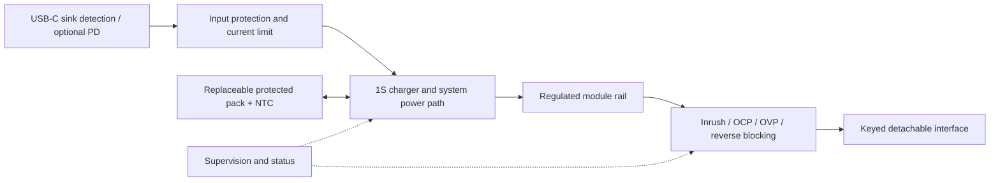

# DC Power Dock — research notes

Date: 2026-10-30. Status: research and architecture hypotheses; no component selection, hardware build, simulation, measurement, or compliance assessment completed.

## 1. What the existing concept establishes

The [clock concept](../README.md) assigns power, charging, energy monitoring, and protection to the dock. It explicitly leaves power, runtime, connector pin count, protocol, and module configuration open. It also keeps integrated AC/DC development separate from the initial external-DC prototype.

The supplied exploded rendering is useful industrial-design input: USB-C input, a replaceable 1-cell pack, NTC, power PCB, insulated pogo carrier, metal enclosure, and screw access. Its dimensions, contact count, battery fit, thermal performance, and power capacity are hypotheses. The diagram does not establish an electrical design.

The user's clarification confirms the first load to characterize is the basic clock core plus display. Portability means moving the assembled clock around for several hours. The exact runtime, load mode, and environmental conditions remain to be specified.

## 2. Findings that change the plan

### USB-C is an input interface, not a power guarantee

A Type-C sink uses CC termination and detection. Available current depends on the source advertisement; a connector and fixed sink resistors do not establish that 3 A is available. Type-C can advertise 1.5 A or 3 A at 5 V without PD. Higher-voltage operating profiles require a suitable PD negotiation path. The controller must translate the detected advertisement or contract into the charger's input-current limit. Treat unsupported sources as a defined reduced-power or refusal state. [TI Type-C primer, especially pp. 2–4](https://www.ti.com/lit/wp/slyy109b/slyy109b.pdf)

For an initial sink-only implementation, TUSB320 illustrates CC current detection through GPIO/I²C; it is not a PD negotiator. A PD architecture could instead evaluate a standalone sink controller such as STUSB4500, whose configured profiles can negotiate without an application MCU. These are reference candidates, not a chosen BOM. Controller configuration, power switching, dead-battery startup, and source fallback still require design and testing. [TI TUSB320](https://www.ti.com/product/TUSB320), [ST STUSB4500](https://www.st.com/en/interfaces-and-transceivers/stusb4500.html)

**Planning implication:** compare 5 V Type-C and a restricted PD input such as 9 V only after calculating system load plus charging demand. Do not promise full operation and fast charging on every USB port. Keep the USB-C port sink-only in the first dock; phone charging and role swapping add requirements outside the initial product.

### A charger with power path supports the intended operating modes

BQ25895 is a useful 1S reference: it has NVDC power-path management, input limits, battery-temperature sensing, and operation without a battery. This is evidence that the topology is feasible, not that the device meets NeoLab's as-yet-unknown load and thermal requirements. [TI BQ25895 product information](https://www.ti.com/product/BQ25895)

Its SYS node follows a battery-related voltage with a minimum regulation setting; it is not a regulated 5 V module output. Its dynamic power management reduces charging when the input limit is reached, then can draw battery supplement if input remains insufficient. Its battery boost/OTG operation has input-voltage conditions; that mode is not evidence of an independent 5 V output while simultaneously accepting USB input. [BQ25895 datasheet, §§8.2.5–8.2.6](https://www.ti.com/lit/ds/symlink/bq25895.pdf)

**Planning implication:** prototype a charger/power-path stage feeding a separately regulated module rail. Verify adapter-to-battery transitions at the module terminals. Account for the efficiency and heat of both conversion stages in adapter mode. If those losses are excessive, evaluate adapter bypass/power-mux alternatives; doing so adds handover and backfeed verification.

### Protection belongs at different boundaries

The battery and detachable module port have different fault cases. BQ2970 illustrates an independent 1-cell protector controlling external charge/discharge FETs for cell overvoltage, undervoltage, overcurrent, and short-circuit protection. Threshold variants and FETs must match the selected pack. [TI BQ2970](https://www.ti.com/product/BQ2970)

TPS25947 illustrates a separate port-protection class: back-to-back FETs, reverse-current blocking, controlled slew, current limiting/circuit breaking, and fault indication. Its family has different fault responses and overvoltage behaviors; its headline ratings do not select a safe variant or setting for a 5 V module. [TI TPS25947](https://www.ti.com/product/TPS25947)

**Planning implication:** distinguish cell protection, charger behavior, input protection, and module-port protection in schematics and tests. A regulated rail alone does not define safe operation when exposed contacts are bridged, a powered module backfeeds, or an input capacitor is hot-plugged. Use hardware limits that remain effective when application firmware crashes.

### Pogo contacts require a part-specific mechanical and electrical envelope

Mill-Max publishes examples with 2 A continuous/3 A peak ratings, 20 mΩ maximum contact resistance, and specified working stroke and spring force; its product range includes other ratings. Those numbers apply to the named contacts and conditions, not every pogo assembly. [Mill-Max spring-contact catalog](https://www.mill-max.com/sites/default/files/external/catalog/2021-02/023-028.pdf)

**Planning implication:** four contacts are still a hypothesis. Select the exact pin/pad pair, working compression, alignment tolerance, current derating, and retention before freezing the interface. Measure resistance and temperature across the assembled power-and-return loop after mating cycles and contamination exposure. Spring force also contributes to the mechanical force trying to separate the dock and clock.

## 3. Architecture options

These comparisons are engineering inferences from the concept and source capabilities above; no assembled option has been tested.

| Option | What it answers | Main cost or limitation | Proposed use |
|---|---|---|---|
| External 5 V source → protected regulated output; no battery | Basic load envelope, contact loss, mechanics, fault behavior | Does not prove portability or backup | Earliest bench experiment |
| 5 V Type-C sink → switching 1S charger/power path → regulated 5 V → protected output | One battery, moderate-complexity portable dock | High input current, two conversion stages while charging, limited charging headroom | First battery prototype if measured demand fits |
| PD sink, restricted accepted voltage profiles → 1S charger/power path → regulated output | More input headroom at lower cable current | Added PD configuration, fallback, voltage ratings, heat, and tests | Evaluate when load plus charge budget needs it |
| Higher-voltage/2S battery or higher-voltage module bus | Larger continuous power or lower distribution current | Different pack, charger, local regulators, protection, compatibility | Revisit only if 1S cannot meet requirements |

Recommended investigation order: start with the first option to measure the actual load and connector; evaluate the second against those results; add PD only when the power budget or cable losses justify it. Battery portability remains an intended product capability even though the first bench experiment can omit the pack.

The tentative 5 V rail is an investigation baseline, not a NeoVerse-wide electrical standard. If the selected core needs different input power, negotiate that requirement before freezing the ecosystem connector.

This is a functional diagram. It does not imply every protection function needs a separate IC. Evaluate selected parts, external components, and failure coverage as a complete circuit.

## 4. Calculations to run before selecting a pack or connector

All figures below are illustrative assumptions, not product targets or measurements.

For battery operation:

`I_battery ≈ P_modules / (V_battery × η_battery_to_port) + I_dock`

With a 5 V module rail, 3.0 V cell under load, and assumed 85% conversion efficiency:

| Output example | Output power | Battery current before dock overhead |
|---|---:|---:|
| 5 V × 1 A | 5 W | 1.96 A |
| 5 V × 2 A | 10 W | 3.92 A |
| 5 V × 3 A | 15 W | 5.88 A |

This is why a dock advertised as “only 2 A output” may need a battery, pack protector, connector, inductor, traces, and wiring that carry considerably more than 2 A. Evaluate peak current at the lowest operating cell voltage, including cell impedance and connector drop. The cutoff voltage must come from the actual pack and circuit; 3.0 V above is only a calculation point.

For adapter operation, use a power budget at one stated boundary:

`P_input_available = V_input_at_dock × I_allowed`

`P_input_required ≈ P_modules / η_input_to_port + P_charge_at_pack / η_input_to_pack + P_dock`

For an illustrative 5 V/3 A source (15 W at the dock), 10 W output at 85% path efficiency uses about 11.76 W. Charging at 4.0 V × 0.5 A with 90% assumed charge-path efficiency adds about 2.22 W, leaving about 1.01 W for dock overhead and margin before cable/source variation. Raising charge current to 1 A would exceed that example budget. Use worst-case power at the dock, not adapter-label power.

For runtime, begin with:

`t ≈ E_pack_usable × η_battery_to_port / (P_modules_average + P_dock_equivalent)`

A nominal 3.7 V/5 Ah pack contains 18.5 Wh by label arithmetic. With 85% conversion efficiency and an assumed usable-energy/derating factor of 80%, the example delivers 12.58 Wh before other overhead: about 6.29 h at 2 W, 2.52 h at 5 W, or 1.26 h at 10 W. This is not a selected battery or a runtime promise. Nominal energy, usable energy, and delivered energy must be kept separate. Replace the assumptions with pack discharge curves, temperature/aging derating, and measured system modes.

The provisional 5 V/2 A (10 W) bench ceiling used elsewhere in this planning package is a test envelope to investigate, not a rated product output. Several hours of portable use may require a lower measured average load, more battery energy, or both.

For the detachable connector:

`ΔV = I × R_loop`, `P_contact = I² × R_loop`

At an illustrative 2 A and 100 mΩ total power-and-return contact resistance, the connector loses 0.2 V and dissipates 0.4 W. Include switches, PCB, cable, and module input tolerance in the voltage budget. Parallel contacts need validated current sharing and behavior when one contact fails to mate.

## 5. What to measure first

1. Record core/display load in standby, normal display, maximum brightness, startup, radio bursts, and audio peaks where applicable. Until hardware exists, use a declared electronic-load profile and identify it as a surrogate.
2. Measure efficiency and temperature at full/low cell voltage, adapter limits, and simultaneous system load plus charging. Converter input/switch ratings are not guaranteed module output ratings.
3. Observe output voltage at the module, input voltage/current, battery voltage/current, and reset/power-good during input removal/restoration, insertion/removal, contact bounce, and weak-source operation.
4. Verify controlled refusal or derating when a source, pack, connector, or temperature cannot support requested power. Sustained battery supplement must not silently imply indefinite adapter operation.
5. Check charger and protection defaults before MCU configuration, watchdog expiry, MCU reset, battery removal, NTC disconnection/short, and deep-discharge recovery. A power policy must be safe before normal application firmware starts.

## 6. Battery and release evidence to plan

IEC 62133-2 covers safe operation of portable sealed secondary lithium cells and batteries under intended use and foreseeable misuse. Obtain the actual pack's manufacturer data, applicable evidence, charging envelope, connector/polarity, temperature limits, and traceable identity. A component or cell certificate does not establish compliance of the assembled dock. Confirm the applicable edition and final product scope with the selected test partner. [IEC 62133-2 scope](https://webstore.iec.ch/en/publication/32662)

UN 38.3 concerns transport testing, distinct from runtime/product validation. Obtain a test summary traceable to the actual battery design. UNECE publishes Revision 8 and Amendment 1; the transport route, packaging, battery configuration, and destination determine the release assessment. PHMSA provides a practical official explanation of test summaries, but US guidance alone does not settle Vietnamese or international shipment obligations. [UNECE manual](https://unece.org/transport/dangerous-goods/rev8-files), [PHMSA test summaries](https://www.phmsa.dot.gov/training/hazmat/new-un-requirement-test-summaries)

Before commercial release, record intended markets and have the relevant lab determine electrical/product safety, EMC, materials/environmental, labeling, and battery-transport obligations. This is a planned applicability review; no compliance or certification claim is made here.

## 7. Decisions still needed

- Actual core/display/module load envelope and allowed module-side voltage range.
- Continuous and peak port power, peak duration, allowed capacitance, and startup sequence.
- Exact several-hour runtime and recharge-time targets under named basic-clock load and ambient conditions; expanded-module runtime remains separate.
- Adapter inclusion, supported USB sources/cables, and reduced-power behavior.
- Pack chemistry/model, service method, permitted replacements, and thermal envelope.
- Number of direct outputs, downstream distribution ownership, and behavior if multiple powered modules are connected.
- Mechanical envelope, contact rating/derating, cost target, intended markets, and production quantity.

Freeze those decisions before a schematic/BOM review can credibly select parts. Current official component pages establish candidate capabilities; they do not establish availability, unit cost, assembled performance, or compatibility with NeoLab modules.
