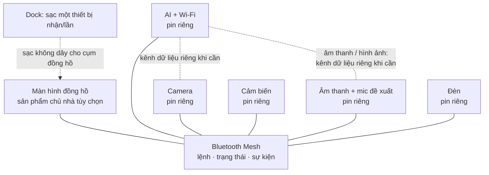

# NeoFilos — thiết kế lại hệ thống module

> **NeoCam:** Bắt đầu phát triển module camera từ XIAO ESP32S3 Sense đã có. Xem [hình concept, đặc điểm và kế hoạch chuẩn bị NeoCam](../neocam/README.md). Pin riêng, nam châm, pogo và kết hợp module là mục tiêu cần kiểm chứng; nguyên mẫu đầu bắt đầu bằng xem hình qua Wi-Fi.

> **Ý tưởng bổ sung:** [Tấm lưng tích hợp vùng sạc điện thoại không dây có định vị từ tính](assets/neofilos-rear-wireless-phone-charging-v1.png), đồng thời hướng tới sạc module qua pogo. Vùng này cần bộ phát không dây riêng, nguồn USB-C phù hợp, quản lý công suất, nhiệt và kiểm tra an toàn; mặt kim loại trong hình chỉ minh họa, cần vật liệu/kết cấu phù hợp cuộn dây. Tương thích điện thoại, căn chỉnh, khả năng giữ từ, sạc đồng thời và độ ổn định chân đỡ cần kiểm chứng; không khẳng định sạc được mọi điện thoại.

> **Điều chỉnh mới nhất:** Thay thanh sạc nằm trên bàn bằng [tấm sạc mỏng gắn sau các module khi đồng hồ vẫn đứng](assets/neofilos-rear-charging-plate-v1.png). Tấm nhận nguồn USB-C, cấp điện qua các cặp pogo tới nhiều module cùng lúc; mỗi module có hai tiếp điểm sạc phía sau. Hình chỉ minh họa ý tưởng: vị trí, số chân và khả năng tiếp cận các module hai bên chưa khớp yêu cầu và cần thiết kế lại; cách đứng và tấm sạc phải phối hợp về cơ khí. Các mô tả thanh sạc, dock và adapter cũ phía dưới là lịch sử.

> **Định hướng mới nhất:** Bỏ dock sạc và adapter đặt trên dock; thay bằng [thanh sạc USB-C cho nhiều module](assets/neofilos-charging-bar-v1.png). Mỗi module có hai tiếp điểm sạc phía sau; thanh có các cặp pogo pin tương ứng và hướng tới sạc nhiều module đồng thời. Cổng USB-C trên thanh là đầu vào nguồn. Nam châm giúp định vị; giao tiếp vẫn không dây. Số vị trí và công suất thực tế chưa chốt; các mô tả dock và adapter phía dưới là lịch sử cần cập nhật. Mạch sạc trong từng module, bảo vệ, giới hạn dòng, nguồn USB-C và tổng tải cần thiết kế và kiểm chứng.

Ngày: 2026-10-31. Trạng thái: **concept và mục tiêu thiết kế; chưa phải sản phẩm đã được thử nghiệm.**

**Cập nhật concept:** Các module có pin riêng cần được bố trí đủ không gian cho pin, mạch và vỏ; kích thước phải xác định sau khi chọn linh kiện. Ưu tiên nghiên cứu nam châm để giữ module về mặt cơ khí, còn giao tiếp giữa module dùng kết nối không dây. Nam châm không tự cấp điện hay sạc pin. Xem [hình concept hệ thống mới](assets/neofilos-system-concept-v2.png); kích thước và kết cấu trong hình chỉ minh họa, chưa kiểm chứng.

NeoFilos là hệ thống các module có thể tự hoạt động và phối hợp để tạo ra những trải nghiệm mới. Cấu hình đồng hồ để bàn và dock trong [concept v7](approved-concept.md) là một cách sử dụng NeoFilos, không phải điều kiện bắt buộc để mọi module hoạt động.

## 1. Quyết định và mục tiêu sản phẩm

1. Tên sản phẩm: **NeoFilos**.
2. Mỗi module chức năng có **pin sạc riêng**, có thể tháo ra và sử dụng độc lập. Dung lượng, thời lượng, cách thay và cách sạc từng module chưa chốt.
3. Các module trao đổi lệnh, sự kiện và trạng thái qua **Bluetooth Mesh trên BLE**.
4. **Bất kỳ hai module chức năng nào trong danh mục được hỗ trợ đều có ít nhất một trải nghiệm có ích khi kết hợp.** Với năm module hiện có, điều này tạo thành 10 cặp cần thiết kế và kiểm chứng. AI + âm thanh là một ví dụ: loa AI.
5. Sau khi được thiết lập và cấp quyền, mục tiêu là cặp module có thể chạy kịch bản của mình mà không cần gắn vào đồng hồ hay dock, và không cần điện thoại duy trì kết nối. Chức năng phụ thuộc dịch vụ đám mây vẫn cần Internet; kịch bản offline phải được định nghĩa riêng.
6. Ngoại hình v7 tiếp tục là mốc: màn hình chữ nhật, ba module phía trên, hai bên như hai tai và dock nhỏ với chân đỡ ẩn. Việc cơ khí gắn/nối module phải được thiết kế và thử nghiệm.

## 2. Các thành phần đề xuất

| Thành phần | Công dụng độc lập dự kiến | Khi gắn với hệ đồng hồ |
|---|---|---|
| **AI + Wi-Fi** | Xử lý tác vụ AI hoặc kết nối dịch vụ, tùy nền tảng; có nút/chỉ báo trạng thái dự kiến. | Phối hợp với các module và ứng dụng trên màn hình. Không gộp loa hay microphone vào module này. |
| **Camera** | Chụp/ghi và lưu hình khi có điều khiển, bộ nhớ phù hợp. Có chỉ báo và màn che vật lý dự kiến. | Hiển thị hình trên màn hình khi có đường truyền hình phù hợp. |
| **Cảm biến môi trường** | Đo và báo điều kiện môi trường. Chọn tổ hợp ánh sáng, nhiệt độ, độ ẩm sau. | Chia sẻ số đo với màn hình và module khác. |
| **Âm thanh** | Phát âm báo/âm thanh; đề xuất thêm microphone để sử dụng giọng nói và nút tắt mic. Nguồn âm thanh và giao thức cần chọn. | Thêm âm thanh và khả năng tương tác bằng giọng nói. |
| **Đèn** | Đèn cá nhân, điều khiển bằng nút tại chỗ. | Chiếu sáng hoặc hiển thị trạng thái theo kịch bản. |
| **Cụm màn hình đồng hồ** | Hiển thị đồng hồ và giao diện. Nguồn, pin và khả năng dùng độc lập của riêng cụm này cần thiết kế. | Là sản phẩm chủ nhà tùy chọn; không phải bộ điều khiển duy nhất của toàn hệ. |
| **Dock** | Pin dự phòng và sạc luân phiên theo đặc điểm dock đã ghi nhận. | Cấp điện không dây cho bộ nhận của cụm đồng hồ khi đặt đúng vị trí. |

Các chức năng độc lập ở đây là mục tiêu; cần chọn nút, chỉ báo, bộ nhớ và phần cứng cụ thể để hiện thực. Tái sử dụng sang robot, đèn bàn hay sản phẩm NeoVerse khác là hướng mở rộng, tùy giao diện và tính năng sản phẩm chủ nhà.

## 3. Kiến trúc chức năng

Hình trên là mô hình chức năng, không hàm ý một bộ điều khiển Mesh nằm giữa. Các module đã vào cùng mạng và ở trong phạm vi vô tuyến có thể trao đổi trực tiếp; chuyển tiếp chỉ cần khi kịch bản và mạng yêu cầu.

**Phân biệt ba việc:** BLE Mesh mang thông điệp điều khiển; pin của mỗi module cấp điện cho chính module đó; âm thanh/hình ảnh liên tục cần đường dữ liệu khác được chọn và kiểm chứng, chẳng hạn Wi-Fi cục bộ hoặc USB nếu thiết kế có hỗ trợ. Wi-Fi cục bộ không nhất thiết cần Internet. Không mặc định dock, Mesh hay màn hình tự chuyển năng lượng hoặc luồng media giữa các module. Bluetooth SIG xác nhận Mesh tối ưu cho thông điệp nhỏ, không dành cho phát nhạc trực tuyến ([FAQ Bluetooth Mesh](https://www.bluetooth.com/learn-about-bluetooth/feature-enhancements/mesh/mesh-faq/)).

## 4. Mười tổ hợp hai module cần đạt

Đây là các kịch bản **đề xuất**, chưa xác nhận phần cứng hoặc phần mềm đã tồn tại. Mỗi cặp chạy sau khi được thiết lập, với điều kiện pin còn đủ và hai module trong phạm vi liên lạc.

| Cặp | Trải nghiệm dự kiến | Điều kiện kỹ thuật chính |
|---|---|---|
| AI + âm thanh | **Loa AI**: nói câu hỏi, nhận câu trả lời bằng giọng nói. | Mic trong module âm thanh là đề xuất; cần đường truyền âm thanh riêng, xử lý nhận dạng/tổng hợp tiếng nói. Nếu AI chạy cloud thì cần mạng và Internet; AI cục bộ cần phần cứng và mô hình phù hợp. |
| AI + camera | **Camera AI** phân tích hình và báo trạng thái/kết quả qua chỉ báo của module AI. | Truyền ảnh qua kênh dữ liệu riêng; năng lực AI, loại nhận diện, quyền riêng tư và thời gian phản hồi cần xác định. |
| AI + cảm biến | **Trợ lý môi trường**: phân tích số đo và báo trạng thái. | Số đo qua Mesh; cách cấu hình, khả năng AI và chỉ báo kết quả trên module cần thiết kế. |
| AI + đèn | **Đèn thông minh**: AI thực thi quy tắc hoặc lịch đã thiết lập để điều khiển đèn. | Mesh mang lệnh; cách nhập yêu cầu/cấu hình phải có sẵn. Giọng nói cần microphone phù hợp, không có sẵn trong cặp này. |
| Camera + âm thanh | **Camera cảnh báo**: phát âm khi camera phát hiện sự kiện. | Camera phải có khả năng phát hiện sự kiện cục bộ; loa có âm báo lưu sẵn. |
| Camera + cảm biến | **Camera chụp theo điều kiện**: cảm biến vượt ngưỡng thì camera chụp ảnh. | Quy tắc ngưỡng; camera có chức năng lưu và truy xuất ảnh. |
| Camera + đèn | **Đèn hỗ trợ chụp**: camera yêu cầu đèn bật trước khi chụp. | Camera chờ xác nhận trạng thái đèn; độ trễ và ánh sáng thực tế cần thử. |
| Cảm biến + âm thanh | **Bộ cảnh báo môi trường**: phát âm báo khi vượt ngưỡng. | Cảm biến thích hợp, ngưỡng đã cấu hình và loa có âm báo lưu sẵn. |
| Cảm biến + đèn | **Đèn tự động**: trời tối thì đèn bật. | Cảm biến ánh sáng, ngưỡng và quy tắc điều khiển qua Mesh. |
| Âm thanh + đèn | **Đèn báo hoạt động âm thanh**: đổi trạng thái khi loa phát hoặc dừng. | Loa phát sự kiện trạng thái qua Mesh; chưa cam kết nhấp nháy đồng bộ nhạc. |

Các kịch bản chỉ dùng quy tắc và tín hiệu Mesh có mục tiêu hoạt động offline sau khi thiết lập. Đối với các cặp có AI, phải chỉ rõ từng chức năng chạy cục bộ hay cần Internet; không suy ra mọi khả năng AI đều offline.

## 5. Làm sao để hai module thực sự kết hợp?

1. **Gia nhập mạng an toàn:** cần cơ chế provisioning/cấp khóa và cấu hình quyền. Ứng dụng điện thoại có thể là một phương án cho lần đầu; chưa quyết định bộ provisioner hay cách ghép khi không có điện thoại. Module từ hai mạng khác nhau không mặc nhiên tự ghép.
2. **Mô tả khả năng:** mỗi module công bố loại, chức năng, phiên bản giao thức và trạng thái sẵn sàng. Ví dụ loa công bố khả năng phát cảnh báo; cảm biến công bố loại số đo.
3. **Cấu hình trải nghiệm:** quy định ai gửi sự kiện, ai nhận lệnh, ngưỡng và cách người dùng kích hoạt. Mesh tự nó không tạo ra ứng dụng hay hiểu ý nghĩa module.
4. **Duy trì sử dụng:** sau thiết lập, mục tiêu các cặp hoạt động không cần dock, màn hình hay điện thoại luôn kết nối; hệ thống phải báo rõ mất kết nối, hết pin, từ chối quyền hoặc phiên bản không tương thích.
5. **Tiết kiệm pin:** chọn chế độ ngủ/đánh thức theo từng module. Nếu dùng Low Power node, cần tính vai trò Friend và kiểm tra độ trễ; không mặc định cả hai module ngủ mà vẫn phản ứng tức thời.

Tham khảo [Bluetooth Mesh primer](https://www.bluetooth.com/bluetooth-mesh-networking-primer/) về provisioning, bảo mật và các vai trò Relay, Proxy, Friend, Low Power.

## 6. Nguồn điện và giới hạn dock

**Phương án adapter đang nghiên cứu:** [NeoFilos Charging Adapter](assets/neofilos-charging-adapter-v1.png) đặt lên mặt sạc không dây của dock, nhận điện qua bộ thu không dây rồi cấp điện cho **một module mỗi lần** qua tiếp điểm pogo. Nam châm và cơ cấu định hướng giữ đúng vị trí; pogo chỉ cấp nguồn, giao tiếp giữa các module vẫn không dây. Module cần tiếp điểm tương ứng và mạch quản lý sạc pin riêng. Điện áp, dòng, chuẩn tương thích, số tiếp điểm, cách chống chập, nhiệt và vị trí nam châm cần thiết kế và kiểm chứng; hình là concept, không xác nhận tiếp điểm đã khớp. Chưa chốt khả năng sạc các module không có giao diện tương thích.

- Mỗi module chức năng cần một hệ pin riêng gồm cell, mạch sạc, bảo vệ, đo/báo pin và chiến lược tiêu thụ phù hợp. Hình thức sạc từng module **chưa chốt**; USB-C riêng hoặc một giao diện sạc tương thích là các phương án cần so sánh. Không mặc định tất cả module đều có bộ nhận sạc không dây.
- Dock vẫn theo [danh sách đặc điểm dock](dc-power-dock/product-features.md): **một thiết bị nhận điện bên ngoài tại một thời điểm**, chọn sạc không dây hoặc cổng USB-C đầu ra. Pin của dock có thể được sạc theo thiết kế quản lý nguồn; điều này không có nghĩa năm module được sạc cùng lúc.
- Mục tiêu đầu ra không dây tối đa **25 W** cho thiết bị nhận tương thích được giữ lại; điểm đo, chuẩn/profile, điều kiện đạt, tương thích điện thoại và tổn hao cần kiểm chứng. Công suất USB-C đầu ra chưa chốt.
- Cách cấp điện/sạc cho các pin module khi chúng gắn trên màn hình **chưa quyết định**. Khẳng định cũ rằng màn hình phân phối điện cho mọi module cần được xem xét lại; pin riêng không tự đảm bảo có thể sạc qua màn hình.
- Đo tải và lập ngân sách năng lượng riêng cho từng module, sau đó đo khi ghép cặp và khi cả cụm hoạt động. Thời lượng thực tế phụ thuộc mức tải, dung lượng, hiệu suất, tuổi pin và chế độ ngủ.

## 7. Ứng viên thử nghiệm: ESP32-S3

ESP32-S3 có thể là ứng viên phát triển cho node Bluetooth Mesh; Espressif cung cấp [ESP-BLE-MESH cho ESP32-S3](https://docs.espressif.com/projects/esp-idf/en/latest/esp32s3/api-guides/esp-ble-mesh/ble-mesh-index.html) cùng ví dụ và các vai trò Mesh. Đây chưa phải quyết định chọn IC cho tất cả module.

ESP32-S3 không hỗ trợ Bluetooth Classic hoặc LE Audio theo [tài liệu âm thanh của Espressif](https://docs.espressif.com/projects/esp-adf/en/latest/solution-center/bluetooth-audio.html); không thể chỉ chọn S3 rồi mặc định có loa Bluetooth A2DP hay LE Audio. Wi-Fi và BLE chia sẻ tài nguyên vô tuyến, cần thử đồng thời tải thực tế; [FAQ ESP-BLE-MESH của Espressif](https://docs.espressif.com/projects/esp-idf/en/latest/esp32s3/api-guides/esp-ble-mesh/ble-mesh-faq.html) hiện nêu Wi-Fi station mode cho coexistence, nên không tự giả định mọi chế độ điểm phát đều được hỗ trợ. Năng lực chạy AI, bộ nhớ, camera và độ trễ phải đánh giá theo tác vụ.

## 8. Lộ trình kiểm chứng đề xuất

1. **Chốt trải nghiệm và giao diện:** xác định 10 kịch bản, hành vi độc lập, phạm vi offline, các nút/chỉ báo và quy trình sở hữu, ghép, tháo, reset.
2. **Prototype giao tiếp dễ đo:** hai board làm cảm biến + đèn; thử provisioning, lệnh, kết nối lại, ngưỡng, pin và hoạt động không có điện thoại sau cấu hình.
3. **Prototype loa AI:** xác định mic, âm thanh hai chiều, kênh dữ liệu, mô hình AI cục bộ/cloud, thời gian phản hồi và riêng tư; kiểm tra đúng điều kiện hai module.
4. **Mở rộng đủ 10 cặp:** kiểm tra từng cặp chỉ với hai module; kiểm tra phiên bản không tương thích, hết pin, mất sóng và cách khôi phục. Định lượng tiêu chí đạt sau khi yêu cầu thời lượng, khoảng cách và độ trễ được chốt.
5. **Tích hợp màn hình và dock:** kiểm tra lắp/tháo, trải nghiệm v7, các chế độ cấp/sạc, giới hạn một thiết bị nhận và nhiệt; kiểm tra không giả định các module được sạc đồng thời.

**Các lựa chọn còn mở:** pin và phương án sạc từng module; bản chất AI và tính năng offline; kênh audio/video; cơ chế ghép mạng ban đầu; giao diện cơ khí, quyền riêng tư, tuổi pin, chi phí và thông số kiểm thử. Các module và cặp chỉ được coi là đạt khi có bằng chứng thử nghiệm tương ứng.
