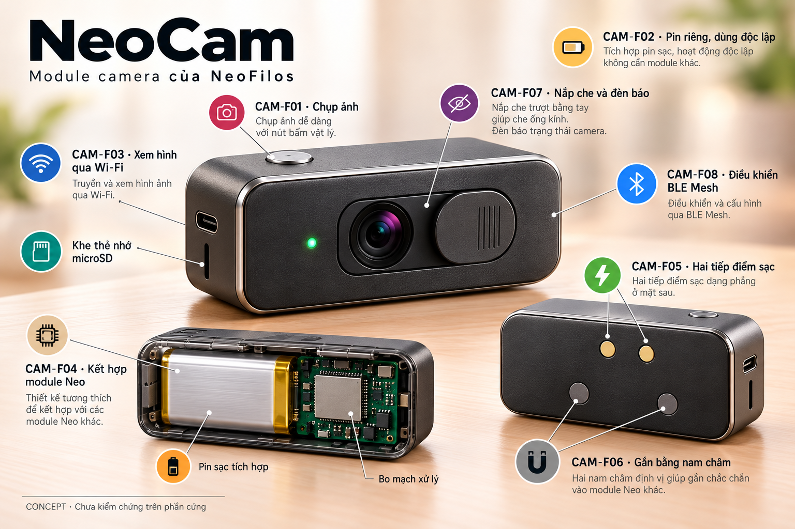
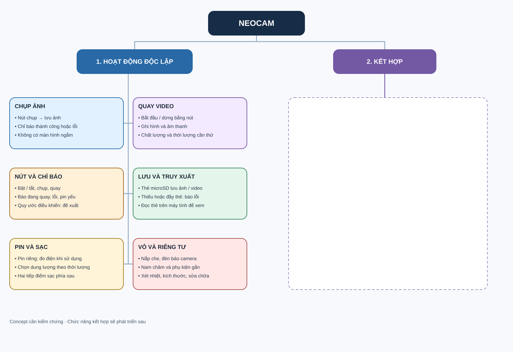

# NeoCam

NeoCam là module camera của NeoFilos, hướng tới chụp ảnh, quay video có âm thanh, dùng độc lập bằng pin riêng, gắn bằng nam châm và kết hợp với các module Neo. Nguyên mẫu đầu tiên bắt đầu từ **Seeed Studio XIAO ESP32S3 Sense mà người dùng đã có**. Ưu tiên hiện tại là giá thấp và kiểm chứng từng chức năng trên board trước khi làm PCB, pin và vỏ riêng.

Ngày cập nhật: **2026-11-06**. Trạng thái: **có hồ sơ và sơ đồ nguồn v0.6, thêm phân tích buck3V3/ESP/SD/bộ nhớ, giữ stock SGM/L/C; chưa sửa kit thật, chưa có PCB được duyệt sản xuất**.

**V0.6 giữ SGM6029C/L4/mạng tụ stock, không thêm tụ bulk3V3.** [Thiết kế buck3V3](buck-3v3-design.md) tính headroom, miền Q/C và kiểm tra riêng nguồn ESP, SD sau ferrite, VDD_SPI. Với VIN3,541667V kế thừa từ mux và ngân sách Rsum0,5Ω/tải600mA, khả năng DC tính được3,241667V; **chưa chứng minh giữ đúng3,3V hoặc không reset**. Miền chân tải3,11275–3,476V chỉ đạt nếu baseline/Ceff/điện lượng và các allowance đã chọn đều đúng; chúng chưa phải đặc tính stock đã xác nhận.

Đường chọn nguồn kế thừa **v0.5: TPS2121RUXR thay Q1/D2**, không lắp QM1/R6 v0.4; giữ R9/charger. [Thiết kế chuyển nguồn USB/pin](usb-battery-switchover-design.md) lưu XCOMP, ILIM80k, SS1µF và ba tụ330µF/10V **ở VIN trước buck**. Ceff>=750µF, ESR<=15mΩ, IN2 có tải>=3,8V cùng các bound gap/dòng ngược cho floor SYS3,541667V có điều kiện. Bài tính [Q1 v0.4](q1-design-decision.md) là lịch sử. Yêu cầu45phút vẫn chưa được chứng minh.

**Bắt đầu đọc tại [hồ sơ thiết kế nguồn NeoCam](power-design-review.md)**: mục tiêu hiện tại, các phép tính, lựa chọn pin/PCM và linh kiện, sơ đồ KiCad, kết quả kiểm tra và tồn đọng. Chế độ ưu tiên là quay độc lập có tiếng45phút, Wi-Fi/BLE tắt; chế độ vừa quay vừa xem trước Wi-Fi giữ ngân sách riêng.

[Ảnh đầy đủ](assets/neocam-features-v1.png) · [Prompt và thông tin tạo hình](assets/neocam-features-v1.json)

Ảnh minh họa thiết kế sản phẩm, không phải ảnh board XIAO hay bản vẽ chế tạo. Kích thước, nội thất, nắp che, nút, đèn và vị trí tiếp điểm cần được thiết kế theo phần cứng thật.

## Mind map NeoCam

Sơ đồ có hai nhánh: **hoạt động độc lập** và **kết hợp**. Nhánh kết hợp để trống để phát triển sau. Các chức năng độc lập là mục tiêu cần kiểm chứng; việc xem ảnh/video vẫn cần thiết bị có màn hình.

[Mở tệp draw.io để chỉnh sửa](assets/neocam-standalone-mindmap.drawio) · [Bản SVG có dữ liệu sơ đồ](assets/neocam-standalone-mindmap.drawio.svg)

Sau khi sửa tệp `.drawio`, hãy xuất lại SVG và bật **Include a copy of my diagram** để ảnh xem trước trên GitHub khớp với bản chỉnh sửa.

## Hồ sơ phát triển

| Tài liệu | Nội dung |
|---|---|
| [Hồ sơ thiết kế nguồn để đọc và duyệt](power-design-review.md) | Tài liệu tổng hợp hiện hành v0.6; mục tiêu, kiến trúc, phép tính, lựa chọn và tồn đọng. |
| [Thiết kế buck3V3 v0.6](buck-3v3-design.md) | Giữ stock SGM/L/C; tính dropout, Q/C, cửa sổ tại tải và những dữ kiện còn thiếu để kết luận no-reset. |
| [Phép tính buck JSON](design-output/buck-3v3-calculations.json) | Số học bằng [script buck](tools/calculate-buck-3v3.py); [audit nguồn](references/buck-3v3-source-audit-2026-11-06.md) phân biệt thông số hãng và điều kiện khảo sát. |
| [Thiết kế chuyển nguồn USB/pin](usb-battery-switchover-design.md) | TPS2121 thay Q1/D2, tụ giữ nguồn, miền tải/điện áp, startup và giới hạn bằng chứng. |
| [Phép tính chuyển nguồn JSON](design-output/source-switchover-calculations.json) | Số học tái lập bằng [script tính](tools/calculate-source-switchover.py), kết quả mô hình đọc bằng [script riêng](tools/read-source-switchover-model.py). |
| [BOM hiện hành v0.6](neocam-power-v0/bom-reference-v0.6.csv) | Linh kiện và trạng thái lựa chọn; stock buck/L/C không phải linh kiện mua thêm; chưa phê duyệt mua/sản xuất. |
| [Quyết định thay Q1 v0.4](q1-design-decision.md) | Lịch sử so sánh sụt áp/nhiệt và phương án DMP2035U; không phải đường nguồn hiện hành. |
| [Sơ đồ nguồn KiCad](neocam-power-v0/README.md) | Mạch phụ trợ XIAO, [trang mux](neocam-power-v0/neocam-power-mux-v0.6.kicad_sch), [trang buck/SD](neocam-power-v0/neocam-power-3v3-v0.6.kicad_sch), MAX17048/nút/LED và điểm truy cập nguồn. |
| [Ngân sách quay độc lập có tiếng](standalone-recording-power-budget.md) | Cây nguồn, dòng tham chiếu có điều kiện và liên kết phép tính tổng hợp. |
| [Hành vi quay thường độc lập](standalone-normal-recording-behavior.md) | Nhấn quay/dừng, hoàn tất tệp, lỗi lưu và xử lý pin yếu. |
| [Bài toán quay video độc lập có âm thanh](standalone-video-audio-problem.md) | Yêu cầu đang xét, bài toán nguồn, dữ liệu cần xác định và giới hạn bằng chứng. |
| [Đọc mạch nguồn XIAO ESP32-S3 Sense](xiao-esp32s3-power-circuit.md) | Sơ đồ nguồn và sạc V1.51 của Seeed, cách tính dòng sạc và các thông số nguồn còn mở. |
| [Phân tích pin 1S, PCM và điện áp tối thiểu](battery-pcm-voltage-analysis.md) | Cách đối chiếu cell/PCM, các bài tính bảo vệ và sụt áp, giới hạn điện áp và các thông số còn mở. |
| [Đánh giá OV3660 qua Wi-Fi](ov3660-wifi-quality-evaluation.md) | Thông số sensor có nguồn và cách xác định chất lượng stream thực tế. |
| [Phân tích OV3660 → ESP32-S3 → Wi-Fi](esp32s3-ov3660-wifi-analysis.md) | Đường dữ liệu, giới hạn datasheet, số liệu Espressif và phép tính băng thông. |
| [Đặc điểm NeoCam](product-features.md) | Tám đặc điểm CAM-F01 đến CAM-F08, phạm vi thử nghiệm và các ý tưởng mở rộng. |
| [Kế hoạch chuẩn bị và phát triển](development-plan.md) | Vật tư, trình tự thử, tiêu chí kiểm chứng, đo pin và hồ sơ cần lưu. |
| [Kiến trúc NeoFilos](../modular-desk-clock/neofilos-system-design.md) | Quan hệ giữa các module và lịch sử thiết kế hệ thống. |

## Nền tảng nguyên mẫu

**Framework phát triển: ESP-IDF ngay từ nguyên mẫu đầu**, theo lựa chọn của người dùng. Firmware camera dùng component `espressif/esp32-camera`; cùng nền tảng ESP-IDF cho Wi-Fi, microSD và BLE Mesh. Phiên bản ESP-IDF, component và cấu hình board sẽ được ghi lại khi chuẩn bị môi trường.

Theo [Seeed Studio](https://wiki.seeedstudio.com/xiao_esp32s3_getting_started/), bản Sense có ESP32-S3, 8 MB PSRAM, 8 MB Flash, camera, microphone số và khe microSD. Có USB-C và hỗ trợ pin sạc phù hợp. Những khả năng này cần firmware và cấu hình đúng để trở thành chức năng NeoCam.

Người dùng đã xác nhận camera **OV3660**, bo mở rộng v1.1 và microSD SanDisk Ultra32GB. Mô hình tính dùng sơ đồ bo mở rộng v1.2 theo quyết định của người dùng; sơ đồ bo chính V1.51 vẫn là tham chiếu chưa xác nhận tương đương với bo thật. Việc thu âm bằng microphone trên board và ghi đồng thời với hình cần được kiểm chứng. Module loa là module riêng.

## Nguyên tắc thiết kế

- **Hình ảnh qua Wi-Fi; lệnh và trạng thái qua BLE Mesh.** Bắt đầu xem hình bằng trình duyệt trên máy tính hoặc điện thoại, sau đó mới tích hợp màn hình NeoFilos.
- **Pin riêng, dùng độc lập:** bản dùng độc lập cần thao tác tại chỗ và cách lưu/truy xuất ảnh. Mục tiêu này chưa được kiểm chứng chỉ bằng demo USB.
- **Giao diện gắn và giao diện sạc:** nam châm giữ cơ khí; hai tiếp điểm phẳng sau lưng module nhận điện từ pogo trên tấm sạc. Không truyền ảnh qua pogo.
- **Dễ bảo trì, ưu tiên rẻ:** bố trí vỏ có thể mở, nghiên cứu thay pin, giữ khoảng trống cho antenna và nhiệt; dùng board có sẵn để tránh mua lặp trước khi đo.
- **Giá:** yêu cầu ngân sách trước đó “1 triệu cho 5 bộ” còn cần xác định phạm vi. Chưa phân bổ một giá trần riêng cho NeoCam và chưa có BOM sản xuất. Khi lập BOM phải ghi cả chi phí tăng thêm với board đã có và chi phí làm lại một NeoCam hoàn chỉnh.

## Chuẩn bị nguyên mẫu

Bài toán hiện đang xét là [quay video độc lập có âm thanh và hệ thống nguồn cho chế độ đó](standalone-video-audio-problem.md). Các bước chuẩn bị board dưới đây chưa phải bằng chứng rằng chức năng này đã hoạt động.

Kiểm tra đúng board/camera/antenna và cáp USB dữ liệu, ghi phiên bản ESP-IDF, thiết lập target `esp32s3` và PSRAM đúng board, rồi nạp chương trình đọc thông tin camera. Dùng [component camera chính thức của Espressif](https://github.com/espressif/esp32-camera) để chụp ảnh, sau đó thêm xem hình qua Wi-Fi nội bộ; đối chiếu pin map với [tài liệu XIAO của Seeed](https://wiki.seeedstudio.com/xiao_esp32s3_camera_usage/). Đầu ra đầu tiên là ảnh thật và log chạy; không cần chờ hệ đồng hồ hoàn chỉnh.
