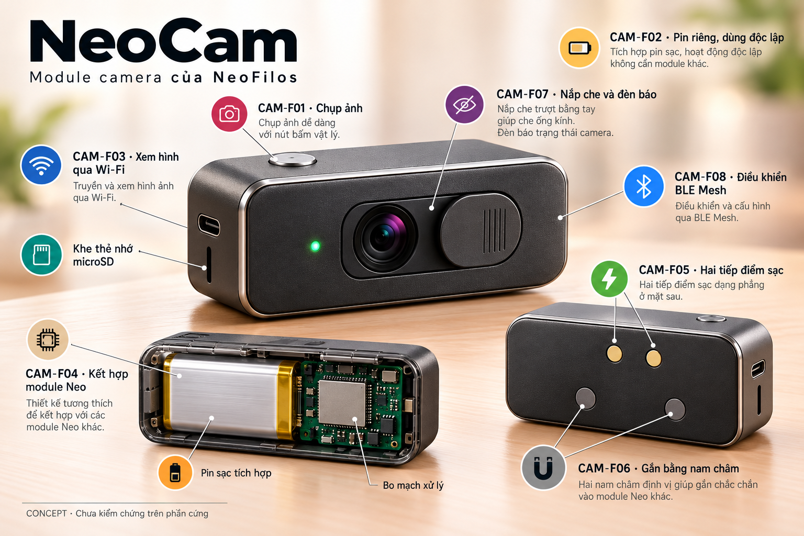

# NeoCam

NeoCam là module camera của NeoFilos, hướng tới chụp ảnh, dùng độc lập bằng pin riêng, gắn bằng nam châm và kết hợp với các module Neo. Nguyên mẫu đầu tiên bắt đầu từ **Seeed Studio XIAO ESP32S3 Sense mà người dùng đã có**. Ưu tiên hiện tại là giá thấp và kiểm chứng từng chức năng trên board trước khi làm PCB, pin và vỏ riêng.

Ngày cập nhật: **2026-10-31**. Trạng thái: **concept và kế hoạch chuẩn bị; chưa có kết quả chạy trên board trong hồ sơ này**.

[Ảnh đầy đủ](assets/neocam-features-v1.png) · [Prompt và thông tin tạo hình](assets/neocam-features-v1.json)

Ảnh minh họa thiết kế sản phẩm, không phải ảnh board XIAO hay bản vẽ chế tạo. Kích thước, nội thất, nắp che, nút, đèn và vị trí tiếp điểm cần được thiết kế theo phần cứng thật.

## Hồ sơ phát triển

| Tài liệu | Nội dung |
|---|---|
| [Đặc điểm NeoCam](product-features.md) | Tám đặc điểm CAM-F01 đến CAM-F08, phạm vi thử nghiệm và các ý tưởng mở rộng. |
| [Kế hoạch chuẩn bị và phát triển](development-plan.md) | Vật tư, trình tự thử, tiêu chí kiểm chứng, đo pin và hồ sơ cần lưu. |
| [Kiến trúc NeoFilos](../modular-desk-clock/neofilos-system-design.md) | Quan hệ giữa các module và lịch sử thiết kế hệ thống. |

## Nền tảng nguyên mẫu

**Framework phát triển: ESP-IDF ngay từ nguyên mẫu đầu**, theo lựa chọn của người dùng. Firmware camera dùng component `espressif/esp32-camera`; cùng nền tảng ESP-IDF cho Wi-Fi, microSD và BLE Mesh. Phiên bản ESP-IDF, component và cấu hình board sẽ được ghi lại khi chuẩn bị môi trường.

Theo [Seeed Studio](https://wiki.seeedstudio.com/xiao_esp32s3_getting_started/), bản Sense có ESP32-S3, 8 MB PSRAM, 8 MB Flash, camera, microphone số và khe microSD. Có USB-C và hỗ trợ pin sạc phù hợp. Những khả năng này cần firmware và cấu hình đúng để trở thành chức năng NeoCam.

Camera trên các đợt board có thể khác nhau, gồm OV2640, OV3660 hoặc OV5640. Cần đọc sensor PID trên board đang có trước khi chốt độ phân giải, khả năng lấy nét và đặc tính tiêu thụ. Microphone có sẵn trên board không tự trở thành đặc điểm đã chốt của sản phẩm NeoCam; chức năng âm thanh chính vẫn thuộc module âm thanh riêng.

## Nguyên tắc thiết kế

- **Hình ảnh qua Wi-Fi; lệnh và trạng thái qua BLE Mesh.** Bắt đầu xem hình bằng trình duyệt trên máy tính hoặc điện thoại, sau đó mới tích hợp màn hình NeoFilos.
- **Pin riêng, dùng độc lập:** bản dùng độc lập cần thao tác tại chỗ và cách lưu/truy xuất ảnh. Mục tiêu này chưa được kiểm chứng chỉ bằng demo USB.
- **Giao diện gắn và giao diện sạc:** nam châm giữ cơ khí; hai tiếp điểm phẳng sau lưng module nhận điện từ pogo trên tấm sạc. Không truyền ảnh qua pogo.
- **Dễ bảo trì, ưu tiên rẻ:** bố trí vỏ có thể mở, nghiên cứu thay pin, giữ khoảng trống cho antenna và nhiệt; dùng board có sẵn để tránh mua lặp trước khi đo.
- **Giá:** yêu cầu ngân sách trước đó “1 triệu cho 5 bộ” còn cần xác định phạm vi. Chưa phân bổ một giá trần riêng cho NeoCam và chưa có BOM sản xuất. Khi lập BOM phải ghi cả chi phí tăng thêm với board đã có và chi phí làm lại một NeoCam hoàn chỉnh.

## Việc đầu tiên

Kiểm tra đúng board/camera/antenna và cáp USB dữ liệu, ghi phiên bản ESP-IDF, thiết lập target `esp32s3` và PSRAM đúng board, rồi nạp chương trình đọc thông tin camera. Dùng [component camera chính thức của Espressif](https://github.com/espressif/esp32-camera) để chụp ảnh, sau đó thêm xem hình qua Wi-Fi nội bộ; đối chiếu pin map với [tài liệu XIAO của Seeed](https://wiki.seeedstudio.com/xiao_esp32s3_camera_usage/). Đầu ra đầu tiên là ảnh thật và log chạy; không cần chờ hệ đồng hồ hoàn chỉnh.
