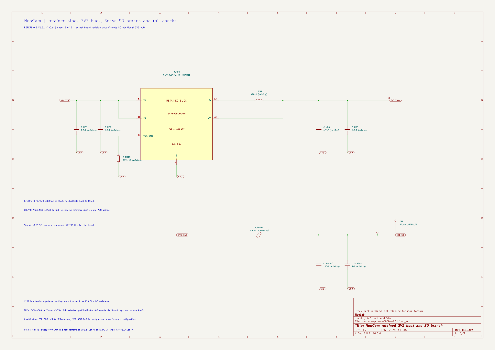

# NeoCam v0.6: buck 3,3 V khi chuyển USB/pin

Ngày **2026-11-06**. Nối tiếp [thiết kế chọn nguồn v0.5](usb-battery-switchover-design.md). Dùng mainboard **XIAO V1.51** và Sense **v1.2** làm mô hình; bo thật chưa được xác nhận tương đương hoàn toàn.

**Quyết định:** giữ **SGM6029CYG/TR, L4 và mạng tụ stock**, không thêm tụ bulk vào 3V3. Sơ đồ v0.6 tách buck và nhánh nguồn microSD ra trang riêng, bổ sung điểm truy cập 3V3 tại kit, SD sau ferrite và VDD_SPI. **Hiện chưa có đủ dữ liệu để khẳng định buck stock giữ ESP32/microSD không reset trên toàn miền đã đặt.** Phần DC có thể đáp ứng theo ngân sách trở dẫn; phần quá độ và các nguồn tại tải còn cần đóng các điều kiện cụ thể dưới đây.

Đây là kết luận thiết kế có căn cứ, không phải coi schematic/ERC sạch hoặc mô hình lý tưởng là bằng chứng phần cứng. Chưa hàn kit, thay linh kiện, nạp firmware hoặc đo thiết bị.

## 1. Mạch đang có và tải cần giữ nguồn

Từ [Seeed V1.51, trang 4](https://files.seeedstudio.com/wiki/SeeedStudio-XIAO-ESP32S3/new-res/202003753_XIAO%20ESP32S3%20Sense_V1.51_SCH_260611.pdf), buck stock dùng U3 SGM6029C, L4=470 nH; C3/C4 ở VIN là 2,2/4,7 µF; C5/C6 ở OUT mỗi tụ 4,7 µF. R13=249 kΩ 1% chọn mã 3,3 V lúc khởi động; đây **không phải cầu chia feedback**. EN nối VIN, VOS sense OUT; MODE trở về thấp nên dùng tự chuyển PSM/PWM.

```text
TPS2121 OUT ── VIN_SYS ── SGM6029 SW ── L4 ── 3V3_XIAO ── ESP32/các tải trên kit
                 │                           │          └── FB1 Sense ── VDD_SD
              3×330µF                     C5/C6                         └── microSD
                                             │
                                             └── VOS feedback

ESP32 VDD3P3_RTC ── đường cấp nội R_SPI ── VDD_SPI ── flash/PSRAM
```

Giữ ghi chú của Seeed: **600 mA là tổng rail 3V3 của bo**, gồm ESP/bộ nhớ, SD, mic và nhánh phụ trên rail. Đây là trần phân bổ thiết kế, chưa phải dòng tác vụ quay đã đo. Không cộng thêm 600 mA cho mỗi tải và không lấy khả năng 1 A của IC để nâng giới hạn cả bo.

| Điểm cần kiểm soát | Dải dữ liệu tham chiếu | Tiêu chí thiết kế hiện tại |
|---|---|---|
| Nguồn chính ESP32 tại chân tải | 3,0–3,6 V | **3,1–3,5 V**, có margin hai phía |
| VDD tại microSD sau FB1 | 2,7–3,6 V cho giao diện SD 3,3 V | **3,1–3,5 V**; còn cần đúng SKU SanDisk Ultra |
| VDD_SPI cấp flash/PSRAM loại 3,3 V đang tham chiếu | 2,7–3,6 V | Kiểm tra **riêng**, không suy từ điện áp buck |

Căn cứ nguồn ESP và đường R_SPI: [datasheet ESP32-S3, mục 5.2–5.3](https://www.espressif.com/sites/default/files/documentation/esp32-s3_datasheet_en.pdf) và [hướng dẫn Espressif](https://docs.espressif.com/projects/esp-hardware-design-guidelines/en/latest/esp32s3/schematic-checklist.html#digital-power-supply). Các tài liệu SD/flash/PSRAM và điều kiện cụ thể được dẫn trong [audit tải](references/buck-3v3-load-transient-audit-2026-11-06.md).

## 2. Buck có tiếp tục chạy khi VIN giảm không?

Kế thừa **toàn bộ điều kiện** của bài mux: VIN thấp nhất tính được là **3,541667 V**, khi IN2 thật ≥3,8 V dưới tải và các giới hạn gap/tụ/dòng ngược đều đạt. Không biến giá trị đó thành số đã đo.

Theo [SGM6029 Rev. A.1](https://www.sg-micro.com/rect/assets/3323f5dc-718f-4b81-b820-398ddb702989/SGM6029.pdf), buck làm việc trong 1,95–5,5 V và có chế độ duty 100%. VIN ở bound này cao hơn mức UVLO rising tối đa 1,95 V khoảng **1,592 V**. EN vẫn được kéo theo VIN. Vì vậy, theo mô hình điện áp vào đã đặt, **không cần coi buck tắt rồi khởi động lại trong 50 µs chuyển nguồn**.

Điều này chỉ giải quyết khả năng tiếp tục hoạt động, chưa giải quyết dropout và đáp ứng vòng điều khiển. Buck không nâng áp; gần duty 100%, đầu ra phụ thuộc điện trở high-side và cuộn cảm.

### 2.1. Tính dropout theo đường dẫn

Ở 100% duty, gần trạng thái DC:

\[
V_{OUT,available}\simeq V_{IN}-I_{3V3}(R_{HS}+R_L+R_{PCB,local}).
\]

Datasheet có RHS=185 mΩ typical/310 mΩ maximum tại **IOUT=100 mA và điều kiện bảng**, không phải maximum trực tiếp tại VIN=3,541667 V/600 mA. L4 trên schematic không có MPN/DCR. Vì vậy đặt **ngân sách nghiệm thu**, không gán giả thành thông số hãng:

| Phần | Ngân sách trở |
|---|---:|
| High-side tại tải/nhiệt/điện áp thực | ≤0,400 Ω |
| Cuộn cảm tại dòng/nhiệt thực | ≤0,080 Ω |
| Đường SW/L/OUT tới điểm sense | ≤0,020 Ω |
| Tổng | **≤0,500 Ω** |

\[
\Delta V_{DC}\le0,6(0,500)=0,300\ V.
\]

\[
\boxed{V_{OUT,available}\ge3,541667-0,300=3,241667\ V}
\]

**Không diễn giải kết quả này là luôn giữ đúng 3,300 V.** Muốn giữ 3,300 V ở 600 mA tại VIN thấp nhất, tổng trở cần ≤**0,402778 Ω**. Muốn còn khả năng giữ mép baseline 3,234 V, tổng trở cần ≤**0,512778 Ω**. Ngân sách 0,5 Ω chỉ cao hơn mép đó khoảng **7,67 mV**, nên đây là một điều kiện chặt, không phải biên rộng đã chứng minh.

Baseline tải yêu cầu cho bài tính tiếp theo là **3,234–3,366 V**. Hai số bằng 3,3 V ±2%, nhưng ở đây là **yêu cầu phải xác nhận khi có tải**. Không dùng dòng accuracy ±2% tại IOUT=0 mA trong bảng để khẳng định toàn bo đạt band đó ở 600 mA. Xem [quét trở/dòng/dropout](design-output/buck-3v3-dropout-envelope.csv).

### 2.2. Gợn và dòng đỉnh cuộn cảm

Trong mô hình CCM lý tưởng, ngoài vùng dropout:

\[
\Delta I_{L,pp}\simeq\frac{V_{OUT}(1-V_{OUT}/V_{IN})}{Lf_{SW}};
\qquad I_{L,peak}=I_{OUT}+\Delta I_{L,pp}/2.
\]

Tại VIN=5,25 V, OUT=3,3 V, L=0,47 µH và **4 MHz typical**, kết quả là **ΔIL≈0,652 A p-p; Ipeak≈0,926 A** ở tải 600 mA. Với Ceff=8 µF và ESR giả định 20 mΩ:

\[
\Delta V_{pp}\simeq\frac{\Delta I_L}{8f_{SW}C}+\Delta I_L\,ESR
\simeq15,586\ mV.
\]

Đây là ví dụ có điều kiện, không là ripple maximum của XIAO: fSW không có min công bố, L4/C5/C6 chưa rõ MPN và chế độ gần duty 100% khác CCM lý tưởng. Cần chọn/đối chiếu Isat cùng giới hạn dòng switch và xung tải, không chỉ dòng trung bình 600 mA. Các trường hợp khác nằm trong [bảng ripple](design-output/buck-3v3-ripple-examples.csv).

## 3. Dạng điện áp vào thực tế khác một bước nhảy lý tưởng

Bank giữ nguồn của mux nằm **trước buck**. Khi rút USB bình thường, điện áp trên nó phải giảm theo điện lượng, thay vì mặc định nhảy ngay cả 5 V→3,54 V:

\[
\left|\frac{dV_{IN}}{dt}\right|=\frac{|I_C|}{C_{VIN}}.
\]

Tại Ceff=750 µF:

- 1 A xả tụ cho khoảng **1,333 mV/µs**.
- 3 A tổng tải và xung ngược cho khoảng **4 mV/µs** trong đoạn đỉnh.
- Bước ESR và allowance đường nối của bài mux tổng cộng tối đa **45+20=65 mV**, nếu các điều kiện đó đạt.
- Khi USB trở lại, yêu cầu soft-start/ramp từ bài mux là **≤200 V/s**, tương đương **0,2 mV/µs**; đây vẫn là yêu cầu cần xác nhận.

Như vậy input bulk giúp buck có thời gian điều chỉnh duty trong giai đoạn coasting. Tuy nhiên, chưa có độ trễ vòng điều khiển lớn nhất hoặc đặc tính nguồn/cáp/layout thực để chuyển kết quả này thành cam kết no-reset. Trường hợp chập cứng VBUS không nằm trong miền rút USB bình thường đã tính.

## 4. Tính giới hạn điện lượng thiếu và dư ở 3V3

### 4.1. Vì sao không thêm tụ lớn?

SGM6029 được bù nội và khuyến nghị **COUT hữu hiệu 5–10 µF**. Tổng danh định C5+C6=9,4 µF chưa phải Ceff: có DC-bias, dung sai, nhiệt và tụ phân tán trên ESP/Sense. Các nhánh sau ferrite còn phụ thuộc trở kháng theo tần số. Không coi mọi tụ trên sơ đồ là một tụ song song lý tưởng ở mọi tần số.

Vì vậy bản v0.6 **không thêm 47/100/470 µF vào OUT**. Chọn miền tính toán hẹp hơn **8–10 µF hữu hiệu** để có một bộ tiêu chí rõ; **chưa chứng minh stock đang có 8 µF**, và không được tự lắp thêm tụ để đủ số khi chưa kiểm tra tổng điện dung/vòng điều khiển.

### 4.2. Từ dòng cuộn cảm tới độ lệch điện áp

Đối với thành phần quá độ sau khi tách gợn switching:

\[
C\frac{dV}{dt}=i_L-i_{load};\qquad
\Delta V=\frac{\int(i_L-i_{load})dt}{C}.
\]

Q− là độ thiếu điện lượng lớn nhất so với baseline trong một excursion; Q+ là độ dư lớn nhất. Phải tính cả phần trong lúc phản ứng và phục hồi. Không lấy mỗi thời gian phát hiện rồi bỏ phần dòng chưa phục hồi; cũng không cộng mọi chu kỳ ripple trong cả video thành Q−.

| Ngân sách ngoài Q/C | Mức |
|---|---:|
| Sai lệch tới chân tải, gồm DC và quá độ qua đường dẫn/FB1 | ≤30 mV |
| Gợn switching, một phía | ≤20 mV |
| Bước ESR do dòng tụ thay đổi | ≤20 mV |
| ESL/ringing còn lại | ≤20 mV |

Ngân sách 30 mV cần đạt tại **từng nhánh**, không chỉ ở đầu buck. Ký hiệu FB1 “120R-1.3A” không cho biết DCR là 120 Ω; cần đúng part và trở kháng thực. Bước ESR được giới hạn theo tích dòng tụ và ESR, chưa phải ESR stock đã được đo.

Tại Ceff=8 µF, cửa sổ 3,1–3,5 V cho phép:

\[
Q_{-,allowed}=8\,\mu F(3,234-3,1-0,030-0,020-0,020-0,020)
=\boxed{0,352\,\mu C}.
\]

\[
Q_{+,allowed}=8\,\mu F(3,5-3,366-0,020-0,020-0,020)
=\boxed{0,592\,\mu C}.
\]

Chọn mục tiêu khảo sát **Q− ≤0,25 µC, Q+ ≤0,40 µC** để không nằm sát mép:

\[
V_{pin,min}\ge3,234-0,030-0,020-0,020-0,020-\frac{0,25}{8}
=\boxed{3,11275\ V}.
\]

\[
V_{pin,max}\le3,366+0,020+0,020+0,020+\frac{0,40}{8}
=\boxed{3,476\ V}.
\]

**Hai kết quả này trả lời “cần giữ đáp ứng tới mức nào”, chưa chứng minh SGM6029 đạt đáp ứng đó.** Đặc biệt, đây không phải kết quả mô phỏng vòng điều khiển hãng. Nếu Ceff chỉ 5 µF thì cùng bộ mục tiêu cho floor **3,094 V**, không đạt tiêu chí 3,1 V. [Bảng C/Q](design-output/buck-3v3-charge-envelope.csv) và [độ nhạy dòng thiếu/thời gian](design-output/buck-3v3-deficit-sensitivity.csv) lưu toàn bộ trường hợp.

### 4.3. Không dùng thời gian mux thay thời gian buck

Nếu giả sử buck ngừng cấp hoàn toàn 600 mA trong 50 µs:

\[
\Delta V=\frac{0,6(50\,\mu s)}{8\,\mu F}=3,75\ V.
\]

Đó là mô hình không thể giữ được nguồn, không phải dự đoán rail sẽ xuống âm. Với margin charge đã phân bổ, cần khoảng **682 µF** nếu thật sự phải giữ cả khoảng off đó, vượt xa miền COUT đang dùng. Thiết kế đúng là giữ **VIN để buck tiếp tục hoạt động**, không chuyển nguyên bài hold-up 50 µs sang tụ output.

### 4.4. Tải nhảy đồng thời là bài toán riêng cần tính vào Q

Mục tiêu Q− 0,25 µC khá chặt. [Audit tải, mục 7](references/buck-3v3-load-transient-audit-2026-11-06.md) có ví dụ plant lý tưởng: VIN=3,541667 V, L=0,47 µH, C=8 µF, tổng R=0,5 Ω, tải nhảy 0,1→0,6 A và high-side bật 100% ngay. Tính LC có tổn hao cho điện áp thấp nhất khoảng **3,19222 V tại tụ**, tương ứng thiếu khoảng **0,33427 µC** so với baseline 3,234 V, trước các allowance khác. Nó vượt mục tiêu 0,25 µC dù chưa có trễ điều khiển.

Ví dụ đó **không chứng minh stock thất bại trong tác vụ quay**, vì bước tải/trở là kịch bản khảo sát. Nó cho thấy không được công bố cả miền hoạt động đã đóng chỉ bằng chọn Qtarget thuận lợi. Nếu có bước tải như vậy cùng lúc chuyển nguồn, phải đánh giá waveform chung hoặc sửa yêu cầu/kiến trúc sau khi có dữ liệu; không bỏ qua đỉnh ghi SD.

## 5. MicroSD và bộ nhớ không được gộp thành “buck đã ổn”

Sense v1.2 có nhánh **3V3→FB1→VCC_SD_3V3**, với C8=100 nF và C9=1 µF. Điện áp sau ferrite và dòng ghi thẻ cần đối chiếu riêng. Người dùng có SanDisk Ultra 32 GB nhưng chưa có SKU đủ để gán một Iwrite/peak/ripple maximum cho đúng thẻ. Phân bổ 600 mA tổng rail không tự chứng minh đỉnh thẻ nằm trong phân bổ đó.

VDD_SPI là nhánh khác. Trong cấu hình bộ nhớ 3,3 V, Espressif nêu đường cấp qua **R_SPI=14 Ω typical**. Ví dụ minh họa, không phải dòng bộ nhớ đã biết:

\[
V_{DD\_SPI}\simeq V_{DD3P3\_RTC}-I_{memory}R_{SPI}.
\]

Nếu nguồn chính 3,1 V và dòng gộp bộ nhớ giả định 30 mA, dùng 14 Ω typical cho **2,68 V**, thấp hơn tiêu chí 2,7 V. Do R_SPI không có maximum và dòng gộp thật chưa biết, không dùng ví dụ này làm dự báo lỗi; nó giải thích vì sao **3V3 ≥3,1 V một mình chưa chứng minh flash/PSRAM đủ nguồn**. [Bảng ví dụ](design-output/buck-3v3-vdd-spi-examples.csv) lưu các trường hợp.

V0.6 chỉ thêm điểm truy cập VDD_SPI; **không cấp ngoài, không nối tắt với 3V3, không sửa strap/eFuse**. Điểm đó không phải chân header có sẵn; phải xác định đúng pad/net và cấu hình bộ nhớ trước khi thao tác trên kit. Giới hạn reset/brownout và trạng thái CHIP_PU còn cần kiểm tra cùng nguồn, không tắt brownout để che sụt áp.

## 6. Linh kiện, sơ đồ và những phần thực sự thay đổi

| Phần | Quyết định v0.6 |
|---|---|
| U3 SGM6029CYG/TR trên XIAO | Giữ; biểu diễn rõ ở trang buck |
| L4 470 nH stock | Giữ có điều kiện; chưa biết MPN/DCR/Isat, không gán mã EVM cho bo thật |
| C3/C4/C5/C6, R13 stock | Giữ giá trị của Seeed; chưa có Ceff/MPN đủ để duyệt toàn miền |
| FB1/C8/C9 Sense stock | Giữ và thể hiện nhánh SD riêng |
| Tụ bulk 3V3 bổ sung | **Không lắp** |
| Điểm truy cập mới | 3V3 kit/ESP, VDD_SPI và SD sau FB1; đo tham chiếu GND gần tương ứng |
| Mux TPS2121 và bank VIN | Giữ cấu hình v0.5; không đưa bank VIN sang OUT buck |

Mở [project KiCad](neocam-power-v0/neocam-power-v0.kicad_pro), [trang buck v0.6](neocam-power-v0/neocam-power-3v3-v0.6.kicad_sch) và [BOM v0.6](neocam-power-v0/bom-reference-v0.6.csv). Các ký hiệu stock được loại khỏi BOM mua thêm và PCB phụ trợ; netlist full-review vẫn thể hiện đúng kết nối. Testpoint ở schematic là định nghĩa điểm truy cập cần bố trí, chưa phải khẳng định trên kit có sẵn pad mới hay đã có layout Kelvin.

## 7. Dữ liệu tính và mô hình đã lưu

- [Script số học](tools/calculate-buck-3v3.py) → [JSON](design-output/buck-3v3-calculations.json), các CSV dropout/charge/ripple/độ nhạy/VDD_SPI.
- [QSPICE charge envelope](design-output/buck-3v3-charge-envelope.cir) → [kết quả](design-output/buck-3v3-model-results.json), [dạng sóng](design-output/buck-3v3-model-waveforms.csv), [script đọc](tools/read-buck-3v3-model.py).
- [Audit SGM/bo chính](references/buck-3v3-source-audit-2026-11-06.md) và [audit tải động](references/buck-3v3-load-transient-audit-2026-11-06.md) giữ nguồn, điều kiện bảng, ví dụ phản biện và phần chưa biết.

QSPICE áp đặt thiếu 0,5 A trong khoảng 0,5 µs và dư 0,4 A trong khoảng 1 µs, với Ceff=8 µF/ESR=20 mΩ. Hai nguồn chuẩn giữ baseline trước/sau sự kiện là **kẹp phục hồi lý tưởng**, không phải vòng điều khiển SGM6029. Kết quả tại rail gồm ESR: **3,192842 V thấp nhất / 3,423926 V cao nhất**. Sau allowance còn lại tương ứng là khoảng **3,122842 / 3,463926 V**. Các xung có cạnh 1 ns nên điện lượng hơi thấp hơn 0,25/0,40 µC, và đỉnh ESR của mô hình thấp hơn allowance 20 mV; vì vậy kết quả khác bound bảo thủ ở mục 4.

Mô hình này kiểm tra quan hệ Q/C/ESR với stress áp đặt. Nó **không mô phỏng VIN→duty→LC của buck thật**, không chứng minh controller đạt Qtarget và không kiểm chứng ESP/microSD. Model điều khiển hãng công khai chưa tìm thấy; EVM của SGM thử cấu hình/tải khác, không dùng thay kết quả NeoCam.

### 7.1. Khảo sát plant LC với dạng VIN từ bank giữ nguồn

Để không chỉ xem xung dòng áp đặt, đã bổ sung [script plant LC](tools/calculate-buck-plant-sensitivity.py), [JSON](design-output/buck-plant-sensitivity.json) và [CSV](design-output/buck-plant-sensitivity.csv). Mô hình dùng:

\[
L\frac{di_L}{dt}=D(t)V_{IN}(t)-Ri_L-V_{OUT};\qquad
C\frac{dV_{OUT}}{dt}=i_L-I_{load}.
\]

L=0,47 µH, C=8 µF, R=0,5 Ω, tải không đổi 0,6 A. VIN được áp đặt theo coasting 1 A/750 µF; đoạn handoff gồm bước −65 mV, 10 µs ở dòng tụ 3 A rồi 40 µs ở 1 A. Điện lượng là **70 µC**, gồm đúng 20 µC thêm do xung ngược; floor VIN vẫn **3,541667 V**. Chiều tăng áp dùng bước +65 mV và ramp 200 V/s tới USB danh định 5 V.

Luật duty khảo sát là **feedforward trễ giả định**, không có feedback điện áp:

\[
D(t)=\operatorname{clip}\left(\frac{V_{target}+RI_{load}}{V_{IN}(t-\tau)},0,1\right).
\]

**SGM6029 không được xác nhận dùng luật này. τ là tham số khảo sát, không phải thời gian phản ứng đã biết của IC.** Trường hợp τ=0 có thể triệt hoàn toàn biến thiên tuyến tính khi chưa chạm duty 100% do chính công thức đã chọn; không diễn giải thành IC thật phản ứng hoàn hảo.

| Kịch bản với baseline 3,234 V | VOUT plant thấp nhất | Sau trừ 90 mV ngân sách output |
|---|---:|---:|
| Rút USB, τ=1 µs | 3,220592 V | 3,130592 V |
| Rút USB, τ=2 µs | 3,207803 V | 3,117803 V |
| Rút USB, τ=5 µs | 3,176681 V | **3,086681 V** |

Bảng cho thấy cùng bộ linh kiện, đáp ứng điều khiển có thể quyết định đạt hay vượt cửa sổ 3,1 V. Nó chưa chứng minh τ thật ≤2 µs. Với reference cao hơn, có thể chạm duty 100% và điện áp giảm do dropout; phải xét điện áp tuyệt đối, không so một cách máy móc Q từ baseline 3,3/3,366 V với Qtarget tính tại baseline 3,234 V.

Đã tính **30 trường hợp**: hai chiều chuyển nguồn, ba baseline 3,234/3,300/3,366 V, năm độ trễ 0/0,25/1/2/5 µs. Ở chiều cắm USB với baseline cao nhất 3,366 V và τ=5 µs, VOUT plant cao nhất **3,413690476 V**; cộng 60 mV ngân sách output thành **3,473690476 V** trong mô hình này. Điện lượng tăng từ baseline là **0,381524 µC**. Các kết quả đạt/vượt là kết quả của luật duty giả định, không là phép xác nhận chip.

Mô hình chưa giải đồng thời dòng input với mux, chưa có switch/PFM/current-limit/feedback thật, chưa mô hình ferrite/VDD_SPI và không bao gồm bước tải nhảy đồng thời. Góc USB 5,25 V chưa được quét trong plant này. Tăng độ phân giải từ 2 ns xuống 1 ns ở một trường hợp chỉ kiểm tra hội tụ số, không xác nhận mô hình vật lý của SGM6029.

```powershell
python concepts/neocam/tools/calculate-buck-3v3.py
Push-Location concepts/neocam/design-output
& 'C:\Program Files\QSPICE\QSPICE64.exe' buck-3v3-charge-envelope.cir
Pop-Location
python concepts/neocam/tools/read-buck-3v3-model.py
python concepts/neocam/tools/calculate-buck-plant-sensitivity.py
python concepts/neocam/neocam-power-v0/verify_netlist.py
```

## 8. Kết luận và điều kiện còn phải đóng

**Đã làm được:** xác định buck và đường nguồn thực theo tài liệu, tính headroom DC, xác định giới hạn Q−/Q+ cần đạt, giữ mạng bù phù hợp thay vì thêm tụ lớn tùy ý, và mở riêng các nhánh SD/VDD_SPI trong schematic.

**Chưa đủ căn cứ kết luận “buck stock bảo đảm không reset”.** Cần đóng:

1. Revision bo thật, MPN/DCR/Isat của L4 và Ceff/ESR của mạng output; kiểm tra ổn định với tụ phân tán/Sense.
2. Baseline có tải, trở dẫn nóng và đáp ứng dòng cuộn cảm/vòng điều khiển; Q−/Q+ của cùng sự kiện chuyển nguồn và tải thực.
3. Rail tại ESP, sau FB1 của thẻ và VDD_SPI đều giữ trong giới hạn tương ứng; CHIP_PU/reset và liên lạc/ghi tệp không lỗi.
4. Tải tác vụ/đỉnh thẻ nằm trong phân bổ 600 mA, các điều kiện mux vẫn đạt, và năng lượng trong cửa sổ pin đủ cho 45 phút cùng đóng tệp.

Những mục này là thông số/bằng chứng còn thiếu được chỉ đích danh, không phải đề nghị thử ngẫu nhiên. Chưa sửa mạch công suất stock chỉ để thay một IC khác cũng thiếu dữ liệu đáp ứng tương tự.


