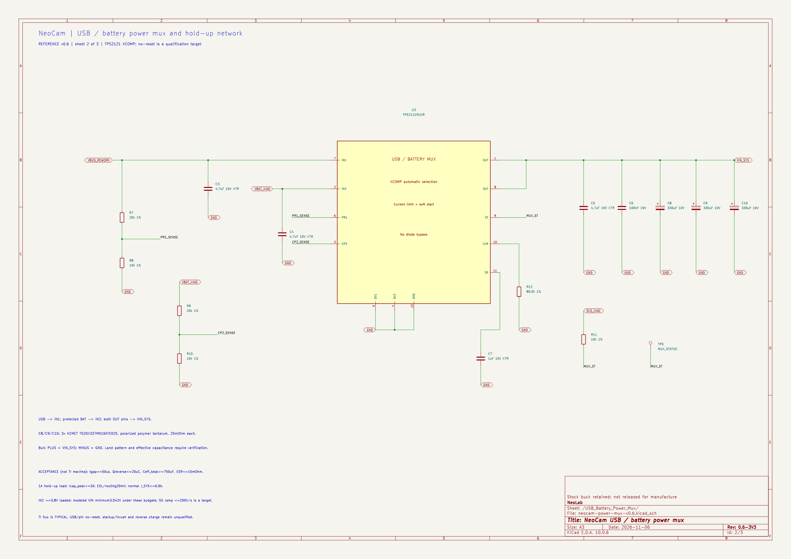
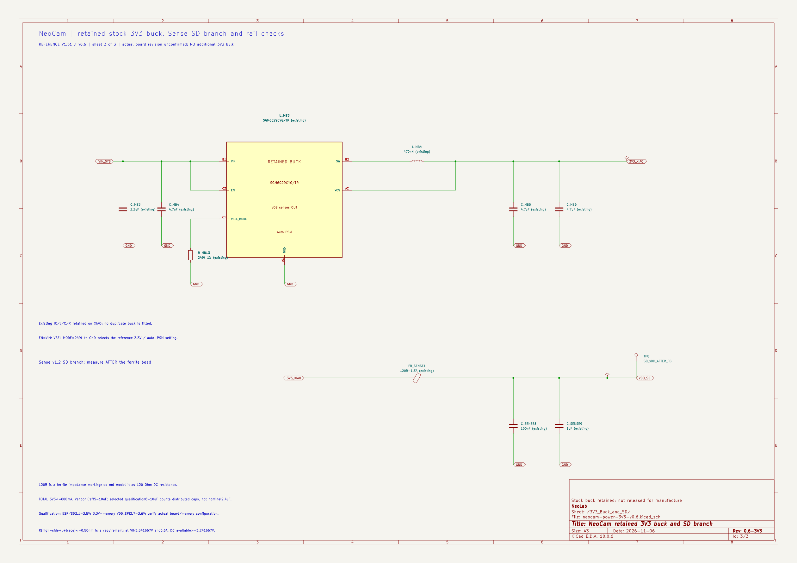

# NeoCam: nguồn USB/pin và rail 3V3, v0.6

Ngày **2026-11-06**. Đây là sơ đồ nguyên lý tham chiếu **ba trang A3 có liên kết điện**, chưa phải PCB chế tạo hoặc kết quả thực nghiệm. Mục tiêu của thay đổi là giữ nguồn khi cắm/rút USB trong miền tải đã định nghĩa; **không tuyên bố đã chứng minh NeoCam không reset**.

Mở [project KiCad](neocam-power-v0.kicad_pro) hoặc [schematic chính](neocam-power-v0.kicad_sch). Trang 2 là [mạch TPS2121](neocam-power-mux-v0.6.kicad_sch); trang 3 là [buck stock và nhánh SD](neocam-power-3v3-v0.6.kicad_sch). Mở schematic chính để kiểm tra cả ba trang, không thay thế bằng project con độc lập.

- **BOM hiện hành:** [bom-reference-v0.6.csv](bom-reference-v0.6.csv). Các CSV v0.4/v0.5/không số phiên bản là bản cũ, được giữ lại.
- [Ảnh trang 1](exports/neocam-power-v0.png) · [SVG trang 1](exports/neocam-power-v0.svg).
- [Ảnh trang 2: power mux](exports/neocam-power-v0-USB_Battery_Power_Mux.png) · [SVG trang 2](exports/neocam-power-v0-USB_Battery_Power_Mux.svg).
- [ERC toàn project](exports/neocam-power-v0-erc.rpt) · [netlist native](exports/neocam-power-v0.net) · [kiểm tra kết nối](exports/connectivity-check.txt).

## Thay đổi so với v0.4

**Loại Q1 và D2 cũ khỏi bo XIAO trong mô hình rework được chọn; không lắp QM1 DMP2035U và R6 của v0.4.** Không có diode Schottky bypass power mux. Giữ USB-C, mạch sạc VBUS→BAT và buck 3,3 V trên XIAO. R9 100 kOhm cũ vẫn nối VBUS xuống GND; ký hiệu R_MB9 chỉ thể hiện phần có sẵn, không mua/lắp thêm.

U3 **TPS2121RUXR** nhận USB ở IN1, pin sau cầu chì ở IN2; cả hai chân OUT nối VIN_SYS, đi vào VIN XIAO tại net source Q1 cũ. Các tên old-Q1 pad chỉ là điểm truy cập net theo sơ đồ V1.51, **không phải đầu nối có sẵn hoặc chỉ dẫn hàn trên bo chưa xác minh revision**. BAT pads vẫn nối charger, MAX17048 và bộ pin bảo vệ như trước.

Snapshot đầy đủ trước thay đổi ở **previous-v0.4/**. Đây là lựa chọn thiết kế mới; không tự chứng minh rằng mọi cách ghép MOSFET song song hoặc mọi phương án khác đều sai.

## Ba trang và các khối

1. Trang 1: bộ pin 1S đã có PCM → JST PH → cầu chì F1 → BAT XIAO; MAX17048 qua I2C; nút quay/dừng; LED đỏ; testpoint BAT/VIN/VBUS/GND. GND đi về **P- sau PCM**, không nối vòng về cực B- thô của cell.
2. Trang 2: TPS2121 XCOMP, hai cầu chia PR1/CP2; điện trở giới hạn dòng; tụ soft-start; tụ lọc hai đầu vào; tụ output và ngân hàng ba tụ polymer; ST kéo lên 3,3 V host và testpoint, không dùng thêm GPIO.
3. Trang 3: mở rõ buck SGM6029C/L4/tụ/R13 có sẵn; thêm điểm đo 3V3 tại ESP, VDD_SPI nội bộ và SD sau ferrite, không thêm tụ bulk trên rail 3V3.
4. Pogo J2 vẫn DNP, hai chân cách ly. Bản này dùng USB-C sẵn trên kit. Giao diện sạc sau lưng chưa được triển khai.

Mục tiêu ghi độc lập hình-tiếng 45 phút, Wi-Fi/BLE tắt và 720p/30 FPS vẫn là yêu cầu chưa chứng minh. Mạch chuyển nguồn không thay thế pin đủ năng lượng để hoàn tất tệp khi cả hai nguồn đều mất.

## Linh kiện và nối chân power mux

| Phần | Lựa chọn / kết nối |
|---|---|
| U3 | TPS2121RUXR, VQFN-HR 12 chân; land pattern chưa duyệt |
| IN1 chân 7 | VBUS_REWORK từ USB 5 V |
| IN2 chân 2 | VBAT_XIAO sau F1 |
| OUT chân 1 và 8 | Cùng nối VIN_SYS; không bỏ quên một chân OUT |
| PR1 chân 6 | R7=20 kOhm từ USB; R8=10 kOhm xuống GND |
| CP2 chân 3 | R9=20 kOhm từ pin; R10=10 kOhm xuống GND |
| OV1 chân 5, OV2 chân 4 | Nối GND: không triển khai OVP đầu vào; chỉ dùng nguồn USB 5 V quy định |
| ILIM chân 10 | R12=80,0 kOhm 1% xuống GND |
| SS chân 11 | C7=1 uF X7R >=10 V xuống GND |
| ST chân 9 | R11=10 kOhm kéo lên 3,3 V host, TP5; không gắn thêm GPIO |
| GND chân 12 | GND chung sau PCM |
| C3, C4 | 4,7 uF X7R >=10 V, 0805, sát hai đầu vào mux |
| C5, C6 | Output: 4,7 uF X7R >=10 V và 100 nF |
| C8, C9, C10 | **3 × KEMET T520X337M010ATE025**, mỗi tụ 330 uF/10 V, ESR ghi mã 25 mOhm, polymer tantalum có cực |
| Cực ngân hàng bulk | **PLUS vào VIN_SYS; MINUS vào GND** |
| Footprint bulk tham chiếu | CP_EIA-7343-43_Kemet-X; phải đối chiếu land pattern trước PCB |

Nguồn: [TI TPS2121](https://www.ti.com/lit/ds/symlink/tps2121.pdf). Mọi điện trở mới dùng 1%; package 0603 trừ các MLCC 4,7 uF dùng 0805. C1/C2/R1-R5 và các khối điều khiển giữ từ v0.3. F1 vẫn là Littelfuse 046701.5NR 1,5 A; BT1 DNK102050 1000 mAh có PCM là mẫu kỹ thuật có điều kiện, chưa duyệt phối hợp sạc/PCM hoặc nguồn mua. J1 phải kiểm tra cực tính dây pack thực tế.

## Ngân sách quá độ được chọn

Các số sau là **điều kiện thiết kế/nghiệm thu cần xác nhận**, không phải tất cả đều là giới hạn bảo đảm của TI:

| Đại lượng | Ngân sách |
|---|---:|
| I_SYS hoạt động bình thường | <=0,9 A |
| Tải dùng tính hold-up | 1 A |
| Thời gian thiếu nguồn tương đương, gồm phát hiện/phục hồi | <=50 us |
| Điện lượng reverse bổ sung | <=20 uC |
| Ceff ngân hàng đã tính điều kiện làm việc | >=750 uF |
| ESR hiệu dụng ngân hàng/đường nối theo định nghĩa bài tính | <=15 mOhm |
| Dòng đỉnh qua tụ | <=3 A |
| Ngân sách ESL/đường nối | 20 mV |
| VBAT_XIAO tại IN2 khi đang tải | >=3,8 V |
| Sụt áp mux được phân bổ ở 1 A | <=0,1 V |
| VIN_SYS yêu cầu | >=3,5 V |

Từ mức trước sụt quá độ 3,7 V:

`DeltaV = (1A x 50us + 20uC)/750uF + 3A x 0,015Ohm + 0,020V = 0,158333V`

`VIN_min theo mô hình = 3,7 - 0,158333 = 3,541667V`.

Ba tụ danh định tổng 990 uF; ở dung sai -20% là 792 uF trước các tác động khác. Do đó vẫn phải chứng minh **Ceff >=750 uF**, không tự coi 990 uF danh định là dung lượng hữu hiệu. Không cộng MLCC vào giá trị hold-up được bảo đảm khi chưa có Ceff tại điện áp/nhiệt độ tương ứng.

TI nêu chuyển nhanh 5 us **typical**, không được thay thành maximum 5 us. SS 1 uF là lựa chọn linh kiện; yêu cầu ramp <=200 V/s cần xác nhận. Tại Cmax=1188 uF, dòng riêng tụ ở ramp này là 0,2376 A; nếu tải chuẩn bị <=0,5 A thì tổng 0,7376 A, chưa kể các giới hạn khác. USB 5 V/3 A phải được nguồn quảng bá và giao diện tiếp nhận đúng; tên cổng Type-C không tự bảo đảm dòng 3 A.

Phép tính đầy đủ: [script chuyển nguồn](../tools/calculate-source-switchover.py), [kết quả JSON](../design-output/source-switchover-calculations.json), [thẩm định hãng](../references/usb-battery-mux-source-audit-2026-11-06.md), [thẩm định tụ](../references/usb-battery-holdup-audit-2026-11-06.md). Xem thêm [hồ sơ nguồn tổng hợp](../power-design-review.md).

## Bằng chứng kiểm tra và giới hạn

KiCad 10 chạy ERC trên **cả ba trang liên kết**: **0 lỗi, 0 cảnh báo, không bỏ qua mục kiểm tra nào**. verify_netlist.py kiểm tra native graph và full-review graph, 14 net đặt tên, đủ 12 chân TPS2121, cả hai OUT, các cầu chia, ILIM/SS, ST, cực ba tụ bulk, các phần QM1/R6/D2 đã bỏ, nguồn/PCM/cầu chì/nút/LED/pogo.

**11 phần tử stock** trên các trang được đặt `in_bom=no`, `on_board=no`: R_MB9, U_MB3, L_MB4, R_MB13, C_MB3-C_MB6, FB_SENSE1 và C_SENSE8/C_SENSE9. Native netlist bỏ các node đó; export_review_netlist.py chỉ bật đúng 11 cờ placement trong các bản tạm, giữ mọi dây/chân/nhãn/giá trị/BOM. Manifest ghi hash từng trang và hai bản chuẩn hóa phải giống nhau. Schematic chính không bị đổi cờ. Không dùng review netlist làm đầu vào chế tạo PCB.

Chưa layout PCB hoặc đo chuyển nguồn thực. Hồ sơ cấp trên có mô phỏng các mô hình áp đặt, không phải kiểm chứng controller SGM6029/TPS2121 thực. Chưa xác nhận no-reset, inrush, reverse current, Ceff/ESR/ESL, độ nóng, chất lượng ghi video hoặc thời lượng. File .kicad_pcb cũ vẫn là tệp rỗng. Các phần đang mở không bị ERC sạch hoặc phép tính mô hình biến thành đã đạt.

## Rail 3V3 của v0.6: giữ mạch hãng, không thêm bulk

[SVG trang 3](exports/neocam-power-v0-3V3_Buck_and_SD.svg) thể hiện **mô hình mainboard V1.51**, revision thật vẫn chưa xác nhận. Những phần đã có được vẽ tách khỏi U1 để phân tích, không lắp thêm một buck song song.

| Ký hiệu review | Phần giữ nguyên theo sơ đồ hãng |
|---|---|
| U_MB3 | SGM6029CYG/TR; A1 GND, A2 VOS, B1 VIN, B2 SW, C1 VSEL_MODE, C2 EN |
| EN | Nối VIN_SYS, không điều khiển bằng GPIO |
| L_MB4 | 470 nH, SW → L → 3V3; DCR/Isat và MPN thực còn cần xác nhận |
| VOS | Nối OUT **sau L**, không nối SW |
| R_MB13 | 249 kOhm, 1%, VSEL_MODE xuống GND; chọn mã điện áp 3,3 V và auto-PSM, không phải cầu chia feedback |
| C_MB3/C_MB4 | VIN: 2,2 uF + 4,7 uF, danh định |
| C_MB5/C_MB6 | OUT: 4,7 uF + 4,7 uF, danh định |
| FB_SENSE1 | Ferrite có ký hiệu 120R-1.3A theo ExpBoard v1.2; không lấy 120 Ohm làm điện trở DC |
| C_SENSE8/C_SENSE9 | **100 nF + 1 uF** ở nguồn SD sau ferrite; không thay bằng 2,2 uF |
| TP6 | Tap 3V3 chung của kit trên net 3V3_XIAO; không đại diện mọi chân nguồn ESP sau lọc riêng |
| TP7 | **VDD_SPI nội bộ** riêng; không phải chân header hoặc điểm cấp nguồn bên ngoài |
| TP8 | VDD_SD sau FB_SENSE1; net riêng, không nối tắt ferrite để đo |

U1 không còn đóng vai nguồn 3V3 độc lập trong mô hình: chân 3V3 của khối là **tải/tap**, buck đã được vẽ trên trang 3. PWR_FLAG chỉ báo đường nguồn có nguồn cho ERC, không phải linh kiện hoặc bằng chứng ổn áp.

Quyết định **không thêm 47/100 uF vào 3V3**: hãng khuyến nghị COUT hiệu dụng 5-10 uF; bài toán quá độ hiện chọn yêu cầu **8-10 uF hiệu dụng**, phải tính cả tụ phân tán trên ESP/bộ nhớ/mic/SD và tác động nhánh lọc. Tổng danh định C_MB5+C_MB6=9,4 uF không chứng minh đã đạt 8-10 uF thực. Ngân hàng 3×330 uF vẫn nằm trên **VIN_SYS**, không chuyển xuống 3V3.

Trần dòng **600 mA là tổng cả rail**, không cộng thêm 600 mA ngoài ESP. Yêu cầu thiết kế đo ở ESP và SD **3,1-3,5 V**; VDD_SPI của cấu hình bộ nhớ 3,3 V cần kiểm tra riêng **2,7-3,6 V**, không suy từ rail chính. Mọi ngưỡng chỉ áp dụng sau xác nhận đúng board/bộ nhớ/cấu hình.

Mô hình duty 100% dùng điều kiện nghiệm thu `R_highside + R_L + R_trace <=0,5 Ohm`:

`V_available >= 3,541667 - 0,6 x 0,5 = 3,241667 V`.

Đây là điều kiện DC có giả thiết, chưa bao gồm sụt quá độ. Bài tính dùng thêm yêu cầu điện lượng thiếu/dư của đầu ra, ripple, ESR và đường nối; không lấy timing của mux làm thời gian buck ngừng cấp. Tụ đầu ra nhỏ không thể một mình nuôi 600 mA trong 50 us nếu giả sử buck tắt hoàn toàn.

[Phép tính rail 3V3](../design-output/buck-3v3-calculations.json), [script số học](../tools/calculate-buck-3v3.py), [thẩm định nguồn](../references/buck-3v3-source-audit-2026-11-06.md), [thẩm định quá độ](../references/buck-3v3-load-transient-audit-2026-11-06.md) ghi rõ số nào là datasheet, giả thiết hoặc yêu cầu nghiệm thu. Snapshot v0.5 được giữ trong **previous-v0.5/**; các file con v0.5 còn trong thư mục là lịch sử, không được project v0.6 tham chiếu.

**Vị trí đo chưa layout:** TP6/TP7/TP8 là các điểm truy cập dự kiến, không phải cam kết có header sẵn hoặc đã bố trí Kelvin. Đo 3V3_KIT tại TP6 không tự xác nhận điện áp ở chân RTC/CPU/analog của ESP sau các bộ lọc/đường nối riêng. Khi kiểm tra giới hạn tại chip phải dò đúng pad/chân nguồn thực; VDD_SPI cũng là rail nội bộ cần xác nhận điểm truy cập trên đúng revision.

