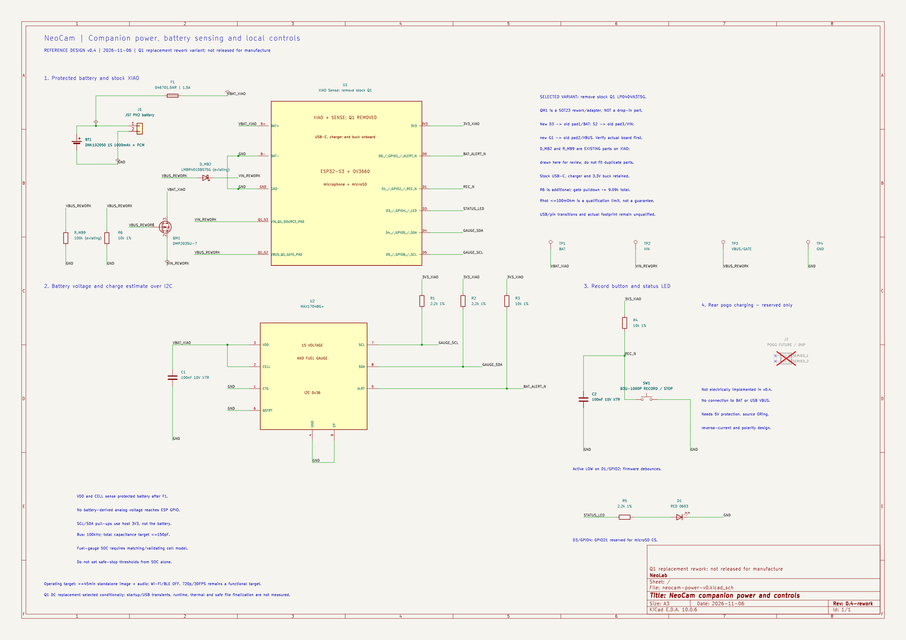

# NeoCam: mạch nguồn phụ trợ v0.4, thay Q1 trong mô hình rework

Ngày **2026-11-06**. Đây là **sơ đồ nguyên lý tham chiếu cho phần phụ trợ và phương án thay MOSFET Q1 của kit XIAO**, chưa phải PCB chế tạo hay chỉ dẫn hàn trên bo chưa xác minh. Giữ USB-C, bộ sạc, buck 3,3 V, camera OV3660, microphone và microSD; **loại Q1 cũ khỏi đường dòng trong biến thể v0.4 được chọn**, thay bằng QM1 qua adapter/rework.

Mục tiêu: quay và lưu hình-tiếng độc lập ít nhất 45 phút, Wi-Fi/BLE tắt, hoàn tất tệp trước khi pin không còn bảo đảm nguồn. **720p/30 FPS và 45 phút chưa được chứng minh**. Xem [hồ sơ thiết kế nguồn](../power-design-review.md) để đọc toàn bộ mục tiêu, ngân sách và tồn đọng.

[KiCad schematic](neocam-power-v0.kicad_sch) · [SVG để phóng to](exports/neocam-power-v0.svg) · [Netlist](exports/neocam-power-v0.net) · [ERC](exports/neocam-power-v0-erc.rpt) · [Kiểm tra kết nối](exports/connectivity-check.txt)

**BOM hiện hành v0.4:** [bom-reference-v0.4.csv](bom-reference-v0.4.csv). Bản CSV không có số phiên bản được giữ nguyên khi đang bị một ứng dụng khác khóa ghi; không dùng bản đó thay BOM v0.4.

## Các khối đã vẽ

1. **BT1, J1, F1:** bộ pin 1S có PCM, connector JST PH hai chân, cầu chì phụ trước BAT+ XIAO. GND đi về **P- sau PCM**, không nối cực B- của cell để đi vòng bảo vệ. J1 chân 1 quy ước dương, chân 2 âm; phải kiểm tra cực tính pack thật, không chỉ dựa vào màu dây hoặc tên JST.
2. **U1:** giao diện chức năng của XIAO/Sense; số chân B+, B-, D0… là tên pad của bo, không phải số chân IC hay footprint đã duyệt. Tham chiếu bo chính V1.51 và mở rộng v1.2; bo mở rộng v1.1 thực tế cần đối chiếu trước khi áp dụng.
3. **U2 MAX17048G+:** đo điện áp và ước lượng SOC qua I2C. Không còn bộ chia áp pin nối GPIO. VDD/CELL nối VBAT_XIAO sau cầu chì; C1 lọc nguồn; CTG/QSTRT/GND/EP nối GND. SDA/SCL/ALRT kéo lên **3,3 V host**, không kéo lên pin 4,2 V. SOC không tự chứng minh còn đủ năng lượng đóng tệp.
4. **SW1, R4, C2:** nút quay/dừng active-low ở D1/GPIO2, pull-up và lọc RC. Firmware cần debounce, xử lý nhấn giữ và lưu tệp trước khi ngủ.
5. **D1, R5:** LED đỏ tại D3/GPIO4. Không dùng GPIO21 đang được bo mở rộng tham chiếu dùng làm CS microSD.
6. **J2 DNP:** hai chân dành cho sạc sau lưng **không kết nối**. Bản này sạc bằng USB-C XIAO. Pogo cần thiết kế đầu vào 5 V, chống ngược cực/dòng và phối hợp USB trước khi nối; không nối nguồn 5 V vào BAT.

Không thêm công tắc cắt pin trong đường quay. Yêu cầu dừng phải cho phần mềm flush/sync/close trước khi ngủ. PCM/cầu chì vẫn có thể cắt trong lỗi, không bảo đảm giữ mọi tệp khi mất nguồn đột ngột.

## Lựa chọn linh kiện

| Ref | Lựa chọn | Package / trạng thái |
|---|---|---|
| BT1 | DNK102050 3,7 V 1000 mAh có PCM làm mẫu kỹ thuật | Pack ngoài; chưa duyệt phối hợp sạc/PCM, nguồn mua, vỏ |
| J1 | JST PH 2 chân, B2B-PH-K phía PCB | Footprint có sẵn; cực tính dây pack chưa duyệt |
| F1 | Littelfuse 046701.5NR, 1,5 A | 0603; cần kiểm tra derating/time-current; không phải giới hạn dòng chính xác |
| QM1 | Diodes **DMP2035U-7**, G1/S2/D3 | SOT23; không thay trực tiếp footprint Q1 cũ |
| R6 | 10 kOhm, 1%, >=0,1 W | 0603; thêm VBUS/gate xuống GND, song song R9 cũ 100 kOhm |
| D_MB2, R_MB9 | D2 LMBR4010BST5G và R9 100 kOhm đã có trên XIAO | Giữ tại bo; chỉ vẽ ra ngoài khối để review; không mua/lắp thêm, không chuyển vào PCB phụ |
| TP1-TP4 | BAT, VIN, VBUS/GATE, GND | Pad test 1,5 mm; vị trí cơ khí chưa layout |
| U1 | XIAO ESP32-S3 Sense có sẵn | Chưa gán footprint giao diện kit |
| U2 | MAX17048G+, TDFN-8 exposed pad | Pin 9 là EP; land pattern phải xác nhận trước PCB |
| R1, R2 | 2,2 kOhm, 1%, >=0,1 W | 0603; pull-up SCL/SDA |
| R3 | 10 kOhm, 1%, >=0,1 W | 0603; pull-up ALRT |
| R4 | 10 kOhm, 1%, >=0,1 W | 0603; pull-up nút |
| R5 | 2,2 kOhm, 1%, >=0,1 W | 0603; hạn dòng LED |
| C1, C2 | 100 nF X7R, >=10 V | 0603; C1 sát U2; C2 sát nút |
| SW1 | Omron B3U-1000P | Có footprint tương ứng; cơ khí vỏ chưa duyệt |
| D1 | LED đỏ 0603, định mức dòng liên tục >=2 mA | Chưa chọn manufacturer code |
| J2 | Dành chỗ, DNP | Không có footprint chế tạo; không mua |

Điện trở/tụ đã chọn giá trị/package, chưa khẳng định mã nhà cung cấp hoặc giá. Đây chưa phải BOM đã duyệt sản xuất.

## Phép tính của mạch phụ trợ

- Bus I2C **100 kHz**, yêu cầu tổng điện dung **<=150 pF**. Pull-up 2,2 kOhm cho `tr = 0,8473 x R x C = 279,6 ns` danh định; phải tính dung sai và ký sinh vào hạn mức khi layout. Điện dung này là yêu cầu, chưa đo.
- Mỗi đường I2C thấp dùng khoảng `3,3/2200 = 1,5 mA`; hai đường cùng thấp dùng khoảng 3 mA ở 3,3 V. ALRT thấp thêm `3,3/10000 = 0,33 mA`.
- Nút R4/C2 có `tau = 10k x 100nF = 1 ms`, không phải cam kết loại hết rung. Giữ nút thấp dùng khoảng 0,33 mA ở 3,3 V.
- Chưa biết Vf LED vẫn giới hạn được dòng qua R5: tại 3,6 V và R5 thấp nhất 2178 Ohm, `I <= 3,6/2178 = 1,653 mA`; `P_R5 <= 3,6^2/2178 = 5,95 mW`. Ví dụ Vf=2 V ở 3,3 V cho khoảng 0,59 mA, không thay datasheet LED.
- U2 đo VBAT_XIAO sau F1; khi quy về cell phải tính sụt áp cầu chì/dây/PCM. Ngưỡng pin yếu xét tải động, buck, SD và năng lượng đóng tệp; không lấy ngưỡng PCM làm ngưỡng firmware.

Nguồn: [MAX17048/17049 ADI](https://www.analog.com/media/en/technical-documentation/data-sheets/MAX17048-MAX17049.pdf), [Seeed XIAO](https://wiki.seeedstudio.com/xiao_esp32s3_getting_started/), [DNK102050](https://www.dnkpower.com/wp-content/uploads/2023/11/DNK102050-3.7V-1000mAh-Lipo-Battery-Specification.pdf), [Omron B3U](https://components.omron.com/us-en/products/switches/B3U). Các điều kiện chọn pin/sạc nằm trong hồ sơ cấp trên.

## Kiểm tra và tái tạo

`generate_schematic.py` tạo sơ đồ/thư viện local NeoCam.kicad_sym; sym-lib-table để KiCad tìm các khối. previous-v0/ giữ bản gốc. alternatives/tmux-v0.2/ giữ phương án đã bỏ, không áp dụng.

KiCad 10 xuất SVG/netlist và chạy ERC: **0 errors, 0 warnings, không có mục kiểm tra bị bỏ qua** theo báo cáo cùng thư mục. verify_netlist.py kiểm tra net nguồn, I2C, ALRT, nút, LED, đường về pack được bảo vệ, cầu chì không bị nối tắt, hai chân pogo cách ly. Đây là kiểm tra kết nối, không xác nhận phần cứng/an toàn pin/thời lượng/firmware.

Chưa layout PCB, chưa mô phỏng QSPICE/ngspice, chưa nạp board, chưa có số đo. File .kicad_pcb cũ là tệp rỗng. Cần chốt pack/charge/PCM, board thực, land pattern và nghiệm thu trong hồ sơ trước chế tạo.

## Thay đổi Q1 của v0.4

- Chọn **QM1 DMP2035U-7**: chân mới **D3 tới VBAT/old-Q1 pad1; S2 tới VIN/old pad3; G1 tới VBUS/old pad2** theo mô hình bo V1.51. Đây không phải thứ tự chân thay trực tiếp. Phải xác nhận revision, cực tính, pad và việc đi dây thật trước khi áp dụng. BAT pads vẫn nối mạch sạc của XIAO; không cắt đường sạc này.
- Sơ đồ thể hiện Q1 cũ đã loại, không lắp QM1 nối tiếp với Q1 cũ. Phương án loại Q1 được chọn để mô hình đơn giản; không khẳng định mọi cách mắc hai MOSFET song song đều tự động bỏ qua bảo vệ.
- Giữ **D_MB2** với anode VBUS, cathode VIN, và **R_MB9** VBUS xuống GND. Hai phần tử vẽ ra ngoài U1 nhưng vẫn là phần có sẵn trên bo. R6 10 kOhm bổ sung song song R9 100 kOhm cho khoảng **9,09 kOhm**; tại USB 5 V, hai điện trở dùng khoảng **0,55 mA** tổng cộng. Khi pin cấp và VBUS=0, đây không phải dòng tiêu thụ cố định 0,55 mA từ pin.
- [Datasheet DMP2035U Rev11-2, June2025](https://www.diodes.com/datasheet/download/DMP2035U.pdf): RDS(on) max **45 mOhm tại VGS=-2,5 V, ID=-4 A,25 C**; VDS=-20 V, VGS abs.max +/-10 V. Giới hạn nghiệm thu tự đặt **Rhot<=100 mOhm**, không gọi là thông số hãng bảo đảm. Khi I=1 A, giới hạn đó tương ứng **100 mV và100 mW**. So sánh/tính nhiệt và dòng tải ghép nằm trong [hồ sơ chọn Q1](../q1-design-decision.md).
- Diode thân đi từ D/BAT sang S/VIN, giúp khởi động đường pin trước khi kênh MOSFET dẫn. Khi có USB, VBUS kéo gate lên; đường USB tới VIN qua D2 vẫn giữ. Khẳng định DC này chưa chứng minh cắm/rút USB không brownout; Qg/Ciss và khởi động cần thẩm định riêng.
- Bản đầy đủ v0.3 trước thay Q1 được giữ trong **previous-v0.3/**. Không sửa PCB rỗng thành mạch đã layout.

## Phân biệt hai netlist và bằng chứng kiểm tra

KiCad bỏ các phần tử `on_board=no` khỏi netlist dành cho board; vì vậy **native netlist** không chứa node D_MB2/R_MB9. Main schematic giữ cả hai `on_board=no` và `in_bom=no` để không lắp trùng phần có sẵn.

`export_review_netlist.py` tạo **exports/neocam-power-v0-review-full.net** từ một bản tạm: chỉ đổi hai cờ placement trên thành yes để KiCad xuất cả node phục vụ review, giữ nguyên mọi dây, chân, nhãn, giá trị và cờ BOM; không ghi ngược vào schematic chính. **exports/review-netlist-manifest.json** ghi phép biến đổi và hai SHA256 chuẩn hóa: chỉ thay đúng hai boolean này bằng cùng sentinel trước khi so sánh, kết quả phải giống nhau.

`verify_netlist.py` kiểm tra cả netlist native (QM1 D/S/G, R6, testpoint và các khối cũ), full-review (thêm D2/R9), lẫn **pin map và cờ thực của schematic chính**. ERC của schematic chính vẫn 0 errors/0 warnings, không bỏ qua kiểm tra nào. Các khối existing dùng ký hiệu chức năng local không gán giả một footprint cho linh kiện đã nằm trên XIAO. Những kiểm tra này không phải bằng chứng PCB/hardware hoặc chuyển nguồn đã đạt.
