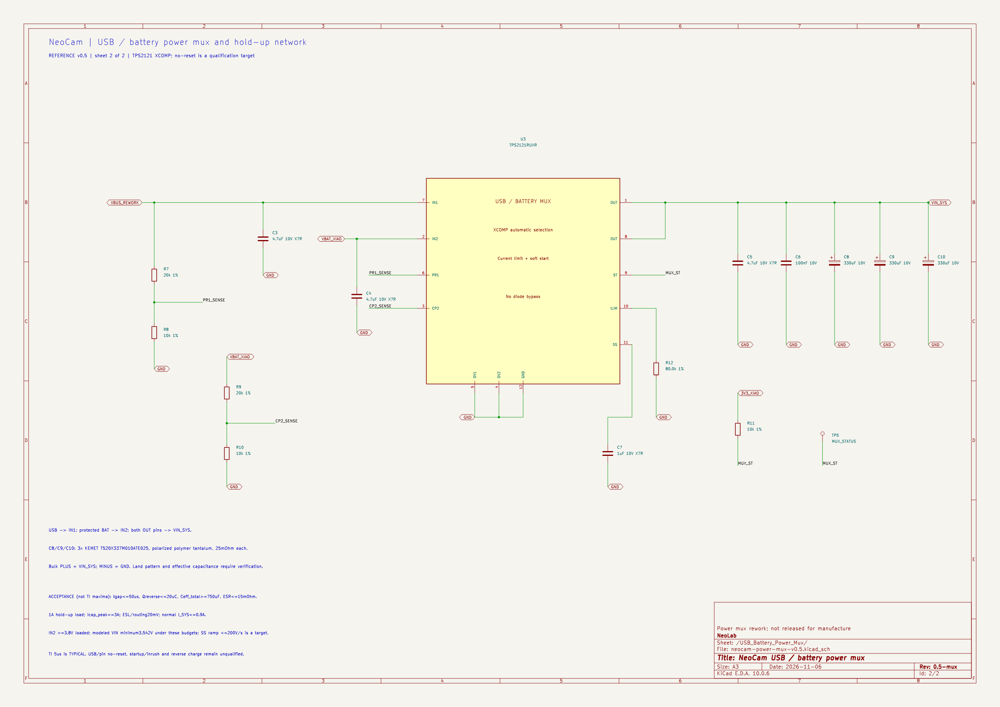

# NeoCam: nguồn USB/pin qua power mux, v0.5

Ngày **2026-11-06**. Đây là sơ đồ nguyên lý tham chiếu **hai trang A3 có liên kết điện**, chưa phải PCB chế tạo hoặc kết quả thực nghiệm. Mục tiêu của thay đổi là giữ nguồn khi cắm/rút USB trong miền tải đã định nghĩa; **không tuyên bố đã chứng minh NeoCam không reset**.

Mở [project KiCad](neocam-power-v0.kicad_pro) hoặc [schematic chính](neocam-power-v0.kicad_sch). Trang 2 là [mạch TPS2121](neocam-power-mux-v0.5.kicad_sch). Không mở trang 2 như một project độc lập để thay thế việc kiểm tra cả hệ.

- **BOM hiện hành:** [bom-reference-v0.5.csv](bom-reference-v0.5.csv). Các CSV v0.4/không số phiên bản là bản cũ, được giữ lại.
- [Ảnh trang 1](exports/neocam-power-v0.png) · [SVG trang 1](exports/neocam-power-v0.svg).
- [Ảnh trang 2: power mux](exports/neocam-power-v0-USB_Battery_Power_Mux.png) · [SVG trang 2](exports/neocam-power-v0-USB_Battery_Power_Mux.svg).
- [ERC toàn project](exports/neocam-power-v0-erc.rpt) · [netlist native](exports/neocam-power-v0.net) · [kiểm tra kết nối](exports/connectivity-check.txt).

## Thay đổi so với v0.4

**Loại Q1 và D2 cũ khỏi bo XIAO trong mô hình rework được chọn; không lắp QM1 DMP2035U và R6 của v0.4.** Không có diode Schottky bypass power mux. Giữ USB-C, mạch sạc VBUS→BAT và buck 3,3 V trên XIAO. R9 100 kOhm cũ vẫn nối VBUS xuống GND; ký hiệu R_MB9 chỉ thể hiện phần có sẵn, không mua/lắp thêm.

U3 **TPS2121RUXR** nhận USB ở IN1, pin sau cầu chì ở IN2; cả hai chân OUT nối VIN_SYS, đi vào VIN XIAO tại net source Q1 cũ. Các tên old-Q1 pad chỉ là điểm truy cập net theo sơ đồ V1.51, **không phải đầu nối có sẵn hoặc chỉ dẫn hàn trên bo chưa xác minh revision**. BAT pads vẫn nối charger, MAX17048 và bộ pin bảo vệ như trước.

Snapshot đầy đủ trước thay đổi ở **previous-v0.4/**. Đây là lựa chọn thiết kế mới; không tự chứng minh rằng mọi cách ghép MOSFET song song hoặc mọi phương án khác đều sai.

## Hai trang và các khối

1. Trang 1: bộ pin 1S đã có PCM → JST PH → cầu chì F1 → BAT XIAO; MAX17048 qua I2C; nút quay/dừng; LED đỏ; testpoint BAT/VIN/VBUS/GND. GND đi về **P- sau PCM**, không nối vòng về cực B- thô của cell.
2. Trang 2: TPS2121 XCOMP, hai cầu chia PR1/CP2; điện trở giới hạn dòng; tụ soft-start; tụ lọc hai đầu vào; tụ output và ngân hàng ba tụ polymer; ST kéo lên 3,3 V host và testpoint, không dùng thêm GPIO.
3. Pogo J2 vẫn DNP, hai chân cách ly. Bản này dùng USB-C sẵn trên kit. Giao diện sạc sau lưng chưa được triển khai.

Mục tiêu ghi độc lập hình-tiếng 45 phút, Wi-Fi/BLE tắt và 720p/30 FPS vẫn là yêu cầu chưa chứng minh. Mạch chuyển nguồn không thay thế pin đủ năng lượng để hoàn tất tệp khi cả hai nguồn đều mất.

## Linh kiện và nối chân power mux

| Phần | Lựa chọn / kết nối |
|---|---|
| U3 | TPS2121RUXR, VQFN-HR 12 chân; land pattern chưa duyệt |
| IN1 chân 7 | VBUS_REWORK từ USB 5 V |
| IN2 chân 2 | VBAT_XIAO sau F1 |
| OUT chân 1 và 8 | Cùng nối VIN_SYS; không bỏ quên một chân OUT |
| PR1 chân 6 | R7=20 kOhm từ USB; R8=10 kOhm xuống GND |
| CP2 chân 3 | R9=20 kOhm từ pin; R10=10 kOhm xuống GND |
| OV1 chân 5, OV2 chân 4 | Nối GND: không triển khai OVP đầu vào; chỉ dùng nguồn USB 5 V quy định |
| ILIM chân 10 | R12=80,0 kOhm 1% xuống GND |
| SS chân 11 | C7=1 uF X7R >=10 V xuống GND |
| ST chân 9 | R11=10 kOhm kéo lên 3,3 V host, TP5; không gắn thêm GPIO |
| GND chân 12 | GND chung sau PCM |
| C3, C4 | 4,7 uF X7R >=10 V, 0805, sát hai đầu vào mux |
| C5, C6 | Output: 4,7 uF X7R >=10 V và 100 nF |
| C8, C9, C10 | **3 × KEMET T520X337M010ATE025**, mỗi tụ 330 uF/10 V, ESR ghi mã 25 mOhm, polymer tantalum có cực |
| Cực ngân hàng bulk | **PLUS vào VIN_SYS; MINUS vào GND** |
| Footprint bulk tham chiếu | CP_EIA-7343-43_Kemet-X; phải đối chiếu land pattern trước PCB |

Nguồn: [TI TPS2121](https://www.ti.com/lit/ds/symlink/tps2121.pdf). Mọi điện trở mới dùng 1%; package 0603 trừ các MLCC 4,7 uF dùng 0805. C1/C2/R1-R5 và các khối điều khiển giữ từ v0.3. F1 vẫn là Littelfuse 046701.5NR 1,5 A; BT1 DNK102050 1000 mAh có PCM là mẫu kỹ thuật có điều kiện, chưa duyệt phối hợp sạc/PCM hoặc nguồn mua. J1 phải kiểm tra cực tính dây pack thực tế.

## Ngân sách quá độ được chọn

Các số sau là **điều kiện thiết kế/nghiệm thu cần xác nhận**, không phải tất cả đều là giới hạn bảo đảm của TI:

| Đại lượng | Ngân sách |
|---|---:|
| I_SYS hoạt động bình thường | <=0,9 A |
| Tải dùng tính hold-up | 1 A |
| Thời gian thiếu nguồn tương đương, gồm phát hiện/phục hồi | <=50 us |
| Điện lượng reverse bổ sung | <=20 uC |
| Ceff ngân hàng đã tính điều kiện làm việc | >=750 uF |
| ESR hiệu dụng ngân hàng/đường nối theo định nghĩa bài tính | <=15 mOhm |
| Dòng đỉnh qua tụ | <=3 A |
| Ngân sách ESL/đường nối | 20 mV |
| VBAT_XIAO tại IN2 khi đang tải | >=3,8 V |
| Sụt áp mux được phân bổ ở 1 A | <=0,1 V |
| VIN_SYS yêu cầu | >=3,5 V |

Từ mức trước sụt quá độ 3,7 V:

`DeltaV = (1A x 50us + 20uC)/750uF + 3A x 0,015Ohm + 0,020V = 0,158333V`

`VIN_min theo mô hình = 3,7 - 0,158333 = 3,541667V`.

Ba tụ danh định tổng 990 uF; ở dung sai -20% là 792 uF trước các tác động khác. Do đó vẫn phải chứng minh **Ceff >=750 uF**, không tự coi 990 uF danh định là dung lượng hữu hiệu. Không cộng MLCC vào giá trị hold-up được bảo đảm khi chưa có Ceff tại điện áp/nhiệt độ tương ứng.

TI nêu chuyển nhanh 5 us **typical**, không được thay thành maximum 5 us. SS 1 uF là lựa chọn linh kiện; yêu cầu ramp <=200 V/s cần xác nhận. Tại Cmax=1188 uF, dòng riêng tụ ở ramp này là 0,2376 A; nếu tải chuẩn bị <=0,5 A thì tổng 0,7376 A, chưa kể các giới hạn khác. USB 5 V/3 A phải được nguồn quảng bá và giao diện tiếp nhận đúng; tên cổng Type-C không tự bảo đảm dòng 3 A.

Phép tính đầy đủ: [script chuyển nguồn](../tools/calculate-source-switchover.py), [kết quả JSON](../design-output/source-switchover-calculations.json), [thẩm định hãng](../references/usb-battery-mux-source-audit-2026-11-06.md), [thẩm định tụ](../references/usb-battery-holdup-audit-2026-11-06.md). Xem thêm [hồ sơ nguồn tổng hợp](../power-design-review.md).

## Bằng chứng kiểm tra và giới hạn

KiCad 10 chạy ERC trên **cả hai trang liên kết**: **0 lỗi, 0 cảnh báo, không bỏ qua mục kiểm tra nào**. verify_netlist.py kiểm tra native graph và full-review graph, 12 net đặt tên, đủ 12 chân TPS2121, cả hai OUT, các cầu chia, ILIM/SS, ST, cực ba tụ bulk, các phần QM1/R6/D2 đã bỏ, nguồn/PCM/cầu chì/nút/LED/pogo.

R_MB9 có sẵn trên XIAO được đặt `in_bom=no`, `on_board=no`. Vì native board netlist bỏ node đó, export_review_netlist.py chỉ bật đúng **một cờ placement** trong bản tạm phục vụ review và chép nguyên trang mux. Manifest ghi hash schematic chính/trang con; hai bản chuẩn hóa chỉ khác cờ đó phải giống nhau. Main schematic không bị thay cờ để xuất full-review. Không dùng netlist review làm đầu vào chế tạo PCB.

Chưa layout PCB, chưa mô phỏng hoặc đo chuyển nguồn thực, chưa xác nhận no-reset, inrush, reverse current, Ceff/ESR/ESL, độ nóng, chất lượng ghi video hoặc thời lượng. File .kicad_pcb cũ vẫn là tệp rỗng. Các phần đang mở không bị ERC sạch hoặc phép tính mô hình biến thành đã đạt.
