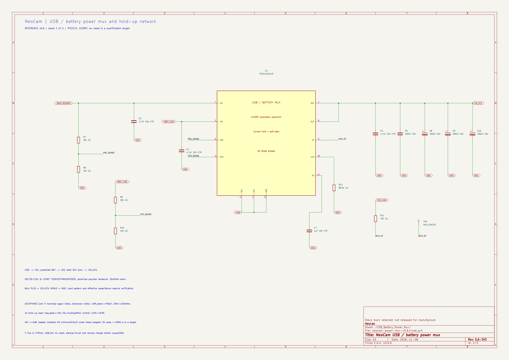

# NeoCam v0.5: thiết kế chuyển nguồn USB/pin khi đang quay

Ngày **2026-11-06**. Thay quyết định chọn nguồn bằng Q1 của v0.4. Phạm vi là **thiết kế và cập nhật sơ đồ**, chưa sửa kit thật hoặc chứng minh chuyển nguồn trên phần cứng.

**Tiếp nối v0.6:** [phân tích buck 3V3](buck-3v3-design.md) giữ nguyên cấu hình mux/bank VIN của tài liệu này, bổ sung trang buck và các điểm truy cập ESP/SD/VDD_SPI. Phiên bản project hiện hành có ba trang; các số hold-up v0.5 dưới đây không tự là bằng chứng 3V3 hoặc bộ nhớ đã đạt.

**Lựa chọn hiện hành: TPS2121RUXR + ba tụ polymer 330 µF/10 V trên VIN_SYS.** Giữ bộ sạc và buck của XIAO; loại Q1 và D2 chọn nguồn cũ khỏi biến thể rework. Kết quả tính là **VIN_SYS ≥3,541667 V**, nếu đồng thời thỏa các giới hạn ở mục 3. Đây là lời giải có điều kiện; không lấy thời gian chuyển nguồn điển hình của hãng làm giới hạn bảo đảm.

Mở [project KiCad](neocam-power-v0/neocam-power-v0.kicad_pro), [trang chính](neocam-power-v0/neocam-power-v0.kicad_sch), [trang power mux](neocam-power-v0/neocam-power-mux-v0.5.kicad_sch) và [BOM v0.5](neocam-power-v0/bom-reference-v0.5.csv). [Hồ sơ tổng hợp](power-design-review.md) giữ các bài toán pin, PCM, nút, đo pin và ghi hình.

## 1. Vấn đề cần giải quyết và thay đổi trên XIAO

Khi rút USB, nguồn vào buck đi từ nhánh USB khoảng 5 V về pin. Nếu hai nhánh cùng ngừng cấp trong một khoảng ngắn, tụ output phải cấp tải. Nếu VIN hoặc 3V3 tụt quá thấp, ESP32 hoặc microSD có thể mất hoạt động giữa lúc ghi tệp. Khi cắm USB, cần thêm kiểm soát dòng nạp tụ; tăng tụ mà không kiểm soát dòng này có thể làm nguồn USB sụt hoặc PCM ngắt.

Q1 DMP2035U-7 của v0.4 đã giải quyết phần điện trở dẫn so với MOSFET stock. Tuy nhiên, gate lấy trực tiếp từ VBUS vẫn phụ thuộc dạng sụt VBUS, điện dung và trình tự chuyển mạch; phép tính RDS(on) thấp không chứng minh chuyển nguồn liên tục. v0.5 thay toàn bộ chức năng chọn nguồn đó bằng IC chuyên dụng.

```text
USB-C trên XIAO ── VBUS ──┬── TPS2121 IN1 ──────┐
                         └── charger stock ── BAT│
                                                ├── OUT ── VIN_SYS ── buck stock ── 3V3
Pack 1S có PCM ─ JST ─ F1 ─ VBAT_XIAO ─ IN2 ────┘                 └── nguồn camera
                              └── MAX17048

                       VIN_SYS ── [3 × 330 µF] ── GND
```

**Trong bản rework đã chọn:** tháo Q1 stock và D2 stock; không lắp QM1 DMP2035U và R6 của v0.4. Nếu để D2 USB→VIN, USB sẽ đi vòng qua power mux, làm mất khả năng kiểm soát đường nguồn. R9 stock 100 kΩ VBUS→GND giữ nguyên. Không thêm Schottky BAT→SYS vòng qua mux vì đường đó sẽ bỏ qua soft-start/giới hạn dòng, đồng thời phải giải quyết riêng dòng rò ngược về pin.

Nối OUT vào **net VIN tại source Q1 cũ/cathode D2 cũ theo mô hình mainboard V1.51**, không đưa OUT hoặc USB 5 V vào BAT hay 3V3. Đây là tên điểm truy cập theo sơ đồ tham chiếu; chưa xác nhận revision/pad trên bo thật. GND toàn bộ mạch phụ phải về **P− sau PCM**, không đi vòng tới B− thô của cell.

## 2. Chọn linh kiện và cấu hình

TPS2121 được chọn vì có hai ngõ vào, chọn nguồn tự động, reverse-current blocking, soft-start và giới hạn dòng có thể đặt. Căn cứ chức năng, chân và cấu hình XCOMP ở mục 6, 9.3 và 10.3 của [datasheet TI Rev. F](https://www.ti.com/lit/ds/symlink/tps2121.pdf). Những dữ liệu hãng và điều kiện được trích chi tiết trong [bản thẩm định nguồn](references/usb-battery-mux-source-audit-2026-11-06.md).

| Phần trên schematic | Linh kiện / giá trị | Vai trò |
|---|---|---|
| U3 | **TPS2121RUXR**, VQFN-HR 12 chân | IN1=USB; IN2=pin; OUT cấp VIN_SYS |
| R7/R8 | **20 kΩ / 10 kΩ, 1%** | Chia VBUS tới PR1 |
| R9/R10 mới | **20 kΩ / 10 kΩ, 1%** | Chia VBAT_XIAO tới CP2; khác R_MB9 stock |
| R12 | **80,0 kΩ, 1%** | Đặt ILIM; danh định khoảng 1,5 A |
| C7 | **1 µF, X7R, 10 V** | Đặt soft-start và thời gian chờ nguồn mới |
| R11/TP5 | **10 kΩ lên 3V3 / testpoint** | Đọc ST khi phân tích; chưa chiếm GPIO |
| C3/C4 | Mỗi đầu vào **4,7 µF, X7R, 10 V** | Decoupling sát IC |
| C5/C6 | OUT: **4,7 µF + 100 nF** | Decoupling cao tần |
| C8/C9/C10 | **3 × T520X337M010ATE025** | Giữ nguồn; dấu **+ vào VIN_SYS, − vào GND** |

Pin map phải giữ đúng: IN1=7; IN2=2; **OUT=1 và 8 đều nối**; PR1=6; CP2=3; OV1=5 và OV2=4 nối GND; ILIM=10; SS=11; ST=9; GND=12. OV nối GND đồng nghĩa chưa triển khai ngắt quá áp theo ngưỡng; thiết kế này chỉ tiếp nhận USB 5 V quy định, không nhận 9 V trực tiếp.

Mỗi tụ bulk là 330 µF, ±20%, 10 V, ESR 25 mΩ tại 100 kHz; case X kích thước 7,3 × 4,3 × 4,3 mm. Căn cứ bảng mã và bảng điện của [KEMET/Yageo T52X/T530](https://yageogroup.com/content/datasheet/asset/file/KEM_T2076_T52X-530), đối chiếu [đúng mã linh kiện](https://www.digikey.com/en/products/detail/kemet/T520X337M010ATE025/819440). Ba tụ làm tăng đáng kể diện tích, chiều cao và giá; đây là lựa chọn nguyên mẫu để có ngân sách quá độ rõ ràng, chưa phải BOM tối ưu cho vỏ nhỏ như GO 3.

### 2.1. Vì sao USB được ưu tiên?

Hai cầu chia cùng tỉ lệ danh định:

\[
V_{PR1}=V_{USB}/3;\qquad V_{CP2}=V_{BAT}/3.
\]

Với USB 4,75 V và pin cao 4,35 V, khoảng cách danh định là 133,3 mV. Tính lại tất cả tổ hợp điện trở ±1%, dòng rò đầu vào ±0,1 µA và dự phòng offset comparator 40 mV cho **margin thấp nhất 51,56 mV**, vẫn chọn USB. Ở pin 3,8 V, CP2 thấp nhất là **1,24917 V**, hơn mức VREF tối đa 1,1 V khoảng **149,17 mV**, đáp ứng điều kiện cấu hình chuyển nhanh. Xem [64 tổ hợp góc sai số](design-output/source-switchover-divider-corners.csv).

Đây là tính toán dựa trên các điều kiện bảng điện TI; không biến nó thành đặc tính ở mọi trạng thái nguồn chưa ổn định. Pin dự phòng phải gắn và hoàn tất thời gian ổn định trước khi quay/rút USB; việc vừa cắm pin rồi lập tức rút USB chưa thuộc miền đã tính.

## 3. Miền hoạt động thiết kế

Các dòng sau là **yêu cầu cần xác nhận của bản lắp**, không phải số đo NeoCam hoặc toàn bộ là maximum do hãng bảo đảm.

| Đại lượng | Giới hạn chọn | Ý nghĩa |
|---|---:|---|
| Tải SYS khi quay bình thường | ≤0,9 A | Cần đủ khoảng cách với ILIM thấp nhất |
| Tải dùng tính hold-up | 1,0 A | Dự phòng trên mức hoạt động bình thường |
| Điện áp thật tại IN2/VBAT_XIAO khi có tải | **≥3,8 V** | Điểm sau dây/đầu nối/F1; không phải điện áp cell hở mạch |
| Điện trở dẫn mux tại điện áp, dòng, nhiệt độ thực | ≤0,100 Ω | Điều kiện nghiệm thu; không suy max ở 5 V thành max ở 3,8 V |
| Tổng thời gian thiếu nguồn tương đương | **≤50 µs** | Gồm phát hiện, chuyển, phục hồi; không chỉ gate switching |
| Điện lượng chảy ngược/lost charge bổ sung | ≤20 µC | Phần mất thêm ngoài tải quay |
| Dòng đỉnh tổng qua bank tụ | ≤3 A | Đã gồm tải và xung chảy ngược |
| Dung lượng hữu hiệu bank tại điều kiện làm việc | **≥750 µF** | Sau dung sai, nhiệt, tuổi thọ và điều kiện sử dụng |
| ESR hiệu dụng bank/đường nối | ≤15 mΩ | Cần xác nhận ở thang thời gian của sự kiện |
| Sụt ESL, ringing, đường nối còn lại | ≤20 mV | Ngân sách bố trí mạch |
| VIN_SYS tối thiểu | **≥3,5 V** | Tiêu chí thiết kế đầu vào buck; chưa tự bảo đảm 3V3 động |
| USB tại IN1 | 4,75–5,25 V; nguồn **5 V/3 A** | Nguồn/cáp đủ năng lực, nhận biết mức dòng phù hợp |

Không mặc định cổng USB trên PC cấp 3 A. Bản schematic đang giả định dùng nguồn 5 V/3 A đã biết; chưa thêm bộ nhận biết CC để tự điều chỉnh theo mọi nguồn USB. Cần giải quyết mục đó nếu yêu cầu cắm USB bất kỳ vẫn quay đầy tải.

Ví dụ điều kiện đủ ở phía pack: nếu tổng điện trở từ P+ pack đến IN2 không quá 0,1 Ω, pack giữ ≥3,9 V ở 1 A thì IN2 ≥3,8 V. Chiều ngược lại **không đúng**: MAX17048 đọc 3,8 V tại IN2 không chứng minh pack là 3,9 V. Firmware còn phải tính sai số, độ trễ, sụt áp khi chuyển tải và năng lượng đóng tệp trước khi đặt ngưỡng cảnh báo/dừng.

Miền này không bao gồm pin yếu dưới điều kiện trên, tháo pin khi không có USB, mất cả hai nguồn hoặc chập cứng VBUS. **Mục tiêu quay 45 phút chưa được chứng minh với cửa sổ điện áp mới.**

## 4. Tính tụ và sụt áp chuyển nguồn

### 4.1. Điện áp bắt đầu bảo thủ

Tính từ phía pin thấp nhất thay vì coi lúc rút USB luôn còn đủ 5 V trên tụ:

\[
V_0\ge V_{IN2,min}-I_{hold}R_{mux}
=3,8-1,0(0,100)=3,700\ V.
\]

Sau rút USB, có giai đoạn tụ coasting từ mức USB xuống mức pin. Bài tính sau xét vùng nguy hiểm cuối giai đoạn này; điện lượng coasting không được cộng thêm như một nguồn cứu hộ ở mức pin thấp.

### 4.2. Điện lượng tụ phải cấp

\[
Q_{forward}=I_{hold}t_{gap}=1,0(50\,\mu s)=50\,\mu C.
\]

\[
Q_{total}=Q_{forward}+Q_{reverse}=50+20=70\,\mu C.
\]

Từ \(i=C\,dV/dt\), tích phân trong khoảng gián đoạn:

\[
\Delta V_C=\frac{\int i_Cdt}{C_{eff}}
\le\frac{70\,\mu C}{750\,\mu F}=93,333\ mV.
\]

### 4.3. ESR và bố trí mạch

\[
\Delta V_{ESR}\le I_{C,peak}ESR=3(0,015)=45\ mV.
\]

Lấy thêm 20 mV cho ESL/ringing/đường nối. Cộng các cực trị cho một bound bảo thủ, dù các cực trị không nhất thiết xảy ra cùng thời điểm:

\[
\boxed{\Delta V_{total}\le93,333+45+20=158,333\ mV}
\]

\[
\boxed{V_{SYS,min}\ge3,700-0,158333=3,541667\ V}
\]

Margin so với tiêu chí 3,5 V là **41,667 mV**. Vì margin không lớn, không được bỏ qua một điều kiện rồi giữ nguyên kết luận.

### 4.4. Tại sao ba tụ?

\[
C_{nom}=990\,\mu F;\quad C_{initial,min}=792\,\mu F;\quad C_{initial,max}=1188\,\mu F.
\]

ESR song song lý tưởng theo giá trị bảng ở 25 °C là \(25/3=8,333\ m\Omega\). Chọn nghiệm thu Ceff ≥750 µF và ESR ≤15 mΩ có thêm khoảng cho điều kiện thực; **dung sai ban đầu không bảo đảm các giới hạn đó qua toàn bộ nhiệt độ/tuổi thọ**. Datasheet tụ có điều kiện endurance thay đổi điện dung/ESR; phải đối chiếu nhiệm vụ và tuổi thọ sản phẩm. Không tính MLCC phụ vào 750 µF khi chưa có Ceff.

Ví dụ góc endurance: sau điện dung ban đầu −20%, nếu giảm tiếp 20% so với ban đầu thì bank còn **633,6 µF**; nếu ESR lên hai lần giới hạn ban đầu thì ba nhánh song song là **16,667 mΩ**. Hai số này không đạt contract 750 µF/15 mΩ đã chọn. Tính riêng với cùng các điều kiện khác vẫn được khoảng **3,51952 V**, nhưng chưa gồm ảnh hưởng nhiệt/layout khác nên không dùng làm chứng minh tuổi thọ toàn sản phẩm. Đây là điểm phải đóng khi chọn dải nhiệt và tuổi thọ; chưa duyệt bank tụ cho sản xuất.

Ngược lại, với cùng các giới hạn dòng/thời gian:

\[
C_{eff,required}\ge\frac{70\,\mu C}{0,200-0,045-0,020}
=518,519\,\mu F.
\]

Chọn 750 µF hữu hiệu thay vì sát 519 µF. Nếu giữ các điều kiện khác, khoảng gián đoạn tới biên 3,5 V là **81,25 µs**. Đây là sức chịu của thiết kế, không phải dự báo thời gian của IC. Tại 100 µs, bound chỉ còn khoảng **3,475 V**, không đạt. Xem [bảng độ nhạy thời gian](design-output/source-switchover-gap-envelope.csv) và [so sánh số tụ](design-output/source-switchover-capacitor-choice.csv).

TI công bố **5 µs typical**, không có maximum tương ứng để chứng minh tgap ≤50 µs cho bản lắp này. Tương tự, không nhân một ngưỡng reverse-current với thời gian phản ứng typical rồi gọi kết quả là Qreverse maximum. Giới hạn điện lượng và đỉnh dòng phải đồng thời thỏa; xung rất ngắn có thể đạt Q nhưng vượt đỉnh dòng/ESR.

## 5. Giới hạn dòng, nạp tụ và ảnh hưởng lên pin

### 5.1. ILIM và tải bình thường

Theo công thức cấu hình, RILIM=80 kΩ cho khoảng **1,499 A danh định**. Bảng điện tại **đúng 80 kΩ** ghi min/typ/max **1,0/1,5/2,0 A**. Khi thêm dung sai điện trở, không dùng nguyên ba số đó làm giới hạn đảm bảo của bản lắp. Chọn tiêu chí nghiệm thu ILIM **0,95–2,2 A**, với tải SYS bình thường ≤0,9 A.

\[
I_{LIM,nom}[A]=\frac{65,2}{(R_{ILIM}[k\Omega])^{0,861}}
=\frac{65,2}{80^{0,861}}=1,4986\ A.
\]

**ILIM này chưa giải quyết bảo vệ lỗi cho cell 1 A liên tục.** Một quá tải 1–2 A có thể vượt mức xả liên tục của pack DNK trước khi PCM 3–5 A hoặc cầu chì 1,5 A ngắt. Cần đóng phối hợp quá tải/thời gian ngắt riêng; không gọi cầu chì là bộ giới hạn tức thời 1,5 A.

### 5.2. Khởi động và cắm USB

C7=1 µF cho điểm slew ước lượng 88 V/s tại 5 V trong bảng TI. Đặt yêu cầu của bản lắp **SR ≤200 V/s**; cần xác nhận vì đây không phải maximum hãng nêu.

\[
I_{cap,start}\le C_{max}SR=1188\,\mu F(200\ V/s)=0,2376\ A.
\]

Giữ tải PREP ≤0,5 A tới khi nguồn ổn định:

\[
I_{SYS,start}\le0,5+0,2376=0,7376\ A.
\]

Cộng phân bổ nhánh phụ 2 mA được khoảng **0,7396 A** ở pin trong mô hình. Không bắt đầu tải quay nặng trong cold-start. Nguồn mới có thời gian settling/soft-start; sự kiện đó không được gọi là chuyển 5 µs từ lúc vừa cắm cáp.

Ngân sách USB khi đã tính cả giới hạn dòng mux:

\[
I_{USB}\le2,2_{\ mux}+0,150_{\ charger}+0,002_{\ aux}
=2,352\ A<3\ A.
\]

150 mA là phân bổ cho nhánh charger tham chiếu, cần đối chiếu điện trở đặt dòng/revision thật. **Không cộng dòng nạp tụ thêm lần nữa ngoài 2,2 A**: dòng qua mux đã gồm tải và nạp tụ. Đầu vào MLCC, hot-plug/cáp và giao diện USB vẫn cần kiểm tra theo cấu hình thực.

### 5.3. Kiểm tra với phân bổ tải quay trước đó

Dùng **phân bổ thiết kế**, không dùng làm dòng tác vụ đã đo: I3V3=0,6 A; nhánh camera=0,15 A; phụ=0,002 A; hiệu suất buck chọn 0,85. Giải đồng thời:

\[
I=0,152+\frac{3,3(0,6)}{0,85V_{SYS}},\qquad V_{SYS}=3,8-0,1I.
\]

Nghiệm làm việc là **VSYS=3,72222 V; I=0,77781 A**, nằm dưới contract bình thường 0,9 A. Không dùng kết quả này để chứng minh 720p/30 FPS hoặc 45 phút.

Tổn hao dẫn ở ngân sách Rmux=0,1 Ω: **81 mW tại 0,9 A**, **100 mW tại 1 A**. Muốn tính nhiệt độ phải có PCB/đường nhiệt và nhiệt độ môi trường; chưa chuyển công suất này thành nhiệt độ junction khẳng định. Dòng rò ba tụ, IC mux, gauge và các cầu chia phải nằm trong phân bổ phụ; không coi tụ là tải DC bằng 0.

## 6. Mô phỏng đã chạy và mức bằng chứng

Đã chạy [netlist QSPICE](design-output/source-switchover-envelope.cir), đọc [kết quả JSON](design-output/source-switchover-model-results.json) và [dạng sóng CSV](design-output/source-switchover-model-waveforms.csv). Mô hình **áp đặt** gián đoạn 50 µs, xung mất thêm 20 µC, Ceff=750 µF và ESR=15 mΩ; hai nguồn được mô hình bằng nhánh lý tưởng có giới hạn dòng. Sự kiện đầu bắt đầu tại 3,7 V sau coasting; sự kiện thứ hai chuyển từ pin sang USB.

| Sự kiện mô hình | VSYS thấp nhất | Sau trừ thêm 20 mV bố trí |
|---|---:|---:|
| USB→pin, vùng cuối coasting | 3,591667 V | 3,571667 V |
| Pin→USB | 3,591649 V | 3,571649 V |

Mô phỏng cao hơn bound 3,541667 V vì cực trị ESR và điện lượng không đồng thời. **Đây không phải macromodel TPS2121**, không mô hình comparator/settling/RCB thực, charger, buck, ESP32 hoặc microSD. Nó kiểm tra phép tính tụ trong các điều kiện áp đặt; chưa chứng minh IC thực chuyển trong 50 µs hoặc NeoCam không reset.

Script tái lập số học: [calculate-source-switchover.py](tools/calculate-source-switchover.py); [toàn bộ kết quả](design-output/source-switchover-calculations.json). Đọc QSPICE bằng [read-source-switchover-model.py](tools/read-source-switchover-model.py).

```powershell
python concepts/neocam/tools/calculate-source-switchover.py
Push-Location concepts/neocam/design-output
& 'C:\Program Files\QSPICE\QSPICE64.exe' source-switchover-envelope.cir
Pop-Location
python concepts/neocam/tools/read-source-switchover-model.py
python concepts/neocam/neocam-power-v0/verify_netlist.py
```

KiCad v0.5 có **hai trang liên kết**, ERC **0 lỗi, 0 cảnh báo, không bỏ qua kiểm tra**. Native/full-review netlist đã đối chiếu đường nguồn, 12 chân mux, hai chân OUT, control, cực tụ và các phần tháo bỏ. Xem [bằng chứng](design-output/verification-summary.md). ERC xác nhận sơ đồ kết nối theo quy tắc, không xác nhận đáp ứng điện áp hay an toàn chế tạo.



## 7. Những việc còn phải đóng trước khi công bố “không reset”

| Điểm cần đóng | Kết quả phải có |
|---|---|
| Revision và rework bo thật | Đúng net VBUS/BAT/VIN; Q1/D2 đã cách ly; không tồn tại nhánh bypass |
| Chuyển nguồn trong miền mục 3 | tgap, Qreverse, Icap peak cùng đạt giới hạn, kể cả cắm/rút lặp và pin gần biên |
| Tụ, layout, nhiệt | Ceff ≥750 µF, ESR ≤15 mΩ, phần ringing ≤20 mV, Rmux ≤0,1 Ω trong miền sử dụng |
| Buck và nguồn tới tải | Đáp ứng VIN 5 V→pin vẫn giữ 3V3 trong giới hạn ESP/SD; tiêu chí thiết kế đề xuất ≥3,1 V, không vượt giới hạn tối đa từng tải |
| Trạng thái quay | Không reset; microSD không mất giao tiếp; file hình-tiếng vẫn đóng/đọc đúng sau chuyển nguồn |
| Khởi động và USB | PREP/ramp/ILIM đạt; nguồn/cáp đủ dòng; xác định khả năng dùng cổng PC/CC trước khi mở rộng tương thích |
| Pin/PCM/charger khi lỗi | Dòng và thời gian ngắt tương thích cell, kể cả quá tải nằm dưới ngưỡng PCM |
| Thời lượng và pin yếu | Đủ năng lượng trong cửa sổ điện áp này cho 45 phút và đóng tệp; đặt ngưỡng có tính sai số/độ trễ |

Chỉ lập tiêu chí ở đây, chưa thực hiện phép đo phần cứng. Để công bố không reset, phải đóng cả đường 3V3 và tác vụ ghi, không chỉ VIN trên giấy.

Tụ giữ nguồn này cũng **không cứu toàn bộ quá trình đóng tệp khi mất cả hai nguồn**: năng lượng từ 3,7 xuống 3,5 V ở 750 µF chỉ khoảng **0,54 mJ**. Phần pin yếu vẫn phải phát hiện sớm và hoàn tất tệp khi pin còn cấp được tải.
