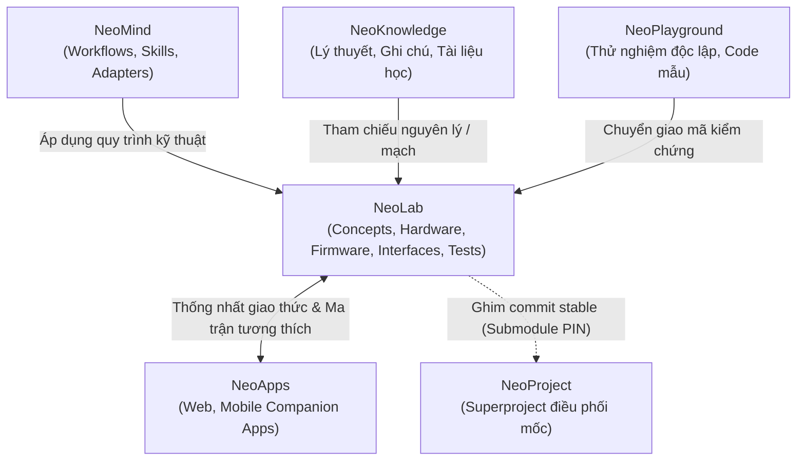

# Repo Plan — NeoLab

Tài liệu kế hoạch kiến trúc, lộ trình phát triển và tổ chức kho lưu trữ (repository plan) cho kho lưu trữ thành phần **NeoLab** trong hệ sinh thái NeoProject.

---

## 1. Mục tiêu và phạm vi

### 1.1. Mục tiêu
**NeoLab** là kho lưu trữ thành phần phụ trách kỹ nghệ sản phẩm (Product Engineering), nghiên cứu và triển khai phần cứng (Hardware), phần mềm nhúng (Firmware), phối hợp đặc tả giao diện kết nối (Interfaces), và xây dựng quy trình kiểm thử/nghiệm thu (Verification/Testing) cho các thiết bị thuộc hệ sinh thái **Neo**.

Trong hệ sinh thái NeoProject:
* *NeoMind* cung cấp quy trình và kỹ năng làm việc (workflows & skills).
* *NeoKnowledge* lưu trữ cơ sở tri thức, ghi chú và tài liệu học tập.
* *NeoPlayground* kiểm chứng giải thuật, ngoại vi và ví dụ độc lập.
* **NeoLab** hiện thực hóa và tích hợp các ý tưởng, nghiên cứu thành sản phẩm kỹ thuật hoàn chỉnh.
* *NeoApps* cung cấp ứng dụng đồng hành (companion apps) và giao diện người dùng.

### 1.2. Phạm vi phụ trách
* **Nghiên cứu ý tưởng & định nghĩa sản phẩm (Concepts & Requirements):** Tập hợp các ý tưởng thiết bị, tài liệu yêu cầu sản phẩm (PRD), mục tiêu kỹ thuật và tiêu chí nghiệm thu ban đầu (ví dụ concept đề xuất *NeoAssistant*, tùy thuộc vào lựa chọn ưu tiên của người dùng).
* **Thiết kế phần cứng (Hardware):** Trách nhiệm kỹ thuật phần cứng đã rõ, bao gồm sơ đồ nguyên lý (Schematics), bố trí mạch in (PCB layout), danh mục linh kiện (BOM), dữ liệu chế tạo và thiết kế cơ khí/vỏ hộp khi sản phẩm yêu cầu.
* **Phần mềm nhúng (Firmware):** Trách nhiệm kỹ thuật firmware đã rõ, bao gồm mã nguồn firmware tích hợp, cấu hình SDK/Board Support, kịch bản nạp (flashing), cập nhật và chẩn đoán lỗi.
* **Giao tiếp liên hệ thống (Interfaces):** Phối hợp cùng *NeoApps* thống nhất giao thức và cấu trúc dữ liệu trao đổi giữa thiết bị với ứng dụng điều khiển hoặc hệ thống ngoài. Vị trí lưu trữ nguồn chuẩn của đặc tả giao tiếp là quyết định còn mở cần hai repo chốt chung.
* **Kiểm định & Bằng chứng thực nghiệm (Tests & Verification):** Thử nghiệm trên bo mạch thật, lưu trữ nhật ký đo đạc, bằng chứng xác thực hoạt động và hồ sơ mốc kiểm tra.

---

## 2. Hiện trạng thực tế và bằng chứng kiểm chứng

Dựa trên kết quả rà soát thực tế tại kho lưu trữ (không giả định):

### 2.1. Cấu hình Submodule & Git State
* **Vị trí trong superproject:** `NeoLab/` (submodule trực tiếp cấp gốc của `NeoProject`).
* **Trạng thái Submodule:** Được khởi tạo độc lập từ commit ghim của superproject (`f325059`).
* **Con trỏ commit hiện tại (Submodule PIN):** `3c0b9d3467301599432c992c398f12b04d630b89` (*Initial commit*).
  * **Tác giả:** Hieu Tran (`<103094887+TNH510@users.noreply.github.com>`).
  * **Thời gian:** Sat Oct 24 15:18:33 2026 +0700.
* **Remote Git:**
  * Fetch: `git@github.com:NeoTech-vietnam/NeoLab.git`
  * Push: `git@github.com:NeoTech-vietnam/NeoLab.git`
  * URL công khai: `https://github.com/NeoTech-vietnam/NeoLab` (Kho công khai / Public).
* **Nhánh làm việc (Branch):** Nhánh tách riêng `docs/repo-plan` (từ commit `3c0b9d3`), nhánh mặc định trên remote là `main`.

### 2.2. Nội dung hiện có trong repo
* Lệnh kiểm tra danh mục tệp (`git ls-files`): Chỉ có duy nhất **01 tệp** `README.md`.
* Nội dung tệp `README.md` (2 dòng):
  ```markdown
  # NeoLab
  Product concepts and engineering for Neo hardware and firmware projects. Includes product design, interfaces, verification, and development documentation as projects evolve.
  ```
* **Nhận định thực tế:** Chưa có bất kỳ thiết kế phần cứng, mã nguồn firmware, thư viện hay dữ liệu sản phẩm nào được di chuyển (migrate) vào repo. Toàn bộ nội dung kỹ thuật hiện tại là con số 0.

### 2.3. Bằng chứng đối chiếu từ tài liệu kiến trúc (`NeoProject.canvas`)
* Node `lab` (ID: `lab`): Xác nhận NeoLab là direct submodule, pin `3c0b9d346730`, trạng thái ban đầu là "README only; no design or code migration. NeoWatch remains separate. Future product-repository relationships are undecided."
* Node `repo-proposed`: Concept *NeoAssistant* hiện đang nằm trong *NeoLearning*; chưa tạo repo riêng cho sản phẩm hoặc companion app của concept này.
* Node `repo-existing-main`: *NeoWatch* là repo riêng tư (Private) hiện hữu, chưa được gộp hay chuyển giao vào NeoLab.
* Node `repo-existing-other`: *NeoBoardSupportPackage* là repo private hiện hữu, chưa chốt vị trí trong thiết kế phân rã.
* Node `lab-boundary`: Ghi nhận rõ các điểm cần chốt: nơi tập hợp concept; khi nào tạo repo sản phẩm; vị trí đặc tả giao tiếp chuẩn.

---

## 3. Cấu trúc thư mục đề xuất, trách nhiệm và nguồn chuẩn

### 3.1. Phân loại trạng thái
* **[ĐÃ CÓ]:** Tệp tin hoặc thư mục đang thực sự hiện diện trong Git tại thời điểm này.
* **[ĐÃ RÕ]:** Trách nhiệm tổng thể của NeoLab về kỹ nghệ phần cứng (Hardware) và phần mềm nhúng (Firmware) của sản phẩm trong hệ sinh thái NeoProject.
* **[ĐỀ XUẤT]:** Cấu trúc cây thư mục, tên đường dẫn và phân chia module. Node `lab-contents` trong canvas chỉ gợi ý các khía cạnh có thể có trong mỗi sản phẩm (concept, hardware, firmware, interfaces, tests, docs), không chốt tên/đường dẫn thư mục cố định và không ép mọi sản phẩm phải có tất cả thành phần.

### 3.2. Cây thư mục đề xuất
```text
NeoLab/
├── README.md                                  # [ĐÃ CÓ] Giới thiệu tổng quan repo NeoLab
├── docs/                                      # [ĐÃ CÓ] Tài liệu kiến trúc và hướng dẫn kỹ nghệ chung
│   ├── Repo Plan.md                           # [ĐÃ CÓ] Kế hoạch phát triển và quản trị repo NeoLab
│   ├── hardware-guidelines.md                 # [ĐỀ XUẤT] Quy chuẩn thiết kế schematic, pcb, BOM (tùy nhu cầu)
│   ├── firmware-conventions.md                # [ĐỀ XUẤT] Tiêu chuẩn coding style, toolchain, cấu trúc firmware
│   └── verification-standards.md              # [ĐỀ XUẤT] Quy trình đo kiểm, biên bản thử nghiệm bo mạch
│
├── concepts/                                  # [ĐỀ XUẤT] Nơi ươm tạo, ghi nhận và thẩm định các ý tưởng sản phẩm
│   └── NeoAssistant/                          # [ĐỀ XUẤT - Ví dụ concept] Hồ sơ ý tưởng trợ lý cá nhân / AI hardware
│       ├── README.md                          # [ĐỀ XUẤT] Giới thiệu concept, bài toán giải quyết, định hướng
│       ├── requirements.md                    # [ĐỀ XUẤT] Yêu cầu sản phẩm (PRD), tính năng cốt lõi (MVP)
│       └── research-notes.md                  # [ĐỀ XUẤT] Khảo sát chipset, linh kiện cảm biến/ngoại vi
│
├── products/                                  # [ĐỀ XUẤT] Không gian tổ chức sản phẩm bước vào giai đoạn thiết kế
│   └── <product-name>/                        # [ĐỀ XUẤT - Ví dụ minh họa]
│       ├── README.md                          # [ĐỀ XUẤT] Mô tả thông số sản phẩm, phiên bản và tình trạng
│       │
│       ├── hardware/                          # [ĐỀ XUẤT] Thiết kế phần cứng (khi sản phẩm có phần cứng riêng)
│       │   ├── schematics/                    # [ĐỀ XUẤT] Sơ đồ nguyên lý
│       │   ├── pcb/                           # [ĐỀ XUẤT] Thiết kế mạch in, Gerber files
│       │   ├── bom/                           # [ĐỀ XUẤT] Danh mục linh kiện
│       │   └── mechanics/                     # [ĐỀ XUẤT] Bản vẽ cơ khí, vỏ hộp (nếu có)
│       │
│       ├── firmware/                          # [ĐỀ XUẤT] Mã nguồn điều khiển nhúng
│       │   ├── src/                           # [ĐỀ XUẤT] Mã nguồn C/C++
│       │   ├── include/                       # [ĐỀ XUẤT] Header files
│       │   ├── config/                        # [ĐỀ XUẤT] Cấu hình board, defconfig, pinout map
│       │   └── scripts/                       # [ĐỀ XUẤT] Script flash, monitor, đóng gói nạp
│       │
│       ├── interfaces/                        # [ĐỀ XUẤT] Đặc tả giao diện kết nối (vị trí nguồn chuẩn còn mở)
│       │   ├── protocols/                     # [ĐỀ XUẤT] Mô tả giao thức truyền tin (BLE, UART, Wi-Fi...)
│       │   └── schemas/                       # [ĐỀ XUẤT] Hợp đồng dữ liệu định dạng chuẩn (nếu dùng)
│       │
│       ├── tests/                             # [ĐỀ XUẤT] Bằng chứng kiểm thử và kiểm chứng chất lượng
│       │   ├── test-plans/                    # [ĐỀ XUẤT] Kịch bản kiểm thử chức năng
│       │   └── test-reports/                  # [ĐỀ XUẤT] Nhật ký đo đạc, bằng chứng chạy trên board thật
│       │
│       └── docs/                              # [ĐỀ XUẤT] Hướng dẫn chế tạo & vận hành
│           ├── assembly-guide.md              # [ĐỀ XUẤT] Hướng dẫn lắp ráp, kiểm tra an toàn điện
│           └── flashing-guide.md              # [ĐỀ XUẤT] Hướng dẫn nạp firmware và cấu hình ban đầu
│
└── shared/                                    # [ĐỀ XUẤT] Thư viện và tài nguyên dùng chung giữa các sản phẩm
    ├── cad-library/                           # [ĐỀ XUẤT] Thư viện linh kiện schematic và footprint (nếu có)
    └── protocols/                             # [ĐỀ XUẤT] Các định dạng packet dùng chung (nếu có)
```

### 3.3. Phân định trách nhiệm và Nguồn chuẩn (Canonical Sources)

| Thư mục / Thành phần | Trách nhiệm chính | Nguồn chuẩn (Canonical Source) |
| :--- | :--- | :--- |
| `concepts/` | Định hình ý tưởng, mô tả bài toán, phạm vi kỹ thuật ban đầu. | Nguồn ghi nhận mục tiêu và tiêu chí MVP. Không lưu mã nguồn sản phẩm chính thức tại đây. |
| `products/<name>/hardware/` | Quản lý thiết kế điện tử và cơ khí của sản phẩm (nếu có). | Nguồn chuẩn bản vẽ nguyên lý và BOM của sản phẩm trong phạm vi NeoLab. |
| `products/<name>/firmware/` | Cung cấp mã nguồn firmware tích hợp cho sản phẩm. | Nguồn chuẩn cho firmware sản phẩm. Phân biệt với mã mẫu học tập tại NeoPlayground. |
| `products/<name>/interfaces/` *(hoặc vị trí thỏa thuận chung)* | Ghi nhận tài liệu và đặc tả hợp đồng truyền thông giữa thiết bị và ứng dụng ngoài. | **Đề xuất vị trí lưu trữ tại NeoLab.** Vị trí chính thức (tại NeoLab, NeoApps hay repo giao thức độc lập) là quyết định còn mở cần hai bên chốt. |
| `products/<name>/tests/` | Lưu trữ bằng chứng kiểm định trên phần cứng thật. | Nguồn lưu trữ biên bản kiểm tra (validation evidence) chứng minh thiết bị hoạt động thực tế. |

---

## 4. Lộ trình phát triển: Giai đoạn đầu, Mở rộng và Dài hạn

*Lưu ý: Các ví dụ về sản phẩm, linh kiện phần cứng hoặc giải pháp công nghệ dưới đây chỉ mang tính chất tham khảo minh họa; việc lựa chọn sản phẩm ưu tiên và kiến trúc chi tiết cần được người dùng/nhóm kiến trúc chính thức chốt trước khi thực hiện.*

### 4.1. Giai đoạn đầu: Từ ý tưởng tới thử nghiệm (Initial Phase — Prototype)
* **Trọng tâm:** Chuyển đổi một ý tưởng khả thi thành nguyên mẫu chạy được trên linh kiện thật để kiểm chứng giá trị kỹ thuật.
* **Các bước triển khai:**
  1. *Kiểm kê concept và thống nhất sản phẩm ưu tiên:* Rà soát các concept đang có (từ NeoLearning hoặc tài liệu thảo luận), trình người dùng duyệt chốt sản phẩm khởi động đầu tiên (ví dụ minh họa: concept *NeoAssistant*).
  2. *Lựa chọn cấu hình thử nghiệm ban đầu (Bench Prototype):* Ưu tiên sử dụng kit phát triển có sẵn phù hợp với nhu cầu bài toán (ví dụ tham khảo: DevKit ESP32 hoặc STM32 kèm ngoại vi thử nghiệm) để kiểm chứng nhanh trước khi quyết định thiết kế phần cứng tùy biến.
  3. *Xác định tiêu chí kiểm chứng tối thiểu (MVP Criteria):* Định lượng rõ chức năng cốt lõi cần chứng minh hoạt động (ví dụ: giao tiếp ngoại vi, thu phát tín hiệu, phản hồi trạng thái).
  4. *Tài liệu hóa quy trình tái lập:* Ghi chép sơ đồ kết nối chân, hướng dẫn build và nạp firmware thử nghiệm.
* **Đầu ra (Deliverables):**
  * Hồ sơ concept được chuẩn hóa (ví dụ tại `concepts/NeoAssistant/` nếu được chọn).
  * Mã nguồn firmware nguyên mẫu chạy kiểm chứng trên bo mạch thử nghiệm.
* **Tiêu chí hoàn thành (Exit Criteria):**
  * Thiết bị thử nghiệm chạy độc lập theo đúng kịch bản MVP, có log/bằng chứng ghi nhận thực tế trên phần cứng thật.

### 4.2. Giai đoạn mở rộng: Tích hợp hệ thống (Expansion Phase — System Integration)
* **Trọng tâm:** Tích hợp phần cứng, firmware với ứng dụng đồng hành; phối hợp chốt giao thức và quản lý tương thích.
* **Các bước triển khai:**
  1. *Thiết kế phần cứng theo nhu cầu:* Nếu sản phẩm cần phần cứng tùy biến, tiến hành thiết kế bo mạch tích hợp theo từng revision cụ thể.
  2. *Thống nhất và đóng băng giao diện kết nối:* Phối hợp cùng nhóm *NeoApps* thống nhất định dạng dữ liệu, đặc tả API/giao thức và chốt nơi lưu trữ nguồn chuẩn của hợp đồng giao tiếp.
  3. *Hoàn thiện firmware tích hợp:* Phát triển các tính năng quản lý trạng thái, kết nối ổn định và xử lý lỗi truyền thông.
  4. *Quản lý ma trận tương thích (Compatibility Matrix):* Theo dõi tính tương thích giữa phiên bản phần cứng (Hardware Rev), bản dựng firmware và phiên bản ứng dụng đồng hành (*NeoApps*).
* **Đầu ra (Deliverables):**
  * Hồ sơ thiết kế phần cứng (nếu có thiết kế riêng).
  * Bản firmware tích hợp đạt chuẩn kiểm thử tại lab.
  * Bản đặc tả giao tiếp đã được thống nhất giữa NeoLab và NeoApps.
* **Tiêu chí hoàn thành (Exit Criteria):**
  * Thiết bị thật giao tiếp ổn định hai chiều với ứng dụng NeoApps qua giao thức đã thống nhất; có biên bản kiểm thử tích hợp đạt yêu cầu.

### 4.3. Giai đoạn dài hạn: Sản phẩm có thể phát hành (Long-term Phase — Production Readiness)
* **Trọng tâm:** Đảm bảo tính sẵn sàng phát hành, tối ưu độ tin cậy và chuẩn hóa quy trình triển khai.
* **Các bước triển khai (tùy nhu cầu cụ thể của từng sản phẩm):**
  1. *Lịch sử sửa đổi rõ ràng:* Truy vết chặt chẽ các vòng sửa đổi phần cứng, cơ khí và firmware kèm lý do thay đổi.
  2. *Cơ chế cập nhật và an toàn (khi cần thiết):* Cân nhắc giải pháp nạp firmware an toàn từ xa (OTA), cơ chế khôi phục dự phòng (failsafe/rollback) hoặc cổng chẩn đoán lỗi chuyên dụng tùy theo độ phức tạp của thiết bị.
  3. *Hướng dẫn triển khai và kiểm tra:* Soạn thảo tài liệu hướng dẫn lắp ráp, quy trình kiểm tra bo mạch trước khi bàn giao.
  4. *Chuẩn bị sản xuất/chế tạo (nếu có nhu cầu thương mại hoặc nhân rộng):* Chuẩn bị hồ sơ sản xuất, đóng gói tài liệu theo tiêu chuẩn chế tạo.
* **Đầu ra (Deliverables):**
  * Hồ sơ phát hành sản phẩm hoàn chỉnh: Tài liệu kỹ thuật, bản firmware ổn định được đóng gói, hướng dẫn lắp ráp và kiểm tra.
* **Tiêu chí hoàn thành (Exit Criteria):**
  * Quy trình lắp ráp, nạp firmware và kiểm thử có thể tái lập độc lập từ tài liệu hướng dẫn mà không phụ thuộc vào người tạo ban đầu.

---

## 5. Phụ thuộc và ranh giới với các kho lưu trữ khác

Sơ đồ thể hiện ranh giới và mối quan hệ giữa **NeoLab** và các kho thành phần khác trong hệ sinh thái:



### 5.1. Ranh giới với NeoKnowledge
* **NeoKnowledge giữ:** Kiến thức lý thuyết tổng quát, nguyên lý hoạt động của vi điều khiển và bus giao tiếp (I2C, SPI, BLE, CAN), ghi chú học tập.
* **NeoLab giữ:** Thiết kế phần cứng cụ thể, sơ đồ nguyên lý bo mạch, cấu hình firmware sản phẩm.
* **Nguyên tắc:** NeoLab không chép lại lý thuyết mà dẫn link tham chiếu về NeoKnowledge khi cần giải thích nguyên lý.

### 5.2. Ranh giới với NeoPlayground
* **NeoPlayground giữ:** Các ví dụ mẫu độc lập, bài thực hành ngoại vi không gắn với cấu trúc sản phẩm hoàn chỉnh.
* **NeoLab giữ:** Mã nguồn firmware tích hợp, gắn liền với sơ đồ mạch và yêu cầu nghiệp vụ của sản phẩm.
* **Nguyên tắc:** NeoLab có thể kế thừa các đoạn mã ngoại vi đã kiểm chứng tại NeoPlayground, nhưng khi đưa vào sản phẩm, quyền sở hữu, duy trì và kiểm thử thuộc về NeoLab.

### 5.3. Ranh giới với NeoApps
* **NeoApps giữ:** Ứng dụng Web, Android, iOS; logic giao diện người dùng và xử lý phía client/app.
* **NeoLab giữ:** Phần cứng vật lý, firmware điều khiển thiết bị.
* **Giao tiếp chung:** Hai bên phối hợp xây dựng và thống nhất giao thức trao đổi. Việc lưu trữ đặc tả giao thức tại `NeoLab/products/<name>/interfaces/` là phương án đề xuất; hai repo cần chốt vị trí chuẩn hóa chính thức để đảm bảo tính đồng bộ khi nâng cấp phiên bản.

### 5.4. Ranh giới với NeoMind
* **NeoMind giữ:** Các bộ quy trình làm việc, agent skills, mẫu tài liệu kỹ thuật dùng chung.
* **NeoLab giữ:** Nội dung kỹ thuật cụ thể, nhật ký thiết kế và biên bản đo kiểm của sản phẩm.
* **Nguyên tắc:** NeoLab áp dụng các template và kỹ năng từ NeoMind theo phiên bản xác định; dữ liệu sản phẩm lưu trực tiếp tại NeoLab.

### 5.5. Quan hệ với NeoProject (Superproject)
* **Quy tắc làm việc:** Công việc phát triển hằng ngày diễn ra độc lập trong repo con NeoLab (sử dụng branch riêng, commit riêng).
* **Cơ chế ghi nhận mốc:** NeoProject chỉ cập nhật con trỏ commit của NeoLab khi sản phẩm đạt một mốc kiểm tra hoạt động ổn định (Stable Baseline).

---

## 6. Quyết định còn mở và các bước tiếp theo

### 6.1. Những điểm còn mở cần thảo luận và chốt (Open Decisions)
1. **Lựa chọn sản phẩm ưu tiên triển khai ban đầu:**
   * Cần người dùng/nhóm kiến trúc chính thức phê duyệt sản phẩm khởi đầu (ví dụ: có chọn concept *NeoAssistant* làm trọng tâm đầu tiên hay sản phẩm nào khác).
2. **Mô hình tổ chức kho lưu trữ sản phẩm (Monorepo vs Polyrepo):**
   * *Phương án A (Monorepo):* Quản lý các sản phẩm trong các thư mục con dưới `NeoLab/products/`.
   * *Phương án B (Polyrepo):* NeoLab đóng vai trò catalog / concept / guideline; các sản phẩm lớn sẽ tách thành repo riêng (tương tự như `NeoWatch` hiện là repo private riêng biệt). Cần chốt tiêu chí khi nào một sản phẩm cần tách repo riêng.
3. **Kế thừa các tài nguyên và repo hiện có:**
   * *Repo `NeoWatch`:* Tiếp tục duy trì độc lập hay tích hợp/chuyển giao vào quản lý chung trong NeoLab?
   * *Repo `NeoBoardSupportPackage`:* Xác định vai trò của BSP này đối với các thiết kế phần cứng của NeoLab (thư viện dùng chung hay gói độc lập)?
4. **Vị trí quản lý chuẩn hóa của Hợp đồng giao tiếp (Interface Specifications):**
   * Lưu trữ tại thư mục đề xuất `NeoLab/products/<product>/interfaces/`, đặt tại repo `NeoApps`, hay tách thành một vị trí/submodule giao thức dùng chung giữa hai bên?
5. **Định hình cấu hình kỹ thuật cho concept được duyệt:**
   * Khi sản phẩm ưu tiên được chốt, xác định yêu cầu chức năng tối thiểu (MVP), lựa chọn nền tảng phần cứng thử nghiệm (DevKit phù hợp) và phương thức kết nối.

### 6.2. Các bước triển khai tiếp theo (Next Steps)
1. **Trình duyệt sản phẩm ưu tiên:** Thảo luận với người dùng để chốt sản phẩm bắt đầu và mô hình quản lý repo (Monorepo vs Polyrepo).
2. **Thống nhất vị trí hợp đồng giao tiếp:** Làm việc cùng nhóm phát triển `NeoApps` để chốt quy ước lưu trữ và phiên bản hóa giao thức kết nối.
3. **Soạn thảo hồ sơ concept được duyệt:** Thiết lập tài liệu mục tiêu, yêu cầu MVP và kịch bản kiểm chứng ban đầu trong `concepts/`.
4. **Chuẩn bị môi trường thử nghiệm:** Chuẩn bị bo mạch mẫu và thiết lập baseline kiểm tra đầu tiên khi có yêu cầu cụ thể.
