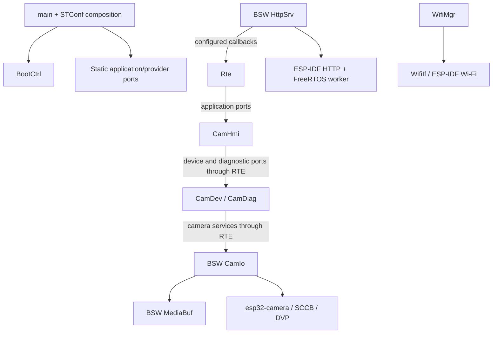
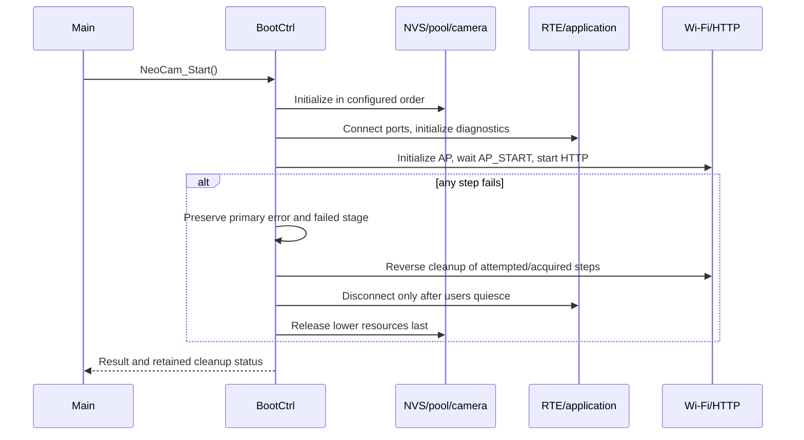
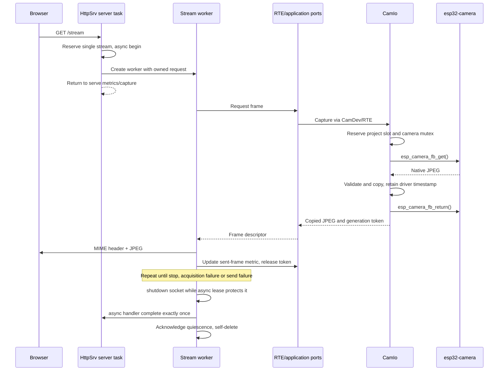

# NeoCam camera-demo architecture

This migration implements the existing VGA/SoftAP demo using the agreed reference
hierarchy. ESP-IDF 6.0.1, camera 2.1.7 and JPEG 1.3.1 are the pinned backends.
The reference workbook taxonomy is retained; NeoCam-specific packages are additions.
No unused Spi/I2c/NvM, recording, microphone, or SD implementation is claimed.

## Module registry and specification profile

| Package | Interface/ownership | Classification |
|---|---|---|
| Infrastruc/CUCEL/Platform, Standard | CPU/endian/types, returns, switches and version structure | R24-11 standard-type subset; no project types added to Platform_Types.h |
| Infrastruc/CUCEL/MemMap | Repeated section markers, invalid/nested/mismatched transition diagnostics | Selected memory-mapping pattern adapted to GCC/ESP-IDF linker sections |
| Infrastruc/BootCtrl | Serialized start/stop of configured steps; primary and cleanup failures | Project lifecycle adapter, not EcuM or AUTOSAR OS startup |
| Infrastruc/BswLib/MediaBuf | Owns two copied JPEG slots and persistent generation tokens | NeoCam extension; independent of NvM and MemMap |
| SysSrv/EbOs | Opaque mutexes; task delay | FreeRTOS adapter, not an AUTOSAR OS implementation |
| SysSrv/LocalTime | Monotonic microseconds | NeoCam extension; not synchronized StbM time |
| CDD/CamIo | Owns camera/SCCB backend and serialized native frame acquisition | CDD adaptation using esp32-camera directly |
| ComStack/WifiStack/WifiIf | Owns AP netif, event registration, Wi-Fi lifecycle and native diagnostics | ESP-IDF adapter |
| ComStack/WifiStack/WifiMgr | Validates C configuration; waits for AP start/stop events | NeoCam extension; not 802.11p WEth |
| ComStack/WifiStack/HttpSrv | Owns server, async stream request, worker and socket lease | NeoCam HTTP transport extension |
| ApplicationLayer/ASW/CamHmi | Dashboard, capture policy and HTTP application ports | Application component |
| ApplicationLayer/ASW/CamDiag | Metrics and JSON schema, serialized through RTE diagnostic mutex | Application component |
| ApplicationLayer/DE/CamDev | Camera device operations mapped to BSW through RTE | Device encapsulation |
| Rte | Typed, statically wired provider/client ports | Hand-written adaptation, no ARXML/RTE generator |
| STConf/ConfAr | Composition and startup-step tables | C source, compiled with the main composition component |

Standards references: [Platform Types](https://www.autosar.org/fileadmin/standards/R24-11/CP/AUTOSAR_CP_SWS_PlatformTypes.pdf),
[Standard Types](https://www.autosar.org/fileadmin/standards/R24-11/CP/AUTOSAR_CP_SWS_StandardTypes.pdf),
[Memory Mapping](https://www.autosar.org/fileadmin/standards/R24-11/CP/AUTOSAR_CP_SWS_MemoryMapping.pdf),
[BSW General](https://www.autosar.org/fileadmin/standards/R24-11/CP/AUTOSAR_CP_SWS_BSWGeneral.pdf).
These define the selected conventions; the project does not claim full module or
methodology conformance. Legacy Compiler.h abstraction, standard EcuM startup,
AUTOSAR OS, SchM generation and full driver suites are not implemented.

Selected requirement anchors: Platform_00002 (no project extensions), Platform_00044
(CPU width), Platform_00046 (byte order), Platform_00026/00027/00034 (boolean), and
Platform_00041/00042 (floating-point representations). Common headers use the exact
standard spellings; project errors, media descriptors and port tables stay in GLOBAL.
Full transformer/message definitions from Std_Types are outside this demo's subset.

The workbook's Mcal is directly under BSW, separate from IoServices. WifiStack is
a NeoCam addition. A future standard Spi driver belongs under Mcal/Spi_STC/Spi;
the camera currently uses SCCB and parallel DVP, not SPI image transport. The
vendor library's internal SCCB transactions remain inside the CDD boundary.

## Dependencies and execution

Function-pointer connections are installed at startup. They permit calls into the
application without a BSW-to-application header/build dependency. Three grouped
IDF components plus main use explicit source lists; package does not mean task.

The IDF HTTP server task handles page, metrics and single captures. One asynchronous
worker handles the long-lived stream. SDK camera/Wi-Fi/network tasks remain backend
implementation details. Camera acquisition is on demand and serialized by one
mutex; continuous producer/fan-out is deferred to recording work.

All lifecycle calls require one serialized composition owner and quiescent users
before destruction. Data-path calls may run concurrently. Camera acquisition uses
a task mutex, never a CPU critical section. Network sends never hold that mutex or
the pool/diagnostic mutexes. ISR code never calls these application interfaces.

## Configuration and memory

Module-local Cfg.h/Cfg.c own editable settings. STConf/ConfAr owns wiring; GLOBAL
owns project contracts, CONFIG/MemMap_Conf owns section attributes, and TOOLCONF
owns build checks. There are no ECUC values files or generator requirements.
The SDK's sdkconfig.defaults owns only backend build parameters.

Neo_StatusType carries project results: parameter/state/busy/memory/I/O/timeout/
too-large/not-ready. It does not change the meaning of Std_ReturnType. Native errors
are logged privately; WifiIf also retains its first native error for diagnostics.

MemMap maps configured constants to `.rodata.neocam`, which the IDF linker places
in flash DROM. Module and pool metadata use internal DRAM BSS. Runtime payloads are
allocated explicitly with `MALLOC_CAP_SPIRAM | MALLOC_CAP_8BIT`; this is CPU-copy
memory, not a promise of DMA suitability. Driver/DMA buffers stay driver-owned.
Run `python3 STConf/TOOLCONF/check_build.py` to inspect the actual map/configuration.

The two 256 KiB JPEG slots are allocated at startup and freed only with zero live
leases. A token contains a slot and generation. Generations survive service restart
and never wrap to an old token: a slot that reaches UINT32_MAX becomes unavailable.
A lease transfers only on successful capture; the HTTP consumer releases once after
send success or failure. The backend and SDK may still allocate dynamically.

## Sequences

The failed step is included in rollback because its own partial cleanup can fail.
Cleanup stops at an unquiesced/failing resource, retaining lower dependencies for a
later NeoCam_Stop() retry. Start is rejected while resources remain active.
ESP-IDF already starts FreeRTOS before app_main; this is not EcuM_Init/StartOS.
NVS full/incompatible errors are reported without erasing storage.

Capture uses the same camera service and lease rules, on the normal HTTP task.
Its acquisition wait and network response can briefly delay other synchronous
requests, but streaming no longer holds that task indefinitely.
Additional streams return 503. Capture pool pressure returns 503; a stream yields
and retries. Oversized/invalid frames are returned to the native driver and fail.
Send failures release copied slots and do not increment camera-failure metrics.

Shutdown sets the stopping flag, rejects new work, and waits up to the configured
10 s for the async worker. Timeout retains the entire server and dependencies;
no task/buffer is forcibly destroyed. Once the worker is quiescent, httpd_stop()
joins the synchronous server task before ports, camera, pool or Wi-Fi are released.
The deadline governs async quiescence, not a forced deadline on httpd_stop().

## Subsequent work

The original targets for video/audio recording, SD, STA preview, Mesh and power
remain unimplemented. Add their real consumers before standard driver modules;
do not represent native SCCB or SDSPI traffic as Spi/I2C calls that do not occur.
For recording, replace on-demand preview acquisition with one timestamped producer
and bounded recorder/preview consumers, retaining the public ownership contract.
